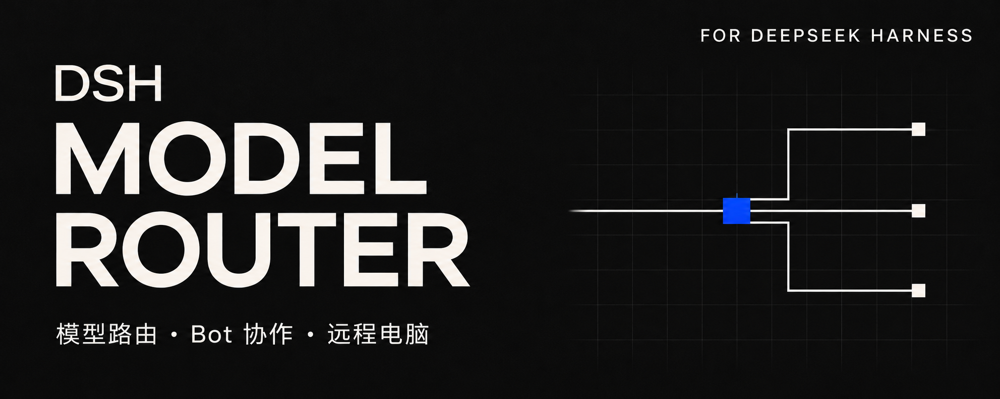
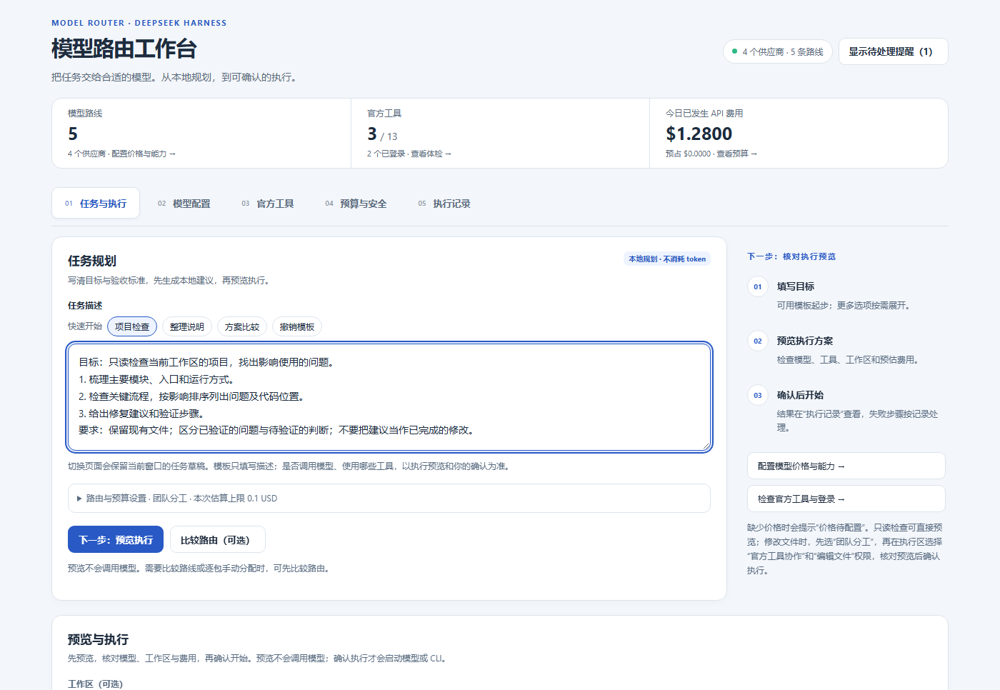
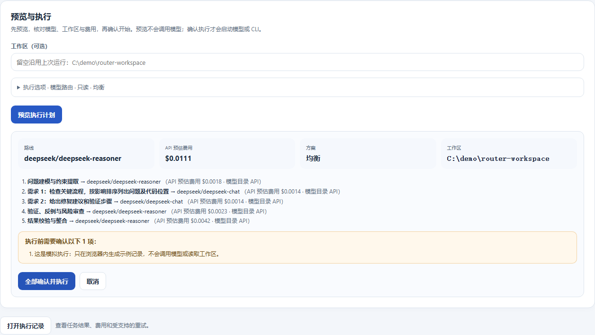
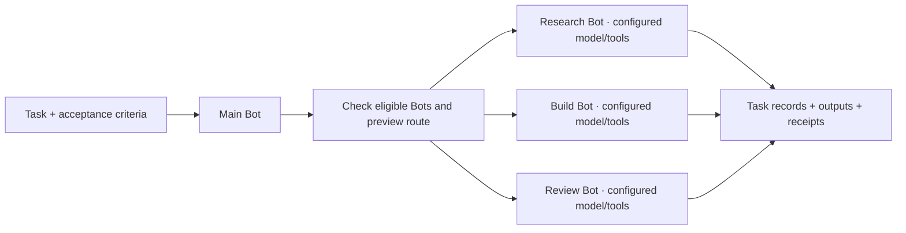

# DSH Bot · Model Router

[English](README.md) · [简体中文](README.zh.md)

[](https://www.npmjs.com/package/@ljwei-stak/dsh-model-route-bot) [](https://www.npmjs.com/package/@ljwei-stak/dsh-model-router) [](https://dshfind.com/en/plugins/Alice-Marx/dsh-model-router?ref=badge) [](https://dshfind.com/en/plugins/Alice-Marx/dsh-model-router?ref=badge) [](https://dsh-plugin.org/plugins/alice-marx/dsh-model-router) [](https://awesome-dsh-plugin.com)

[](https://dshfind.com/en/plugins/Alice-Marx/dsh-model-router?ref=badge)



**Model routing and a persistent Bot workspace for [DeepSeek Harness](https://github.com/deepseek-ai/deepseek-harness).**

Turn a task into a reviewable execution plan, select suitable configured models or native CLI tools, and follow the results in one workspace. Add the full Bot edition for long-running conversations, multi-Bot delegation, private files, and your own Windows computers.

This is a community plugin. It reuses Harness model configuration and Host services; each provider or CLI uses its own account and access rights.

**Current stable version: 0.66.4 · Windows Remote Agent: 0.1.1**

[Choose an edition](#editions) · [Install](#install) · [First task](#quick-evaluation) · [Bot delegation](#bot-routing) · [Remote computers](#computers) · [Support](#troubleshooting)

<a id="editions"></a>

## Choose the workspace you need

| Edition | Package to enter in **Plugins → Add plugin** | What it adds |
| --- | --- | --- |
| **DSH Bot + Model Router** | `@ljwei-stak/dsh-model-route-bot` | The full Bot workspace, model-routing workbench, Bot delegation, remote computers, private libraries, and routines. |
| **Model Router** | `@ljwei-stak/dsh-model-router` | A **Model Router** entry in the standard Harness interface, with route planning, tools, execution, and accounting. DS Bot is not installed. |

Use **one edition per Harness profile**. Both editions share the routing configuration. To switch, remove the existing package entry in plugin management, add the other edition in the same profile, and retain your data directories and configured Bot home. [Routing-only guide](packages/model-router-plugin/README.md).

<a id="capabilities"></a>

## Capabilities at a glance

| Workflow | What you can do | Edition |
| --- | --- | --- |
| Task-oriented model routing | Start from a task template; compare economy, balanced, or quality-first plans; use one route, a dependency-based team, or an exact model. | Both |
| Reviewable execution | Inspect models, tools, workspace, permissions, and estimates before confirming; track progress, results, cancellation, and supported retries. | Both |
| Native CLI tools | Detect and install registered tools, check login and mode readiness, and open an interactive terminal. | Both |
| Budgets and feedback | Set API limits, track reservations and receipts, inspect subscription calls/tokens separately, and use optional reviews and explicit ratings. | Both |
| Persistent Bot conversations | Give each Bot its own model, role, work directory, private chat, and permissions; handle side chats, questions, and approval cards. | Full Bot |
| Groups and shared context | Use mentions, staged group goals, handoffs, conversation search/checkpoints, and Bot/group/team memory with revision history. | Full Bot |
| Browser and document work | Use per-Bot browser partitions, supported Office reading/previews, connectors, credential cards, avatars, and team appearance settings. | Full Bot |
| Scheduled work | Schedule a target Bot or group through the Host's Automation tasks service. | Full Bot |
| Bot-to-Bot routing | Let a Main Bot select an eligible execution Bot from committed model, tool, computer, and funding settings, then dispatch real tasks. | Full Bot |
| Windows computers and routines | Pair your own computer, watch or control its desktop, record confirmed input, and replay saved routines. | Full Bot |
| Private file libraries | Organize files per Bot, upload/download binary files, edit text, and search private text with line-level results. | Full Bot |

<a id="install"></a>

## Installation

1. Open **Plugins → Add plugin** in Harness Desktop and enter **one** package:
   - Full workspace: `@ljwei-stak/dsh-model-route-bot@0.66.4`
   - Routing only: `@ljwei-stak/dsh-model-router@0.66.4`
2. Enable it, fully quit Harness **including its tray process**, then restart so the Host loads the installed version.
3. Configure provider credentials and models in the official Harness **Models** settings. Open the Bot workspace for the full edition, or **Model Router** in the sidebar for the routing-only edition.

CLI installation is also supported. Choose the command for your edition:

```powershell
# Full Bot workspace
dsh plugin --profile desktop add @ljwei-stak/dsh-model-route-bot@0.66.4

# Routing-only workspace
dsh plugin --profile desktop add @ljwei-stak/dsh-model-router@0.66.4
```

Alternatively, import the matching `.tgz` from [GitHub Releases](https://github.com/Alice-Marx/dsh-model-router/releases/latest). For an extracted local package, select the inner `package` directory containing `package.json` and `.dsh-plugin`. A global npm installation alone does not register a Harness plugin.

<a id="quick-evaluation"></a>

## Complete your first task

The model-routing workbench is available in both editions. In the full Bot workspace, open **Advanced workbench**.

1. **Prepare a model.** Add a working provider/model in Harness. In **Model configuration**, refresh routes and enter known prices and capabilities. Leave unknown information blank.
2. **Describe the result.** In **Task & execution**, choose **Project check**, **Organize documentation**, or **Compare approaches**, then edit the task and acceptance criteria. **Undo template** restores your previous text.
3. **Go to the preview.** Click **Next: preview execution**, then **Preview execution plan**. Check the selected models/tools, workspace, permissions, and estimated API cost or subscription usage.
4. **Confirm the run.** Read the confirmation items and choose **Confirm all and execute**. Creating or previewing a plan does not invoke a model; confirmation starts execution.
5. **Inspect the result.** Open **Execution history** for output, receipts, status, cancellation, and supported retry actions. Verify the requested artifact before treating the task as complete.

The application currently uses Chinese interface labels; English descriptions here explain the corresponding controls.



*Actual workbench component with offline demonstration data. Models, prices, usage, and paths shown in these screenshots are examples.*

<a id="workbench"></a>

## Model-routing workbench

| Tab | Main use |
| --- | --- |
| **Task & execution / 任务与执行** | Write a task, choose a planning mode, optionally compare or assign packages, preview, and confirm execution. |
| **Model configuration / 模型配置** | Manage exact configured routes, prices, quality evidence, billing preferences, and CLI model mappings. |
| **Native tools / 官方工具** | Inspect tool installation, login, and execution-mode readiness; manage installations and terminals. |
| **Budget & safety / 预算与安全** | Set API limits and execution policy; inspect actual spend, reservations, and subscription usage. |
| **Execution history / 执行记录** | Review task output, receipts, interrupted/unknown states, cancellation, and supported recovery actions. |

Choose **Single task** for one route, **Team** for packages with dependencies, or **Exact model** to use a specific configured route. **Compare routes** is optional; after comparison, you can keep the recommendations or manually select an API model/tool for each package.

Route/budget and execution options are collapsed until needed. Draft task text, mode, selected model, and explicit per-task estimate stay in the **current window's memory** when pages remount; closing the app or reloading the client clears this draft. The **Needs your attention** panel can be closed with **×** and restored from the header; this visibility preference is remembered on the device. Failed-task reminders open the relevant execution record.



*Offline preview example; no model was called. In a live workspace, confirmation starts the selected model or supported CLI.*

Model routing executes read-only analysis. To modify files, choose **Team → Native-tool collaboration → Edit files**, then review the execution preview. A separate worktree collects changes; it does not restrict system access outside that tree.

<a id="official-tools"></a>
<a id="session-tools"></a>
<a id="team-lifecycle"></a>

### Use native tools with their own accounts

The tool registry includes **Kimi Code, Claude Code, Codex, MiniMax Code, MiMo Code, Grok Build, Gemini, OpenCode, StepCode, Pi, Hermes, ZCode, and DSH TUI**. In **Native tools**, detect the tool, choose an available install method, complete the vendor's login, then check readiness for the execution mode you want.

An interactive terminal exposes the installed tool's own workflow and capabilities. Managed single-tool and team execution use supported adapters; installation or login alone does not establish readiness for every mode or model. Vendor-native processes run with the current system user's permissions. Provider credentials and coding-plan endpoints remain in Harness settings.

<a id="daily-work"></a>

## Build a persistent Bot workspace

**Full Bot edition.** Create a Bot and set its role and work directory. In **Bot bindings**, pick an engine on the provider rail: a configured API route, or a verified official tool such as Claude Code or Codex. Choose that engine's exact model and an optional reasoning effort, then commit tools, computer/workspace access, and funding. An ordered fallback list can be saved for a later host recovery step; those backups do not grant extra model routes. An official-tool engine also grants that tool in a host-verified execution mode. Mark a coordinating Bot as **Main** when you want it to delegate work.

| To do this | Use this workflow |
| --- | --- |
| Hold a private conversation | Select a Bot in the sidebar, send a message, and respond to questions or approval cards as they appear. |
| Collaborate in a group | Create a group from the chat selector, set members/administrators and response rules, and use `@` mentions to address Bots. Configure staged goals for longer work. |
| Manage long-term context | Search conversations, use checkpoints/segments, and edit Bot, group, or team memories. Review proposed skill/project-rule learning before accepting it. |
| Work with pages and documents | Open the current Bot's browser panel, manage pages, and attach supported Office documents for reading/preview. Configure connectors and enter secrets through credential cards when needed. |
| Schedule recurring work | Enable the Host's Automation tasks service, choose the target Bot/group, task, and schedule, then check the next-run state. The Host and relevant Agent must remain running. |
| Customize the workspace | Manage avatars and team appearance independently of the private file library. |

Integration mode reuses Harness Sessions. An optional independent runtime has its own session store; switch ownership explicitly so a Bot is served by one runtime at a time.

<a id="task-progress"></a>

## Multi-Bot task progress and pending items

**Available in the full Bot edition 0.66.4.** On **Tasks**, inspect task counts per Bot, filter by **All / In progress / Needs attention / Ended**, or search task names and task, plan, or operation IDs. Counts and filters cover loaded records; funding admission is in progress, while budget waiting needs attention.

**Needs your attention** reports the full count and expands beyond six items. Each reminder opens the original task; approval reminders can open the owning Bot's conversation to show its original request. Open a task's **timeline** for queue, admission, execution, stop-request, and reconciliation events, with the original identities for each attempt. Reading history does not dispatch tasks or invoke models; stop requests still require confirmation. Older Hosts without history support retain existing receipt details.

The Host loads at most **512 tasks**, prioritizing pending and active work before newer historical records, and explicitly reports loaded and total counts when truncated. History reads the latest **80 events** on demand and reports its total when truncated. These are durable managed-task records; they do not cover every chat message or live provider output.

This iteration draws on [Agents Anywhere](https://github.com/anywhere-labs/Agents-Anywhere)'s timeline and capability-based actions. See the [task workspace notes](docs/integration/agents-anywhere-tasks.md) for implementation and verification.

<a id="bot-routing"></a>

## Delegate from a Main Bot to execution Bots

**Full Bot edition.** Model routing chooses a model route; Bot routing chooses a configured Bot and dispatches a task to it.

Routing uses each Bot's own saved prices, including when Bots share the same model. Invalid prices or quality scores remain unknown. When scores tie, a known price takes precedence before the Bot ID.

Changing a task, refreshing candidates, or switching Hosts retires the previous preview. Expand **View comparison basis** to inspect candidate scores and unknown information. Creating a task requires a current preview; a confirmed submission shows its plan ID and disables repeat creation. If the acknowledgement is missing or incomplete, refresh the task records and check the original submission before creating another task. On narrow screens, scroll tables horizontally to inspect all columns.

**Check original submission** reads the original request's durable plan and operation IDs without resubmitting, granting access, or calling a model. A missing record is a current observation: the original request may still complete. The reminder survives page remounts for the same connected Host in this window, and stores only the submission reference in memory. Reloading the app clears it. After checking the records yourself, an explicit reminder dismissal only clears the notice; it does not stop the original task or create another one.

Before reloading, expand **Save submission code** and copy the code. After reloading, connect to the original Host and paste it into **Check a saved submission** to query the original record. The code contains only the original Bot and request IDs; it contains no task text or credentials and does not authorize execution. Invalid codes are rejected locally. If clipboard access is unavailable, select and copy the code manually. Lookup failures explain whether to sign in again, update the Host, check a mismatched record, or reconnect; the reference remains available for another read.



*An example team arrangement. Create these Bots and commit their access before routing work to them.*

1. Configure the Main Bot and execution Bots with their actual models, allowed tools, computer/workspace grants, and funding settings.
2. Open **Tasks → Bot routing**, enable it, select **Economy**, **Balanced**, or **Quality first**, and save the policy.
3. Enter a task and choose automatic routing or a specific Bot. Select the computer/directory and operation type if required. **Preview route** explains the selection, missing conditions, rejection reasons, and proposed bindings.
4. Choose **Create task with this route** to dispatch. Follow the task record and inspect the output. An accepted plan ID means submitted, not completed.

The Main Bot can also call `bot_route_task` or its alias `bot_dispatch`. Both dispatch by default; `preview: true` only previews. `bot_task_plan_status` returns the actual plan/task state. Each execution Bot's model call has its own budget admission and receipt linked to the parent task. Role text does not grant tool or computer permissions.

<a id="computers"></a>

## Connect your Windows or cloud computer

**Full Bot edition.** Bring your own **Windows x64 computer or cloud desktop**. The setup wizard creates the local Agent configuration and pairing file; the Host must be able to reach the Agent over your configured network, VPN, or tunnel.

**On the computer to control:**

1. Download the [complete Windows Agent 0.1.1 package](https://github.com/Alice-Marx/dsh-model-router/releases/download/v0.63.3/dsh-remote-agent-0.1.1-windows-x64.zip), extract it into a permanent directory, and run `start.cmd`. Keep the interactive Windows user signed in.
2. In the setup wizard, configure the accessible address, port, approved work directories, and optional command/browser capabilities. It registers the Agent and desktop helper for the current user and generates `private/pairing.private.json` without storing a Windows password. Subsequent runs retain the existing configuration.

**In Harness:**

3. Open **Remote computers → Add computer** and import `private/pairing.private.json`. Check the populated endpoint and grants, select the allowed Bots, then pair/probe the computer. Keep this pairing file private.
4. In **Bot bindings**, save the Bot's computer and tool grants. Open **Computer operations** or the computer page, select a display, and choose **Connect desktop** to watch first.
5. Choose **Take control** and wait for confirmation before sending keyboard, mouse, wheel, or text input. **Watch only** returns control and releases held input. Use **Expand** or double-click while watching for a larger view; disconnect when finished.

Desktop viewing uses adaptive JPEG streaming with native input acknowledgements and a visible measured frame rate. Human control prevents conflicting Bot desktop automation. The current desktop implementation targets an available, signed-in Windows interactive session; performance depends on resolution and network conditions. Secure/UAC desktops are outside this capture scope. Computer pairing configures access; it does not provision a cloud machine or establish network connectivity.

<a id="routines"></a>

## Record and replay a routine

**Full Bot edition.** Routines save a demonstrated desktop sequence privately for the selected Bot.

1. Connect to the desktop, take control, restore the application to a known starting state, enter a routine name, and choose **Start recording**.
2. Demonstrate the workflow. Only successfully acknowledged inputs are recorded; mouse movement is sampled into 200 ms waypoints.
3. Choose **Stop and save**. Saving waits for queued input and confirmed release of held keys/buttons. Recorded text is part of the saved routine.
4. Open **Routines**, select the Bot/computer, restore the same starting layout, and run the saved sequence. Check the result and any stopped step.

A routine holds up to **200 retained steps**, with pauses up to **60 seconds**, and checks display identity, physical resolution, coordinates, and recorded DPI. It replays coordinates and timing, so application/layout changes may require a new recording. If an input may have taken effect but its acknowledgement was lost, the result is **unknown**. Inspect the real desktop and provide a reconciliation note before unblocking another run. A stop request remains pending until stopping is confirmed.

<a id="library"></a>

## Give each Bot a private file library

**Full Bot edition.** Open **Library**, select a Bot and folder, then upload/download files, create folders, or edit supported text. Name filtering narrows the current folder. **Search text** scans the selected Bot's private text files and returns file paths, line numbers, and matching lines; open a result to edit and explicitly save the file.

Binary transfers preserve the original bytes, with a **16 MiB per-file limit**; text reading/editing is limited to **1 MiB per file**. Same-name uploads are rejected. Authorized `bot_library_search` calls use the calling Bot's own library. PDF/Office uploads are stored as files; searchable text here is not a general OCR or semantic-indexing service.

<a id="costs"></a>

## Understand execution and accounting

- **Plan locally.** Route comparison and execution preflight do not call models. Confirmed execution sends the selected task/context to a provider or CLI and may incur charges.
- **Control API spending.** Per-task estimates and daily/monthly limits check recorded spend plus active reservations. Unknown prices or amounts require the relevant confirmation under a finite budget. Estimates are planning controls; provider bills remain authoritative.
- **Track subscriptions separately.** Subscription calls and reported input/output/cache tokens are recorded independently of API money. Missing usage remains unknown and does not imply zero usage or prove a vendor's remaining quota.
- **Choose fallback behavior.** Billing preferences can favor subscription, require subscription, or use API only. A subscription-to-API change requires fresh API estimation, budget admission, and any required confirmation. Managed editable/single-tool/team runs do not automatically retry on API.
- **Recover from evidence.** Execution records retain attempts, receipts, reservations, and unknown effects. Review interrupted work before retrying; elapsed time or a stop request does not prove that a remote action stopped.
- **Refine routing deliberately.** Optional stronger-model reviews may add calls. Explicit ratings adjust a bounded preference term; they do not raise measured quality or bypass quality floors. Learning can be disabled, ratings withdrawn, and the learning baseline reset.

<a id="architecture"></a>
<a id="data"></a>

## Integration, data, and compatibility

The Host owns committed model, tool, computer, funding, and operation identity. Bot dispatch, model-originated tools, and owner workbench actions follow this authority. Worktree isolation organizes code changes; vendor-native processes use the current user's system access.

Provider credentials and authenticated sessions are managed by Harness. Routing state, receipts, committed Bot bindings, private libraries, and routine ledgers live under `<DSH_HOME>/model-router/`. The configured Bot home stores upstream conversations, memory, browser state, and team files. Agent configuration and pairing credentials remain on the controlled computer. Back up these locations before changing runtime ownership; keep pairing files, recordings, logs, and private files out of public reports.

| Component | Current scope |
| --- | --- |
| Harness integration | Declared Host versions are listed in [package.json](package.json); integration verification uses the actual Harness SDK **0.2.2-rc.1**. |
| Bot foundation | Pinned [DS Bot](https://github.com/Fei2411/DS-Bot) **0.2.7**, with project-specific integration and product overlays. |
| Remote desktop | Windows x64 Agent **0.1.1**, with an available signed-in interactive desktop. |
| Tool execution | Availability depends on the local platform, installed CLI, account, exact model, and supported execution adapter shown by the workbench. |

<a id="troubleshooting"></a>

## Troubleshooting and support

| Symptom | What to check |
| --- | --- |
| Old interface after an update | Fully quit the tray Host, verify the installed package/version, and restart. |
| No route or eligible execution Bot | Check configured exact models, allowed tools, grants, availability, and the route preview's rejection reasons. |
| Tool installed but execution blocked | Check login, model access, mode-specific readiness, workspace, and committed permissions. |
| Agent reachable but desktop unavailable | Check the signed-in Windows session, Agent/helper tasks, display access, and native logs. |
| New Bot cannot use a paired computer | Check the pairing's allowed Bots/managed-Bot limit, then save that Bot's computer and tool grants. |
| Can watch but cannot take control | Check desktop-input permission, write access, and current control ownership. |
| Interrupted, unknown, or stop pending | Inspect execution records and the actual remote result; reconcile before another attempt. |
| Routine reports a display change | Restore the original display, resolution, DPI, and application layout, or record again. |
| Library upload/edit refused | Check file size and same-name collisions; binary transfer and text-edit limits differ. |
| Cost or usage unknown | Check actual model identity, configured prices, and reported usage. Missing data is not zero. |

Use [GitHub Issues](https://github.com/Alice-Marx/dsh-model-router/issues) for reproducible problems and [GitHub Releases](https://github.com/Alice-Marx/dsh-model-router/releases/latest) for installation files. Include the edition, plugin/Host versions, platform, steps, and a sanitized screenshot or error. Remove credentials, pairing files, and private task content.

## License and acknowledgements

Project extensions are [MIT licensed](LICENSE). The bundled DS Bot source retains its **Apache-2.0** license and notices; provenance is recorded in [SOURCE.json](modules/bot-runtime/SOURCE.json). Thanks to [DeepSeek Harness](https://github.com/deepseek-ai/deepseek-harness) and [DS Bot](https://github.com/Fei2411/DS-Bot) for the Host and Bot foundations.

## Technical reference: accounting and routing

### Actual cost versus planning estimate

The formula below applies to API-billed results. Algorithmic route-price comparisons are planning inputs; they do not turn a subscription into an API bill. The execution preview separates API money from estimated subscription tokens.

For API-billed results, a valid CLI-reported USD amount, including explicit zero, wins over token-price calculation. Otherwise, token-based CLI accounting requires complete normalized usage, known nonnegative prices, and a reported actual model matching the priced route or its explicit CLI mapping:

<!-- formula:actual-cost -->
```math
C_a = \frac{I_u p_i+O p_o+R p_r+W p_w}{10^6}
```

$`C_a`$ is `actualUsd`; $`I_u`$, $`O`$, $`R`$, and $`W`$ correspond to `inputTokens`, `outputTokens`, `cacheReadTokens`, and `cacheWriteTokens`. $`p_i`$, $`p_o`$, $`p_r`$, and $`p_w`$ are the matching input, output, cache-read and cache-write prices in USD per million tokens.

These ledger counters are disjoint after adapter normalization; do not add cached tokens to an inclusive input count. Missing optional cache prices use the input price. Incomplete usage, absent prices or unknown/unmatched identity keep the amount `null`, not zero. Complete terminal evidence can survive a failed/cancelled/timed-out run; partial events are marked `usageIncomplete`.

For example, a complete API result with 1,000 uncached input tokens at \$1/million and 500 output tokens at \$5/million costs \$0.0035. A subscription result instead records the reported tokens and call count; it is not converted to API money. A provider-reported \$0 for an API attempt is explicit evidence for that attempt, not proof that earlier unknown attempts were free. Actual provider bills are authoritative. Official-team mode does not automatically fall back to API, but a vendor CLI using its own API credentials still incurs API-billed usage.

<a id="routing"></a>

### How routing works

Manual assignment: after planning, choose algorithm recommendations or select an API model / official tool for each package. See the [workbench workflow](#workbench).

The planner is a deterministic local heuristic, not a trained success predictor. It classifies text, estimates complexity, creates suitable analysis/execution/verification/synthesis packages, discovers exact configured routes, overlays profiles, and applies capability/quality constraints. An explicit route bypasses comparison with other routes. Catalog quality/latency/risk hints are experimental priors, not measured success probabilities or live vendor quotes. Execution is currently text-oriented; a vision label does not establish an end-to-end multimodal pipeline.

#### Token and price estimate

Without matching resource evidence, base input tokens are $`\max(80,\lceil n/3.7\rceil)`$, then adjusted by package-stage multipliers. Base output is 900, adjusted by stage/reasoning effort, with minimum 220. Here $`n`$ is the JavaScript `text.length` value. This is a text-length heuristic, not a vendor tokenizer. Sufficient matching, complete history replaces these heuristics with empirical P90 resource estimates, without applying effort or stage multipliers again. Let $`I`$ be total estimated input, $`R`$/$`W`$ the cached-read/write portions, $`O`$ output, and prices USD per million tokens:

<!-- formula:planning-cost -->
```math
C = \frac{(I-R-W)p_i+O p_o+R p_r+W p_w}{10^6}
```

<!-- formula:cost-utility -->
```math
U_c = \frac{1}{1+C/\max(C_{\mathrm{ref}},10^{-12})}
```

$`U_c`$ is `costUtility`. The price symbols are the same as above. $`C_{\mathrm{ref}}`$ uses fixed reference prices (input 1, output 5, cache read/write 1 USD/million), not a vendor offer. Fixed scaling prevents an unrelated expensive candidate from flattening all cost penalties. Unknown prices produce a public estimate of `null` and cost utility 0. Internal unconstrained search uses a cost sentinel of 0, but finite-budget assignment excludes unknown-price candidates; the sentinel never means free execution.

#### Candidate objective and quality floors

With normalized quality $`q`$ and normalized latency, specialty, reasoning-fit and risk proxies:

<!-- formula:latency-utility -->
```math
L = \begin{cases}
\dfrac{1}{1+t/10\,000}, & t\text{ known}, \\
1-\min(1,\max(0,\ell e_\ell)), & \text{otherwise}.
\end{cases}
```

<!-- formula:candidate-utility -->
```math
u = w_q q+w_c U_c+w_\ell L+w_s s+w_r r-w_k k-\alpha\max(0,f-q)+\Delta_p
```

<!-- formula:assignment-score -->
```math
S = \sum_{j=1}^{n}u_j - 0.015\sum_{(i,j)\in E}\mathbf{1}[\rho_i\ne\rho_j]
```

$`L`$ is latency utility: $`t`$ is the matching historical P90 duration in milliseconds; otherwise $`\ell`$ is the latency proxy and $`e_\ell`$ its effort multiplier. In the utility formula, $`s`$/$`r`$/$`k`$ are specialty/reasoning-fit/risk, $`f`$ is the quality floor, $`\alpha`$ is criticality, and $`\Delta_p`$ is the bounded `preferenceAdjustment`; the $`w`$ terms are the corresponding weights. $`S`$ is `assignmentScore`; $`E`$ contains dependency edges, and $`\rho_j`$ is package $`j`$'s `provider/model` route. The indicator is 1 when routes differ, otherwise 0.

Quality first uses sufficient matching objective task evidence, then falls back to task-category LiveBench, overall LiveBench, and profile/catalog estimates. Model and effort are compared jointly only when at least two API efforts have usable task evidence; observed duration can replace the latency proxy. Public-data refresh is opt-in. Human ratings affect only the bounded `preferenceAdjustment`; they cannot increase objective quality or satisfy its floor.

| Package basis | Quality | Cost | Latency | Specialty | Reasoning | Risk |
| --- | --- | --- | --- | --- | --- | --- |
| Simple | 0.28 | 0.45 | 0.14 | 0.04 | 0.07 | 0.02 |
| Balanced | 0.40 | 0.26 | 0.10 | 0.09 | 0.10 | 0.05 |
| Complex | 0.48 | 0.14 | 0.06 | 0.14 | 0.11 | 0.07 |
| Synthesis | 0.58 | 0.08 | 0.04 | 0.08 | 0.16 | 0.06 |

Base quality floors are **0.75 / 0.78 / 0.82** for simple/balanced/complex tasks; critical complex packages raise the floor, and complex synthesis is at least 0.84. The economy preset multiplies quality/cost/latency weights by 0.75/1.6/1.1 and lowers the floor by 0.04. Quality-first multiplies quality/cost/specialty/reasoning by 1.35/0.5/1.2/1.2 and raises the floor by 0.04. Tilted weights are renormalized to the original total; adjusted floors are clamped to [0.5, 0.97]. Balanced applies no tilt.

#### Candidate pruning and assignment search

1. Prefer candidates meeting each package's floor. If none qualify, retain up to three highest-quality fallbacks and report relaxation.
2. Keep at most **12 candidates per package**, including anchors for lowest known cost, greatest utility and highest quality. Local Pareto pruning is disabled when dependencies exist, because route identity affects handoffs.
3. Validate unique package IDs and topological dependency order. Search the retained Cartesian space exactly when its size is at most **4,096**; otherwise use **beam width 256**. Search compresses dominated prefixes sharing the same future dependency boundary and ranks them using optimistic future handoffs. Remaining minimum costs prune infeasible prefixes; the beam protects the cheapest feasible prefix under a finite budget.
4. Compare assignments lexicographically: fewer relaxed packages, smaller quality shortfall, higher utility, lower cost, fewer route switches, then stable route order. Minimum-cost mode compares cost before utility. Each dependency crossing a `provider/model` route subtracts 0.015 from utility.
5. Report search metadata and feasibility. When a positive budget has no feasible assignment, a minimum-cost alternative can still be returned with `budgetFeasible: false`. A displayed plan is not proof that the budget is satisfied.

“Exact” applies only to the retained candidate space and proxy objective. Candidate caps and beam pruning prevent a guarantee of global optimality over all configured models; use the preview to inspect the selected route and any relaxed quality floor.

Routing profiles support matching resource evidence, fallback rules, reasoning-effort handling, and optional JSON validation with escalation. Escalation defaults to off and permits at most one additional ordinary API request after billing and budget checks.
