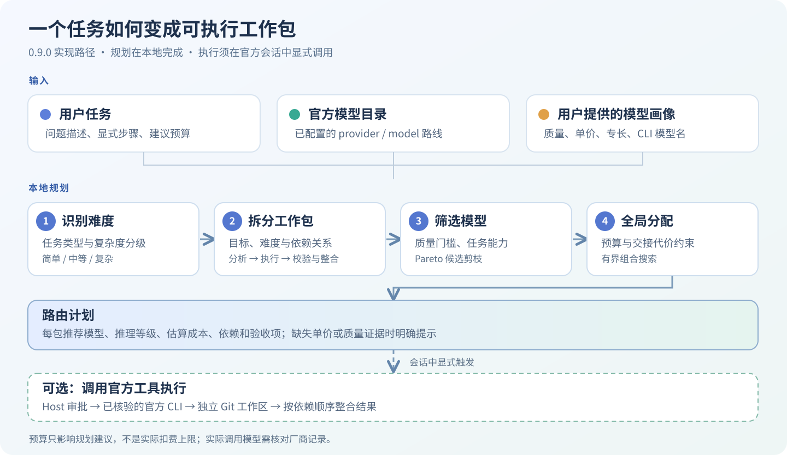
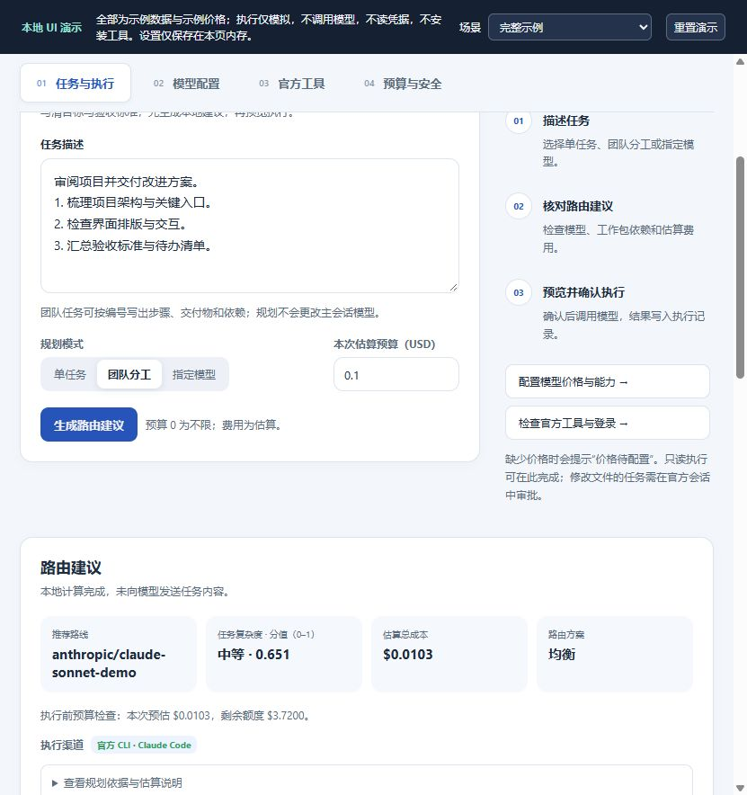
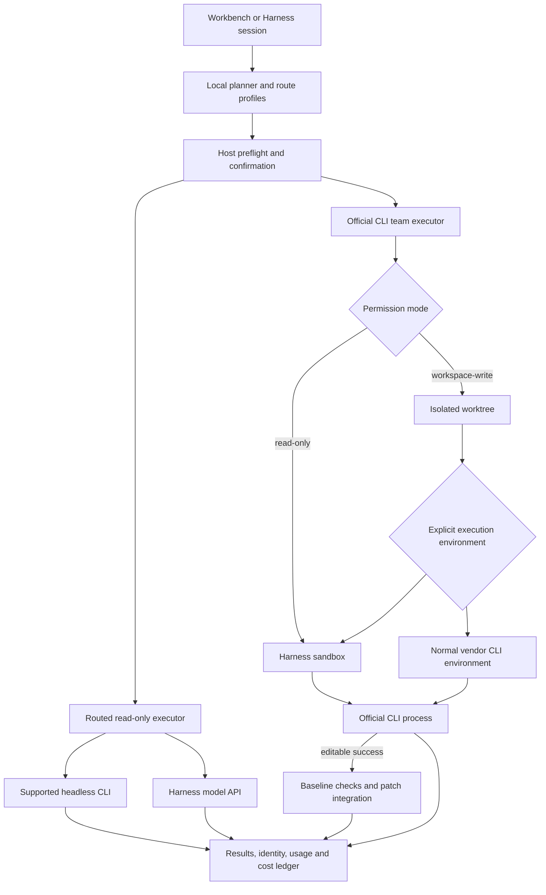

# Model Router · DeepSeek Harness Desktop

[English](README.md) · [简体中文](README.zh.md)

[](https://dsh-plugin.org/plugins/alice-marx/dsh-model-router)

A cost-aware model-routing workbench for **DeepSeek Harness Desktop**. Plan locally, compare configured routes, inspect execution permissions, and run dependent work packages through model APIs or supported official vendor CLIs.

Current version: **0.22.2** (`@ljwei-stak/dsh-model-router`). Choose algorithm recommendations or manually assign each decomposed package to an exact model API or official tool, preserving dependencies, refreshed cost previews and retry targets. Routing now supports task-specific quality evidence, joint model/effort selection, historical P90 resource estimates and dependency-aware search. Manual mixed execution is read-only; tools use their configured default model, while the existing editable official-team workflow remains available. Compatibility remains **DeepSeek Harness Desktop 0.2.0-rc.1 / 0.2.0-rc.2 / 0.2.1-rc.2**, including Hermes/Pi installation and terminal support; neither has a verified managed runner yet. Real vendor execution evidence remains tied to **0.20.0**, with no new model experiments in this release. The router and [GAL](https://github.com/Alice-Marx/deepseek-harness-galgame) have been independent plugins since 0.12.0.

Official CLI teamwork runs packages sequentially with dependency context and no automatic model-directory API fallback. Editable teams explicitly choose the Harness sandbox or the vendor CLI's normal environment. In the latter, Git worktrees collect edits but do not restrict OS access. CLIs retain their configured model unless explicitly mapped. See [real Windows validation and its limits](docs/releases/0.20.0-validation.md).

Both README versions describe the same interfaces, formulas, defaults and limits. [Changelog](CHANGELOG.md) preserves release history. More walkthroughs: [workbench](docs/WORKBENCH_USER_GUIDE.zh.md), [installation](docs/INSTALLATION_GUIDE.zh.md), [migration](docs/archive/MIGRATION.md), and [experiment protocol](docs/ROUTING_SELFTEST_STEPS.zh.md).

<a id="quick-evaluation"></a>

## Quick evaluation

**One-line value:** A cost-aware DSH workbench for planning tasks, routing model calls, and running dependent work packages with explicit execution permissions.

**Category:** **Models & Reasoning** (模型与推理), the best fit in the [community directory's category list](https://www.alldsh.com/categories/); this is a community taxonomy, not an official DSH classification.

**Install (DSH Plugin Hub / web profile):** With the DSH CLI available, install the published npm package with:

```sh
dsh plugin --profile web add @ljwei-stak/dsh-model-router@0.22.2
```

**Install in Harness Desktop:** Launch Desktop once to initialize its `desktop` profile, quit Desktop fully, then run:

```sh
dsh plugin --profile desktop add @ljwei-stak/dsh-model-router@0.22.2
```

You can also paste the package spec into **Harness Desktop → Plugins → Add plugin**. Restart Desktop after installation. A global `npm install -g` by itself does not register a Desktop plugin.

**Package and entry point:** [`@ljwei-stak/dsh-model-router@0.22.2` on npm](https://www.npmjs.com/package/@ljwei-stak/dsh-model-router) is published. The root [`package.json`](package.json) declares the package and bundle patch; [`.dsh-plugin/index.mjs`](.dsh-plugin/index.mjs) exports the required `apply(ctx)` entry point. License: [MIT](LICENSE).

**Configuration:** There is no supported import of a user-authored JSON/YAML configuration file. Configure providers, models, and credentials on Harness's **Models** page; configure routing profiles and preferences in the plugin settings. Persistent router state is stored in `$DSH_HOME/model-router/state.json` (default: `~/.dsh/model-router/state.json`). Provider CLIs retain their own login and configuration. The router does not copy API keys into model profiles or terminal logs.

**Screenshots and evidence:** The [workbench screenshot](docs/assets/workbench-task-preview.jpg) uses fixture models, prices, and health data; it is a simulated UI preview, not a live Harness or model run. See the [routing workflow diagram](docs/assets/routing-workflow.svg) for the execution flow. The [real Windows validation report](docs/releases/0.20.0-validation.md) documents specific 0.20.0 executions and their limits; 0.22.2 has no verified end-to-end vendor run.

**Permissions and risks:** Planning is local and makes no model call. Execution sends the selected task/context to the chosen model API or vendor CLI and may incur charges. The default Harness-restricted environment separates read-only runs from approved `workspace-write` runs. An explicitly selected `cli-native` editable team runs with the current OS user's permissions, outside the Harness process sandbox; a Git worktree collects changes but does not restrict OS access. External providers and CLI services apply their own data handling and billing terms.

**Compatibility:** Declared host support is DeepSeek Harness Desktop **0.2.0-rc.1**, **0.2.0-rc.2**, and **0.2.1-rc.2**. Node.js **>=22.19** and pnpm **10.34.6** are source development/build requirements, not plugin runtime prerequisites. Compatibility beyond the declared host versions is not claimed.

**Contents:** [Quick evaluation](#quick-evaluation) · [Capabilities](#capabilities) · [Install](#install) · [Workbench](#workbench) · [Architecture](#architecture) · [Session tools](#session-tools) · [Official tools](#official-tools) · [Team lifecycle](#team-lifecycle) · [Costs](#costs) · [Routing algorithm](#routing) · [Data](#data) · [Development](#development) · [Troubleshooting](#troubleshooting)

<a id="capabilities"></a>

## What is included

| Capability | Current behavior |
| --- | --- |
| Task planning | Local task classification and complexity analysis; single-route recommendation, dependent team work packages, or an explicit configured model. |
| Model configuration | Reads exact `provider/model` routes from Harness; optional user-supplied quality, USD prices, specialties, CLI model names, execution and billing preferences. |
| Routing presets | Economy, balanced and quality-first presets; quality floors, estimated token costs and bounded assignment search. Missing prices stay unknown. |
| Read-only execution | Preview and confirm a routed run from the workbench, or invoke it in an official Harness session. Supported headless CLIs and model-directory API calls return recorded results. |
| Editable CLI execution | A sequential CLI team from the workbench, or one supported CLI from a session, using approved isolated Git worktrees and conditional patch integration. |
| Official tools | Detect, install/update, check launch readiness and inspect login status for twelve registry tools; installation jobs have logs and cancellation. |
| Interactive terminal | PowerShell/system shell and all twelve registry CLI targets (ZCode TUI on verified Windows desktop installs), including fixed login commands, live output and multiple sessions. |
| Costs and subscriptions | Daily/monthly budget checks, economy downgrade or pause, subscription-first routing, quota cooldown and explicit handling of other subscription failures. |
| History and quality | Per-package results, dependency views, failure details, rerun/reassignment, ratings and optional stronger-model review. |
| Execution boundaries | Shows what each route can read/write and whether its process uses the Harness sandbox. |

Generating a route recommendation is local: it does not start a vendor CLI or make a paid model call. Actual execution can incur charges.



<a id="install"></a>

## Install in DeepSeek Harness Desktop

Open **Plugins → Add plugin** and enter:

```text
@ljwei-stak/dsh-model-router@0.22.2
```

Use the official HTTPS npm source `https://registry.npmjs.org/` when a mirror lacks that exact version. Enable the plugin, then fully quit Harness (including its tray process) and restart it. Plugin details should show **0.22.2** and the sidebar should contain **模型路由** (Model Router). A global `npm install -g` alone does not register a Desktop plugin.

You can instead install a local `.tgz` archive or its extracted inner `package` directory through the plugin manager. Both must contain `package.json` and `.dsh-plugin`. See [releases](https://github.com/Alice-Marx/dsh-model-router/releases) for archived builds, or build your own checkout below.

### Upgrade from the old package name

The old name `@ljwei-stak/model-router-galgame` ended at 0.13.0. Remove that plugin entry while retaining your profile/application data, then add `@ljwei-stak/dsh-model-router@0.22.2`. Do not keep both entries installed: they share the internal plugin id `model-router-galgame` and tool names. The retained id lets existing router settings and history carry over.

For the combined 0.11.x package, back up the profile and export the GAL saves you want to preserve before upgrading. Story playback, artwork, music and saves now belong to the independent `@ljwei-stak/dsh-galgame` package. The detailed save limitations are in [MIGRATION.md](docs/archive/MIGRATION.md).

<a id="workbench"></a>

## Use the workbench

The workbench groups the workflow into four navigation tabs. Its header summarizes registered routes, detected tools and today's recorded API spending.

| Tab | What you do there |
| --- | --- |
| **任务与执行** — Task and execution | Describe the task, generate advice, choose routed read-only execution or official CLI teamwork, preview and confirm, then inspect history. |
| **模型配置** — Model configuration | Refresh/search the model directory and edit exact-route profiles. |
| **官方工具** — Official tools | Complete onboarding checks, inspect/install tools and use the interactive terminal. |
| **预算与安全** — Budget and security | Set routing/cost/review policies and inspect subscription status and execution boundaries. |

Switching tabs keeps the panels mounted, preserving in-progress installation and terminal state.



*Screenshot from the local UI preview with fixture models, prices, and health data. No real model or Harness connection was used. Expand a work package to inspect its goal, dependencies, and acceptance checks.*

1. Configure providers, models and credentials on Harness's official **Models** page. In **模型配置**, refresh the directory. A listed route does not prove that its credentials, network or model entitlement work.
2. Optionally enter quality and prices for the routes you want compared. Prices are **USD per million tokens**; quality is a user-supplied **0–100** estimate. Leave unknown prices blank rather than entering zero.
3. In **任务与执行**, describe concrete deliverables, constraints and acceptance criteria. Select **单任务** (single recommendation), **团队分工** (dependent packages for sufficiently complex requests), or **指定模型** (one exact route, without comparing others). Team mode alone does not start any team.
4. Set the per-run estimate target; `0` removes that planning constraint. Click **生成路由建议**. The result appears directly below planning. Check the route, complexity, cost, execution channel and each package's dependencies/checklist.
5. In **在工作台执行**, choose **模型路由（只读）** for the existing routed executor, or first select **团队分工** and choose **官方工具协作**. For official teamwork, select **只读检查** (read-only) or **编辑文件** (edit files). Editable teams also choose **Harness 受限环境** (Harness sandbox, the default) or **厂商 CLI 正常环境** (normal vendor environment, outside the Harness sandbox). Enter an existing absolute workspace path, or reuse the last run's path. Click **预览执行计划**, review each package, its permissions and required confirmations, then explicitly confirm execution. The Host rechecks the plan before starting; changed conditions can require confirmation again.
6. Inspect **执行记录与子任务** for the actual channel, response, failures, cost and ratings. Official teamwork replans using only installed CLIs ready for the selected permission mode. Edits require approval and a clean Git repository; successful worktree changes are conditionally integrated. An unavailable or failed CLI never silently becomes an API call in this mode.

Changing task text, planning mode, profiles, directory or relevant settings invalidates the prior recommendation. Changing execution inputs also discards the pending or completed preview, so execution requires a new preview of the current request. Previewing execution uses current Host state and can differ from a previous local plan.

Example task:

```text
Review this project and prepare an implementation plan.
1. Map the entry points and identify the main UI workflows.
2. Review the interface at wide and narrow widths; list layout problems.
3. Check the execution and billing boundaries.
4. Combine the findings into a prioritized change list with verification steps.
```

The router plans and delegates text/code tasks. It does not itself render videos, generate artwork or control creative applications.

<a id="architecture"></a>

## Architecture and execution contracts

The Host owns route discovery, settings, approvals, workspace validation, process launching and the persistent ledger. The React client requests previews and renders Host results. Planning, managed execution and installation requests accept fixed tool IDs and typed fields rather than arbitrary shell commands, executable paths, installer packages or download URLs. The same remote namespace separately exposes an explicitly confirmed interactive terminal, which accepts arbitrary user input under current-user permissions.



| Path | Selection and permissions | Failure/fallback behavior |
| --- | --- | --- |
| Routed execution | `model_router_execute` / workbench `executor: "routed"`; read-only; CLI or Harness model API according to execution/billing policy. | An eligible API fallback can follow the configured subscription policy. |
| Official CLI, Harness environment | Single-tool `model_router_tool_run` or team execution; only currently supported/ready CLI modes; Host sandbox required. | Missing confinement or readiness blocks launch. No automatic API fallback. |
| Official CLI, normal environment | Only editable official teams: `official-team + workspace-write + cli-native`; separate user confirmation. | Runs under current user permissions with `sandboxEnforcement: "none"`. No automatic environment switch or API fallback. |

**Discovery is not execution acceptance.** Installed version, trusted launch entry, login status, supported permission mode, network connectivity and model entitlement are different checks. A CLI working in an interactive terminal can still be unavailable in a restricted task: the adapter, platform, sandbox and selected installation must all match.

### Workbench RPC

The authenticated Host remote is `ctx.remote.modelRouterOfficialTools`, defined in [official-tools-remote.mjs](.dsh-plugin/shared/official-tools-remote.mjs). It is an internal mounted-client interface, not a standalone public HTTP API. A preview request has this shape:

```json
{
  "task": "Analyze this repository's logging, implement a small improvement, and verify it.",
  "executor": "official-team",
  "planMode": "team",
  "executionMode": "workspace-write",
  "executionEnvironment": "cli-native",
  "workspace": "C:/work/example-repository",
  "budgetUsd": 1,
  "preset": "balanced"
}
```

Replace the workspace with an existing clean Git root. Call `previewRun(request)`, decode its response with the client's `unwrapRemote` helper, show the plan and `reasons`, and stop if blocked. Preview does not call a model or create a worktree; entry/version/integrity checks may access the network. Only after the user accepts every current reason may the client call `startRun({ ...request, confirmedReasons: preview.reasons.map(r => r.code) })`.

Native editing normally requires `workspace-write` and `unsandboxed`; an exceeded budget adds `over-budget`. Do not hardcode this list or populate it without consent. `startRun` replans and repeats preflight; it does not consume a frozen preview token. New confirmation requirements return `needs-confirmation` with `missing` and updated reasons. Changing task, mode, workspace or profiles requires a fresh preview. Workbench requests use saved route `cliModel` mappings; temporary `cliModelsJson` bindings belong to the session tool below.

<a id="session-tools"></a>

## Session tools

Ask an official Harness session to invoke these tools. Configure the session workspace before tasks that access local files.

| Tool | Purpose |
| --- | --- |
| `model_router_routes` | List configured routes; does not verify account/network availability. |
| `model_router_plan` | Generate a local `single` or `team` plan. |
| `model_router_consult` | Ask one configured model for a live second opinion via the model API. |
| `model_router_execute` | Execute a read-only routed plan, or one explicit `provider`/`model`, with recorded results. |
| `model_router_tools` / `model_router_health` | Inspect installation/readiness or version/login/billing health. |
| `model_router_tool_install` | Install one fixed registry tool from its official source. |
| `model_router_tool_run` | Run one supported CLI in `read-only` or approved `workspace-write` mode. |
| `model_router_team_execute` | Replan among currently executable CLI routes, then run work packages sequentially. |
| `model_router_rerun_step` | Rerun a failed step and its unfinished dependents, resume eligible editable teams, or repeat a failed single-tool run. |
| `model_router_rate` | Record `up`, `down` or `clear` for one stored result. |

Session commands are `/router <task>`, `/tools`, and `/tools install|cancel <tool-id>`.

A local planning request:

```json
{"task":"Review the architecture and prepare a verification checklist","mode":"team","budgetUsd":10}
```

A read-only single-tool request:

```json
{"tool":"codex","task":"Inspect the repository and list UI layout issues; do not edit files","mode":"read-only"}
```

An editable native-team request to `model_router_team_execute`:

```json
{
  "task": "1. Analyze the logging module and propose a small improvement. 2. Implement it and report verification results.",
  "mode": "workspace-write",
  "executionEnvironment": "cli-native",
  "budgetUsd": 1
}
```

The session supplies its authorized workspace; configure it as an editable clean Git root first. The tool's approval hook requests the required confirmations. Session tool arguments use `mode`, not the workbench's `executionMode`, and do not accept `workspace`, `executor` or `planMode`. For temporary model binding, `cliModelsJson` is a JSON-encoded **string**, for example `"{\"claude-code\":\"<verified-cli-model-name>\"}"`; replace the placeholder with a model accepted by that installation. This mapping does not force the planner to select that tool.

Supply `provider` and `model` together when selecting an exact catalog route. All CLIs retain their own configured model by default; a catalog recommendation is never automatically passed as a CLI model argument. To switch explicitly, save a verified **官方 CLI 模型名** in the route profile, pass `cliModel` for one tool call, or use team `cliModelsJson`. Team bindings prefer a package id, then a tool id, then the saved route mapping. ZCode uses its own default and cannot switch model per call. History records the recommendation, requested CLI name and reported actual model separately; a request is not proof of the model used. Check vendor records when no actual model is reported.

The CLI team runner is the plugin's own sequential dependency executor. It does not control the model selection or lifecycle of Harness's built-in Agent Teams.

<a id="official-tools"></a>

## Official tools and execution modes

| Registry id | Tool | Managed single-tool/team modes |
| --- | --- | --- |
| `kimi-code` | Kimi Code | Approved `workspace-write` |
| `claude-code` | Claude Code | Windows: `read-only`, approved `workspace-write` |
| `codex` | Codex CLI | Windows: Harness `read-only`; explicit native editable team supports `workspace-write` |
| `minimax-code` | MiniMax Code | Approved `workspace-write` |
| `mimo-code` | MiMo Code | Windows: `read-only`, approved `workspace-write` |
| `grok-build` | Grok Build | Windows: `read-only`, approved `workspace-write` |
| `gemini` | Gemini CLI | Routed headless adapter; not the managed single-tool/team runner |
| `opencode` | OpenCode | Install, probe and login check; no verified restricted execution entry yet |
| `stepcode` | Step Code | Install, probe and login check; no verified restricted execution entry yet |
| `hermes` | Hermes Agent | Official Windows/POSIX installer, version checks and interactive terminal; authenticate with `hermes auth`; no verified managed runner |
| `pi` | Pi | Official npm/pnpm package and interactive terminal; enter `/login` inside Pi; no verified managed runner |
| `zcode` | ZCode | Windows; approved `workspace-write` |

Hermes uses its [official source installer](https://hermes-agent.nousresearch.com/docs/getting-started/installation) in non-interactive mode, then you run `hermes auth`. A configured shared root places its source in `<root>/hermes-agent`; the plugin binds that checkout's `.hermes/bin` launcher and refuses a different old global copy. Existing configuration, login and history stay in their original Hermes home. Without a shared root, vendor defaults remain in use. The installer may refresh its global convenience command to the selected checkout. Uninstall source installs through `hermes uninstall`. Pi uses [`@earendil-works/pi-coding-agent`](https://github.com/earendil-works/pi/tree/main/packages/coding-agent) through npm/pnpm with `--ignore-scripts` and requires Node.js 22.19 or later. Start `pi`, then enter `/login`. Both tools keep login status unknown until confirmed in their own interface; the plugin does not read their credentials.

Installers use fixed official npm packages at each vendor's `@latest`, the vendor's own installer script, or the official publisher-signed Windows ZCode installer. An installation newer than the reported latest is not downgraded. Latest-version lookups are cached for about 12 hours; unavailable lookups leave the version unknown. New vendor releases are not automatically validated by this project. ZCode's installation window still requires you to choose a directory and finish installation.

**Unified install settings.** The top of the **官方工具** page (also in the plugin settings form) sets the install address for every tool at once: one install directory (empty means each vendor's default location), an npm source, and per-tool overrides for vendor installer-script mirrors. Directories must be absolute; sources must be https. Each row picks its own install method from `npm`, `pnpm` or the vendor script (`curl | bash` or `irm | iex`); a method that cannot run on this platform says so on the row instead of being silently swapped. The exact command is shown above the buttons before anything runs.

**Script installs never pipe remote content into an interpreter.** The plugin downloads the script, checks expected vendor markers, rejects HTML/unexpected vendor content, and runs the local copy. Marker checks are not cryptographic proof of its origin or safety. A mirror must rehost the vendor script rather than substitute a different program. Step Code's script accepts an install directory; the OpenCode script hardcodes `~/.opencode/bin`, so a custom directory only applies to it through the package managers' configured global directories. Script installs can be switched off entirely, leaving only the package managers.


**Update destination.** Click **保存安装设置** after changing the shared directory or sources. Tool actions wait until saving and command refresh finish. npm uses `--prefix`; pnpm uses its own `global-dir`, `global-bin-dir` and store settings. Install jobs retain the chosen configuration even if another settings page changes it while they are queued. Updates check the selected command directory, so a different current copy on PATH cannot make a missing target look installed. Vendor scripts with fixed paths explain their actual destination; ZCode still requires directory selection in its signed installer window.

The [workbench guide](./docs/WORKBENCH_USER_GUIDE.zh.md#厂商安装渠道) lists each vendor’s actual channels and native-install execution limits.

With no shared directory, ordinary checks discover the selected manager's packages on PATH. An install, update, repair or removal job resolves and locks that manager's default global destination before comparing versions. If that destination cannot be resolved safely, set and save a shared directory first.

**One-click repair and uninstall.** Repair re-runs the same fixed official command, which is what a broken install needs even when it already reports the latest version. Uninstall removes only the program: a package-manager install goes back through the same manager, and a script install removes its registered command entries and supported PATH records; vendor version directories may remain. The Windows Codex native directory junction has no generic delete-based uninstall. The row explains this limitation. **Configuration, credentials and session history are always kept.**

Installation, trusted launch readiness, account login and model entitlement are separate checks. An unknown login status is not proof of logout. Trust checks depend on the tool and installation source:

| Entry | Implemented verification |
| --- | --- |
| Windows Claude / Codex | Valid vendor Authenticode signature on the executable; Codex also checks wrapper/platform-package layout. Claude requires version 2.1.259 or later. |
| MiMo / Grok | Native executable against the exact official npm platform archive; Grok also verifies the compressed member and its decompressed executable. |
| Windows MiniMax vendor-script layout | Installed package code against the exact npm release, version-pointer/layout checks and required native-module presence. |
| Kimi / ordinary MiniMax npm or pnpm, `cli-native` | Additional registry checks on package code, manifest and actual entry. This extra path is not applied to those ordinary copies in the Harness environment. |
| Windows ZCode | Signed desktop executable, same-root bundle metadata, and a stored first-seen script SHA-256 per signed build. The desktop signature does **not** cover the JavaScript; first-seen script trust is a separate assumption. |

Here, “npm attestation” means exact registry-release consistency: verify the tarball using its registry `dist.integrity` SHA-512, then compare selected members' SHA-256/size, optionally using a verified cache. It is not npm provenance/Sigstore verification, an independent publisher signature or a proof of every dependency/local file. Gemini's routed adapter and OpenCode/Step terminals do not inherit these managed-entry claims. See [the registry](.dsh-plugin/shared/official-tool-registry.mjs), [executor](.dsh-plugin/shared/official-tool-executor.mjs), [npm checks](.dsh-plugin/shared/npm-attestation.mjs) and [ZCode trust](.dsh-plugin/shared/zcode-bundle.mjs).

Version and CLI login-status checks use the selected installation's concrete entry. A missing selected copy cannot be replaced by a different command on PATH; its login status remains unknown when that entry cannot be checked.

In a session, `/tools install|uninstall|repair|method <tool-id> [method]` does the same; agents can call `model_router_tool_install`, `model_router_tool_repair` and `model_router_tool_uninstall`. The install directory and download sources always come from the user's own plugin settings and never travel over the RPC, so no call can redirect an install at an arbitrary package or URL.

`model_router_execute` has fixed headless adapters for Claude, Codex and Gemini. Other suppliers use the model-directory API unless a supported subscription route applies. Missing/unusable CLIs can fall back to that API; subscription failures follow the policy below.

Editable execution needs a clean Git root and Host approval. The default Harness environment additionally requires process confinement; explicitly confirmed `cli-native` teams run outside that sandbox. Both retain worktree and conditional patch-integration checks described below. Read-only CLI flags do not necessarily limit reads to the workspace; check **安全边界**, especially Codex's broader readable scope.

In the Harness environment, Claude read-only uses restricted mode, Read/Glob/Grep only, no shell, slash commands or existing MCP configuration. Editable Claude retains its normal tools/configuration. The executor forwards a base environment, proxies and an allowlist of vendor configuration/credential variables, not every Host variable; subscription-only launches remove API credentials. Native execution preserves normal vendor state/configuration and can use its skills/MCP if that CLI supports and loads them. It does not verify that every configured skill or MCP service works.

For Windows Codex tasks in the Harness environment, only read-only is available: the outer ACL sandbox grants the original `CODEX_HOME` state and a private temporary directory, while Codex retains `--sandbox read-only`. Explicitly confirmed native editable teams can use Codex with its own workspace-write policy. Codex network readiness remains account/environment dependent and did not pass the real connection checks in this batch.

### Interactive terminal

In **官方工具 → 官方工具终端**, select the shell or an installed CLI, choose interactive/login mode where available, enter an existing absolute directory, and review the startup confirmation. Verified Windows ZCode desktop installations provide their bundled TUI as a terminal target.

These sessions run **outside the Harness sandbox**, with the Host user's login environment, proxies and API-key variables. Commands typed there can read/write files with that user's permissions. Terminal launches are separate from routed execution and its approval/billing policy.

The optional `@lydell/node-pty` dependency supplies a real pseudo terminal. If it cannot load, the card reports pipe mode: full-screen interfaces, resizing and arrow keys may not work. At most four sessions run concurrently, unread sessions expire after about two minutes, and each session lasts at most six hours. Explicitly end sessions when finished; closing the workbench or unloading the plugin also ends them.

The plugin does not persist terminal input/output. It stores session metadata only. With text selected, Ctrl+C copies; otherwise it interrupts. Ctrl+Shift+V pastes.

<a id="team-lifecycle"></a>

## Team lifecycle, model identity and recovery

The team runtime executes a topologically ordered dependency graph **sequentially**, not concurrently. Each package receives the overall task, its goal/checklist and the outputs of its direct dependencies (up to 2,500 characters per dependency). The first non-successful package stops all remaining packages, including independent packages later in the plan. This is the plugin's executor, independent of Harness's built-in Agent Teams.

### Model identity

Three fields have different meanings: the recommended catalog `provider/model`, the requested `requestedCliModel`, and the CLI-reported `actualModel`. The catalog recommendation is not automatically a CLI argument. Explicit selection follows **package binding > tool binding > saved route.cliModel > vendor CLI default**. ZCode has no per-call model switch; MiniMax/MiMo mappings must use their supported `provider/model` form.

If an explicit binding conflicts with an actual model reported by the CLI, the package becomes `model-mismatch` and downstream work stops. If no unambiguous actual model is reported, identity stays unknown; a successful process does not prove the requested model ran. Reassigning a failed package uses the new route's saved mapping rather than retaining the old tool's mapping.

### Editable worktree and integration

1. Canonicalize the source path, check session authorization and require a clean Git root with a HEAD commit. Record that baseline.
2. Create a detached isolated worktree. On Windows, Host-derived storage is `os.tmpdir()/.model-router-workspaces/<source-path-hash>/run-<uuid>`; source/worktree overlap and redirected storage are rejected. This avoids source drives whose ACLs cannot initialize the Harness boundary. Other platforms retain their supported in-scope worktree policy.
3. Run packages in that worktree. Cancellation stops the process tree; failed runs preserve their worktree and earlier package results.
4. After all packages succeed, stage changes and compute a binary diff against the **original source baseline**, including changes a CLI committed inside the worktree. Git-ignored outputs are not included.
5. Recheck that the source is clean and its HEAD is unchanged. Run `git apply --check`, then apply the patch to the source. Do not auto-commit. Conflicts, changed source or outputs needing manual handling preserve an `integration-pending` result/worktree.

A worktree separates collected changes; only the selected Harness environment supplies an OS boundary. Native tools/MCP can affect files or services beyond it. Internal execution limits are 64,000 task bytes, 32,000,000 captured output bytes, a 32,000-character output tail, a default 45-minute timeout and a two-hour maximum. Kimi and ZCode additionally reject command-line prompts over 16,000 UTF-8 bytes. These are process limits, not billing caps.

### Failure and retry

History stores package status, exit code, bounded scrubbed diagnostics, entry/model evidence and available usage/cost. A later adapter exception does not discard earlier results. `cli-completed` means the runtime completed its process/patch workflow; deliverables still need acceptance checks. `blocked`, `cancelled`, `incomplete` and `integration-pending` distinguish preflight, interruption, package failure and integration problems.

A retry targets a failed package and unfinished downstream packages, preserving other successful results. Eligible editable `incomplete/cancelled` runs require the recorded source, retained worktree and baseline: the Host validates them, creates a fresh worktree, seeds prior unintegrated edits, and continues. Already integrated or `integration-pending` teams cannot use this step-resume path. Native retry again requires write and unsandboxed consent (`confirmWrite` and `confirmUnsandboxed` in the workbench rerun request); disabling the legacy `confirmUnsandboxedCli` setting cannot bypass it. Previous attempt charges remain in spending totals.

Implementation: [official-team-runtime.mjs](.dsh-plugin/shared/official-team-runtime.mjs), [official-tool-executor.mjs](.dsh-plugin/shared/official-tool-executor.mjs), and [run-ledger.mjs](.dsh-plugin/shared/run-ledger.mjs).

<a id="costs"></a>

## Costs, subscriptions and quality

- **Budgets:** per-run planning target plus daily/monthly checks. Over-budget routing can try the economy preset or pause for confirmation. Unknown prices remain unknown. These are local accounting/estimation controls, not a hard provider billing cap.
- **Subscription-first:** the default is to prefer a detected CLI account subscription or a configured coding-plan route. API-key environment variables are removed for CLI subscription attempts. `billing` can be `subscription-first`, `api-only` or `subscription-only`; `subscription` can be `cli-login`, `plan-key` or `none`.
- **Fallback:** detected quota exhaustion/rate limits mark a subscription in cooldown and can retry the routed step on its configured API route, subject to policy and availability. Other attempted subscription failures pause by default (`onSubscriptionFailure: "ask"`): choose API retry, subscription retry or cancel in history. Managed editable/single-tool/team runs do not automatically retry on the API.
- **Accounting:** API costs count toward budgets. Subscription runs display a reference cost separately. A valid CLI-reported amount, including zero, takes precedence. Token-based CLI cost requires complete usage and an actual reported model matching a configured model or its explicit CLI mapping; unknown or mismatched identity keeps cost unknown. The recommendation's price alone cannot establish actual CLI cost. Provider bills remain authoritative. Version 0.15.0 retains spending from evicted detailed runs and replaced retry results, so trimming history or retrying a step does not erase earlier charges. Costs already discarded by older versions cannot be reconstructed.
- **Quality and preference:** optional `off`/`sample`/`always` stronger-model review can add paid calls; it is not treated as human feedback. Explicit ratings adjust separate subjective utility for the exact route and task type, using time decay and low-sample shrinkage (default limit ±0.04, configurable up to ±0.1). They do not change objective quality scores or their hard floors; learning can be disabled, ratings withdrawn, or its starting point reset.

Coding-plan keys and endpoints stay in Harness provider settings. A `plan-key` profile may name an exact configured `apiRoute` as its fallback; the profile editor does not accept credentials or arbitrary commands. Vendor plan eligibility and terms must be checked with the vendor.

### Actual cost versus planning estimate

A valid CLI-reported USD amount, including explicit zero, wins over token-price calculation. Otherwise, token-based CLI accounting requires complete normalized usage, known nonnegative prices, and a reported actual model matching the priced route or its explicit CLI mapping:

<!-- formula:actual-cost -->
```math
C_a = \frac{I_u p_i+O p_o+R p_r+W p_w}{10^6}
```

$`C_a`$ is `actualUsd`; $`I_u`$, $`O`$, $`R`$, and $`W`$ correspond to `inputTokens`, `outputTokens`, `cacheReadTokens`, and `cacheWriteTokens`. $`p_i`$, $`p_o`$, $`p_r`$, and $`p_w`$ are the matching input, output, cache-read and cache-write prices in USD per million tokens.

These ledger counters are disjoint after adapter normalization; do not add cached tokens to an inclusive input count. Missing optional cache prices use the input price. Incomplete usage, absent prices or unknown/unmatched identity keep the amount `null`, not zero. Complete terminal evidence can survive a failed/cancelled/timed-out run; partial events are marked `usageIncomplete`.

For example, a complete API result with 1,000 uncached input tokens at \$1/million and 500 output tokens at \$5/million costs \$0.0035. A subscription result can show that amount as `referenceCostUsd` while `costUsd` stays null; reference cost is not added to API spending. A provider-reported \$0 is explicit evidence for that attempt, not proof that earlier unknown attempts were free. Actual provider bills are authoritative. No automatic API fallback in official-team mode prevents a router fallback; a vendor CLI may still use its own configured API credentials.

<a id="routing"></a>

## How routing works

Manual assignment: after planning, choose algorithm recommendations or select an API model / official tool for each package. See the [manual assignment guide](docs/MANUAL_TASK_ASSIGNMENT.zh.md).

The planner is a deterministic local heuristic, not a trained success predictor. It classifies text, estimates complexity, creates suitable analysis/execution/verification/synthesis packages, discovers exact configured routes, overlays profiles, and applies capability/quality constraints. An explicit route bypasses comparison with other routes. Catalog quality/latency/risk hints are experimental priors, not measured success probabilities or live vendor quotes. Execution is currently text-oriented; a vision label does not establish an end-to-end multimodal pipeline.

### Token and price estimate

Without matching resource evidence, base input tokens are $`\max(80,\lceil n/3.7\rceil)`$, then adjusted by package-stage multipliers. Base output is 900, adjusted by stage/reasoning effort, with minimum 220. Here $`n`$ is the JavaScript `text.length` value. This is a text-length heuristic, not a vendor tokenizer. Sufficient matching, complete history replaces these heuristics with empirical P90 resource estimates, without applying effort or stage multipliers again. Let $`I`$ be total estimated input, $`R`$/$`W`$ the cached-read/write portions, $`O`$ output, and prices USD per million tokens:

<!-- formula:planning-cost -->
```math
C = \frac{(I-R-W)p_i+O p_o+R p_r+W p_w}{10^6}
```

<!-- formula:cost-utility -->
```math
U_c = \frac{1}{1+C/\max(C_{\mathrm{ref}},10^{-12})}
```

$`U_c`$ is `costUtility`. The price symbols are the same as above. $`C_{\mathrm{ref}}`$ uses fixed reference prices (input 1, output 5, cache read/write 1 USD/million), not a vendor offer. Fixed scaling prevents an unrelated expensive candidate from flattening all cost penalties. Unknown prices produce a public estimate of `null` and cost utility 0. Internal unconstrained search uses a cost sentinel of 0, but finite-budget assignment excludes unknown-price candidates; the sentinel never means free execution.

### Candidate objective and quality floors

With normalized quality $`q`$ and normalized latency, specialty, reasoning-fit and risk proxies:

<!-- formula:latency-utility -->
```math
L = \begin{cases}
\dfrac{1}{1+t/10\,000}, & t\text{ known}, \\
1-\min(1,\max(0,\ell e_\ell)), & \text{otherwise}.
\end{cases}
```

<!-- formula:candidate-utility -->
```math
u = w_q q+w_c U_c+w_\ell L+w_s s+w_r r-w_k k-\alpha\max(0,f-q)+\Delta_p
```

<!-- formula:assignment-score -->
```math
S = \sum_{j=1}^{n}u_j - 0.015\sum_{(i,j)\in E}\mathbf{1}[\rho_i\ne\rho_j]
```

$`L`$ is latency utility: $`t`$ is the matching historical P90 duration in milliseconds; otherwise $`\ell`$ is the latency proxy and $`e_\ell`$ its effort multiplier. In the utility formula, $`s`$/$`r`$/$`k`$ are specialty/reasoning-fit/risk, $`f`$ is the quality floor, $`\alpha`$ is criticality, and $`\Delta_p`$ is the bounded `preferenceAdjustment`; the $`w`$ terms are the corresponding weights. $`S`$ is `assignmentScore`; $`E`$ contains dependency edges, and $`\rho_j`$ is package $`j`$'s `provider/model` route. The indicator is 1 when routes differ, otherwise 0.

Quality first uses sufficient matching objective task evidence, then falls back to task-category LiveBench, overall LiveBench, and profile/catalog estimates. Model and effort are compared jointly only when at least two API efforts have usable task evidence; observed duration can replace the latency proxy. Public-data refresh is opt-in. Human ratings affect only the bounded `preferenceAdjustment`; they cannot increase objective quality or satisfy its floor.

| Package basis | Quality | Cost | Latency | Specialty | Reasoning | Risk |
| --- | --- | --- | --- | --- | --- | --- |
| Simple | 0.28 | 0.45 | 0.14 | 0.04 | 0.07 | 0.02 |
| Balanced | 0.40 | 0.26 | 0.10 | 0.09 | 0.10 | 0.05 |
| Complex | 0.48 | 0.14 | 0.06 | 0.14 | 0.11 | 0.07 |
| Synthesis | 0.58 | 0.08 | 0.04 | 0.08 | 0.16 | 0.06 |

Base quality floors are **0.75 / 0.78 / 0.82** for simple/balanced/complex tasks; critical complex packages raise the floor, and complex synthesis is at least 0.84. The economy preset multiplies quality/cost/latency weights by 0.75/1.6/1.1 and lowers the floor by 0.04. Quality-first multiplies quality/cost/specialty/reasoning by 1.35/0.5/1.2/1.2 and raises the floor by 0.04. Tilted weights are renormalized to the original total; adjusted floors are clamped to [0.5, 0.97]. Balanced applies no tilt.

### Candidate pruning and assignment search

1. Prefer candidates meeting each package's floor. If none qualify, retain up to three highest-quality fallbacks and report relaxation.
2. Keep at most **12 candidates per package**, including anchors for lowest known cost, greatest utility and highest quality. Local Pareto pruning is disabled when dependencies exist, because route identity affects handoffs.
3. Validate unique package IDs and topological dependency order. Search the retained Cartesian space exactly when its size is at most **4,096**; otherwise use **beam width 256**. Search compresses dominated prefixes sharing the same future dependency boundary and ranks them using optimistic future handoffs. Remaining minimum costs prune infeasible prefixes; the beam protects the cheapest feasible prefix under a finite budget.
4. Compare assignments lexicographically: fewer relaxed packages, smaller quality shortfall, higher utility, lower cost, fewer route switches, then stable route order. Minimum-cost mode compares cost before utility. Each dependency crossing a `provider/model` route subtracts 0.015 from utility.
5. Report search metadata and feasibility. When a positive budget has no feasible assignment, a minimum-cost alternative can still be returned with `budgetFeasible: false`. A displayed plan is not proof that the budget is satisfied.

“Exact” applies only to the retained candidate space and proxy objective. Candidate caps and beam pruning preclude a claim of global optimality over every configured model. Unit/synthetic tests establish mechanisms, not actual answer-quality gains. The public 2026-06-25 LiveBench score/cost tables used by the research audit are aggregate data; a paired per-question quality/cost matrix was not obtained, so no real routing gain is claimed. See [research](docs/ROUTING_RESEARCH.zh.md), [derivation/experiments](docs/ROUTING_DERIVATION_EXPERIMENTS.zh.md), and [validation protocol](docs/ROUTING_LIVEBENCH_VALIDATION.zh.md).

See the [algorithm optimization guide](docs/ROUTING_ALGORITHM_OPTIMIZATION.zh.md) for evidence import, fallback rules, effort handling, and optional JSON validation with escalation. Escalation defaults to off and permits at most one additional ordinary API request after billing and budget checks.

Implementation: [router.mjs](.dsh-plugin/shared/router.mjs), [assignment-solver.mjs](.dsh-plugin/shared/assignment-solver.mjs), [routing-evidence.mjs](.dsh-plugin/shared/routing-evidence.mjs), [harness-plan.mjs](.dsh-plugin/shared/harness-plan.mjs) and [quality-gates.mjs](.dsh-plugin/shared/quality-gates.mjs).

<a id="data"></a>

## Data and privacy

Router profiles/preferences are held in the Harness plugin settings. Runtime state is stored in `<DSH_HOME>/model-router/state.json` (default `~/.dsh/model-router/state.json`): health/onboarding, subscription cooldown, ratings, up to 200 recent runs, 50 terminal metadata records and opt-in public data snapshots. Applied rates and data/feedback policy versions are frozen in run records. Preferences are local to that shared DSH_HOME, not authenticated per-user accounts; public data requests do not upload tasks or feedback.

Version 0.15.0 also retains bounded spending aggregates for up to 90 populated calendar dates and 24 months. These contain amounts/counts, not task or response content.

Run history includes task text, output excerpts, route/workspace, failures and costs. Stored task text is capped at 20,000 characters and each answer at 4,000; reruns can therefore depend on truncated stored context. The plugin does not store API keys in model profiles or terminal transcripts. Task execution still sends the selected task/context to the chosen provider or CLI.

State writes use a lock and atomic replacement. Unparseable state is preserved as a `state.json.corrupt-<timestamp>` backup and surfaced as a notice. Back up state/profile data before migrations and avoid sharing unredacted histories or logs.

<a id="development"></a>

## Develop from a cloned checkout

The Git clone is a complete source checkout; the npm package is a runtime distribution and excludes client source, scripts, tests and the experiment project.

Requirements: **Node.js 22.19+** and **pnpm 10.34.6** (pinned in `packageManager`). In PowerShell, from the directory containing your clone:

```powershell
cd .\dsh-model-router
pnpm install --frozen-lockfile --strict-peer-dependencies
npm run build:client
npm test
npm run check:client
npm run pack:local
```

If already in the repository, omit the first `cd`. The archive appears in `dist`; install that absolute `.tgz` path through Desktop's plugin manager in a test profile. Do not treat successful unit tests as proof of vendor account access, actual model identity or billing.

To inspect the UI without starting Harness or vendor tools:

```powershell
npm run preview:ui
```

Open [the local preview](http://127.0.0.1:4173). It uses mock models, tools and history, with populated, empty, error, onboarding and delayed-preview scenarios for layout/interaction checks. Simulated execution does not call providers, install tools or start a terminal. This is not Host integration verification. Use `npm run preview:ui -- --port 4174` if the default port is occupied; refreshing picks up client-source edits.

| Location | Role |
| --- | --- |
| `.dsh-plugin/index.mjs` | Host plugin, session tools, settings, execution and remote handlers. |
| `.dsh-plugin/client/` | React workbench source and CSS. |
| `shared/router.mjs`, `assignment-solver.mjs`, `harness-plan.mjs` | Local scoring/search and Host model-directory integration (under `.dsh-plugin/`). |
| `shared/official-tools-remote.mjs`, `official-tools-runtime.mjs` | Fixed RPC codecs, installation selection/jobs and preferences. |
| `shared/official-tool-executor.mjs`, `official-team-runtime.mjs` | Trusted entry, permissions/process capture, dependency execution and patch integration. |
| `shared/task-executors.mjs`, `subscription-billing.mjs` | Routed CLI/API execution, subscription policy and fallback. |
| `shared/run-ledger.mjs`, `router-state.mjs` | Identity/usage/cost records, retained spending and locked atomic persistence. |
| Other `.dsh-plugin/shared/` modules | Terminal contracts, tool health, public snapshots and bounded feedback. |
| `.dsh-plugin/client.js` | Generated Desktop client bundle; rebuild after client changes. |
| `scripts/` and `tests/` | Build/package/verification helpers and regression tests. |
| `experiment-plugin/` | Separate research experiment project; not shipped as part of the router plugin. |
| `docs/` and dated reports | User documentation and historical verification records. |

`check:readme` guards the six display formulas, inline mathematical symbols, leading zeros in decimals, matching formulas in both languages and the reviewed blob hashes. `npm test` and `prepack` run this check; render changes must also be viewed on GitHub. The math blocks use [GitHub-supported syntax](https://docs.github.com/en/get-started/writing-on-github/working-with-advanced-formatting/writing-mathematical-expressions).

`check:client` rebuilds in memory and compares the generated output with the committed bundle; `prepack` refuses a stale bundle. pnpm 10 has no `pnpm peers check` command: use the strict install above. Unavailable/incompatible host SDK packages may require the installed Harness runtime for local integration testing; [setup-harness-dev.mjs](scripts/setup-harness-dev.mjs) links missing SDK packages from an explicitly supplied Host `node_modules`, and [start-harness-preview.mjs](scripts/start-harness-preview.mjs) starts a separate local web Host profile. These helpers do not replace dependency verification or Desktop acceptance checks.

Legacy compatibility/research files and dated reports are preserved for reference; their presence does not make every older integration an active feature of the current packaged plugin. Releases and synchronization follow [AGENTS.md](AGENTS.md); use versioned packages or verified release tags to reproduce a release.

### Verification layers and known limits

| Evidence | What it establishes |
| --- | --- |
| Unit/fixture tests | Local planner, contract, ledger, state and failure handling for covered cases; no vendor account access. |
| Standalone UI preview | Layout and client interaction with fixtures; no authenticated Host execution. |
| Authenticated Desktop RPC | Actual Host preflight/approval/launch path for the selected run. |
| Production runtime CLI team | Real vendor processes, dependency context and files for that invocation; not automatically a UI or automatic route-selection test. |
| Source file readback | The expected artifacts reached the source workspace; business correctness still depends on the chosen checks. |

The 0.20.0 Windows record contains a real Claude workbench RPC run and a separate installed-production-runtime Claude → MiniMax handoff, with file/shell tools and patch integration checked. The handoff used explicitly selected packages; it does not prove automatic route quality. Codex connection checks failed in that batch. Other vendors, every skill/MCP service, cross-platform behavior, billed totals and quality–cost improvements are not all accepted by those runs. [The dated report](docs/releases/0.20.0-validation.md) retains the exact scope. The 0.20.1 retry-confirmation fix has contract/regression coverage; this patch adds no new model experiments or spending.

When maintaining these docs, update both languages in the same change: matching stable section anchors, API keys, defaults, formulas, capability tables, examples and evidence limits. Record the paired Git blob hashes in [README.i18n.yaml](README.i18n.yaml); hashes identify the reviewed text and do not prove translation correctness. Keep historical experiment reports tied to the runtime version actually tested.

<a id="troubleshooting"></a>

## Troubleshooting

| Symptom | Check |
| --- | --- |
| No routes or planning disabled | Configure Harness Models, refresh the directory and wait for tool detection. |
| Cost unknown | Supply both input/output USD prices for each compared route. |
| CLI installed but not executable | Review launch-readiness reason, platform/mode support and installation source. |
| Login/entitlement still fails | Check the vendor account, CLI login, network and actual model access; installation alone is insufficient. |
| Frontend says Host is older | Fully quit Harness, including the tray process, then restart. |
| Preview differs from old advice | Directory, login, quota or budget state changed; review the new preview. |
| Terminal TUI does not render | Check whether the card reports PTY or pipe fallback. |
| Logged in, but no executable team route | Check `readyModes`, platform, selected install and permission mode; terminal login alone does not establish managed capability. |
| Skills/MCP missing in Claude read-only | Restricted mode disables them; editable/native choices have different permissions and require the corresponding confirmation. |
| Editable team stopped | Read the failed package, exit/diagnostic fields and integration state; preserve the worktree before eligible retry/manual review. |
| Changes not integrated | Check source cleanliness/HEAD, patch conflict and ignored outputs. Do not treat a retained worktree as an applied source change. |
| Wrong or unknown CLI model | Compare recommendation, requested mapping and reported actual model; check the selected CLI's own default/configuration. |
| Native run asks again | New starts/retries require current write/unsandboxed consent; preview is not an enduring approval token. |

For issues include host/plugin versions, selected mode, tool status and redacted errors: [issue tracker](https://github.com/Alice-Marx/dsh-model-router/issues).

License: [MIT](LICENSE).
