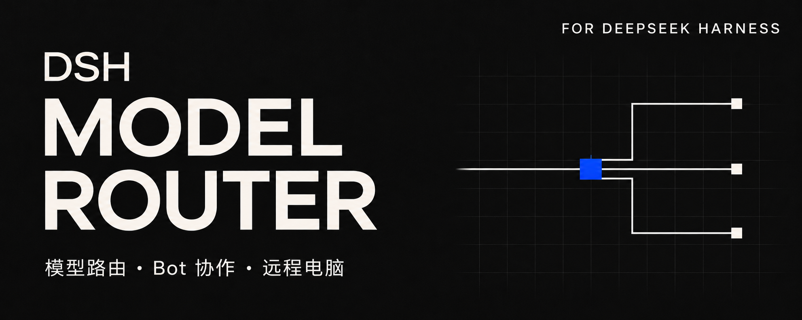
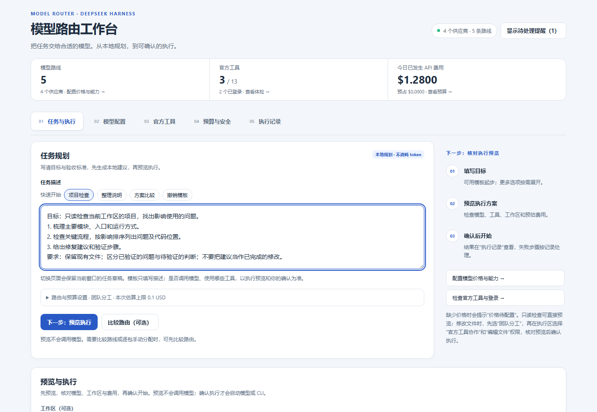
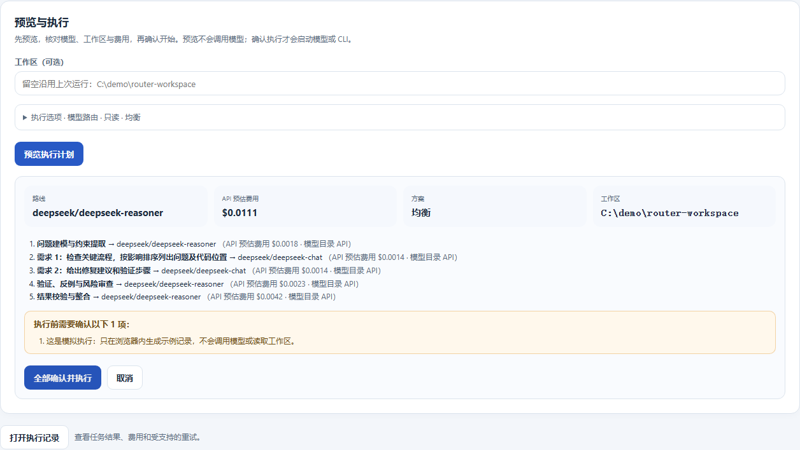
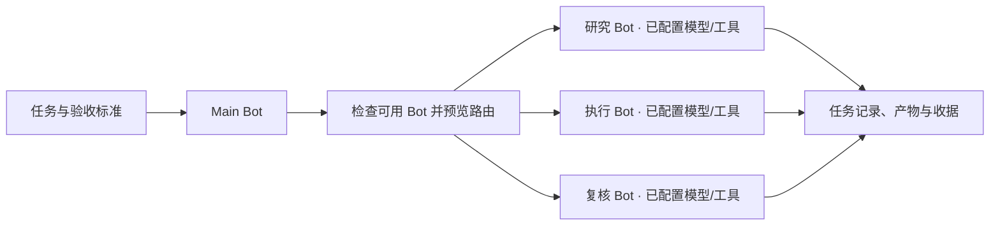

# DSH Bot · 模型路由

[English](README.md) · [简体中文](README.zh.md)

[](https://www.npmjs.com/package/@ljwei-stak/dsh-model-route-bot) [](https://www.npmjs.com/package/@ljwei-stak/dsh-model-router) [](https://dshfind.com/zh/plugins/Alice-Marx/dsh-model-router?ref=badge) [](https://dshfind.com/zh/plugins/Alice-Marx/dsh-model-router?ref=badge) [](https://dsh-plugin.org/plugins/alice-marx/dsh-model-router) [](https://awesome-dsh-plugin.com)

[](https://dshfind.com/zh/plugins/Alice-Marx/dsh-model-router?ref=badge)



**面向 [DeepSeek Harness](https://github.com/deepseek-ai/deepseek-harness) 的模型路由与持久化 Bot 工作区。**

将任务转化为可审查的执行计划，为不同环节选择合适的已配置模型或原生 CLI 工具，并集中跟踪结果。完整 Bot 版本进一步提供长期对话、多 Bot 分工、私有资料库，以及用户自有 Windows 电脑的连接与操作。

本项目是社区插件，独立管理 AI 连接并复用 Host 服务；各模型供应商与 CLI 使用各自的账户及访问权限。

**当前正式版：0.73.1 · Windows Remote Agent：0.1.3**

以 Bot 联系人和聊天为主要入口，集中使用独立 AI 连接、多模型路线、团队委派、私有资料库、数据分析与自有 Windows 电脑。任务、通知和执行记录保存在工作空间中，Main Bot 可在已保存的多条模型路线之间调度。

版本变更、修复与验收记录见 [GitHub Releases](https://github.com/Alice-Marx/dsh-model-router/releases) 和 [GitLab 文档档案](https://gitlab.com/Alice_marx/dsh-model-router/-/tree/main/docs)。

[选择版本](#editions) · [安装](#install) · [AI 连接](#ai-connections) · [第一个任务](#quick-evaluation) · [Bot 分工](#bot-routing) · [远程电脑](#computers) · [问题反馈](#troubleshooting)

<a id="editions"></a>

## 选择适合的工作区

| 版本 | 在「插件 → 添加插件」中输入 | 安装内容 |
| --- | --- | --- |
| **DSH Bot + 模型路由** | `@ljwei-stak/dsh-model-route-bot` | 完整 Bot 工作区、模型路由工作台、Bot 分工、远程电脑、私有资料库与例行任务。 |
| **模型路由** | `@ljwei-stak/dsh-model-router` | 在 Harness 原有界面增加「模型路由」入口，提供路线规划、工具、执行与核算，不安装 DS Bot。 |

同一个 Harness profile **选择一种版本**。两者共用路由配置；切换时，在插件管理中移除原包入口，再在同一 profile 添加另一个版本，保留数据目录并沿用已配置的 Bot home。[纯路由版本操作说明](packages/model-router-plugin/README.zh.md)。

<a id="capabilities"></a>

## 功能概览

| 工作流 | 可用能力 | 适用版本 |
| --- | --- | --- |
| 任务驱动的模型路由 | 从任务模板起步，比较省钱、均衡或效果优先方案；支持单路线、带依赖的团队分工及指定准确模型。 | 两种版本 |
| 可审查的执行 | 确认前检查模型、工具、工作区、权限与估算；集中跟踪进度、结果、取消状态和受支持的重试。 | 两种版本 |
| 原生 CLI 工具 | 检测与安装已登记工具，检查登录及执行模式就绪状态，打开交互终端。 | 两种版本 |
| 预算与反馈 | 设置 API 限额，核对预占和收据，独立查看订阅调用/token，并使用可选复核与显式评分。 | 两种版本 |
| 持久化 Bot 对话 | 每个 Bot 独立配置模型、角色、工作目录、私有对话与权限；支持侧聊、提问和审批卡片。 | 完整 Bot |
| 群聊与共享上下文 | 使用提及、分阶段群目标、交接、对话搜索/检查点，以及带变更历史的 Bot/群/团队记忆。 | 完整 Bot |
| 浏览器与文档工作 | 每 Bot 浏览器分区、支持的 Office 读取/预览、连接器、密钥卡片、头像与团队外观设置。 | 完整 Bot |
| 定时工作 | 通过 Host 的 Automation tasks 服务为目标 Bot 或群设置定时任务。 | 完整 Bot |
| Bot 之间的任务路由 | Main Bot 根据已提交的模型、工具、电脑与资金配置选择符合条件的执行 Bot，真实派发任务。 | 完整 Bot |
| Windows 电脑与例行任务 | 配对自有电脑、观看或接管桌面、录制已确认输入，并回放保存的例行任务。 | 完整 Bot |
| 私有文件资料库 | 按 Bot 管理文件夹、二进制上传下载、文本编辑及返回行号的私有文本检索。 | 完整 Bot |
| 会话线程 | 让同一个 Bot 拥有多条彼此独立的对话：命名、切换、归档与恢复，并可直接在聊天中打开。 | 完整 Bot |
| 固定网页面板 | 把常用的仪表盘与看板固定下来，列表保存在宿主、重启后仍在，可内嵌显示或在浏览器中打开。 | 完整 Bot |
| 显示偏好 | 选择聊天宽度与气泡样式，刷新后仍然保留，且不触碰任何对话内容。 | 完整 Bot |

<a id="ai-connections"></a>

## AI 连接与 Bot 设置

**完整 Bot 版本在“设置 → AI”独立管理模型连接。** 可以为同一提供商保存多个连接，分别设置名称、账号、模型与容量，再在 Bot 的“模型与工具”中选择路线。通过“模型 API”“CLI 聊天”“官方工具”分类管理连接。在 Bot 设置中展开工具行，选择执行身份与方式后保存。聊天模型和官方执行工具分别授权。点击 Bot 联系人上方的“电脑”或“AI 连接”直接进入页面；页面顶部也可打开当前 Bot 的设置。

| 连接类型 | 配置方式 | 用途 |
| --- | --- | --- |
| API 模型 | 添加提供商或兼容 API 连接，填写端点、独立凭据及模型容量。 | 支持 OpenAI、Anthropic、Google Gemini 协议及 Ollama；按 API 资金配置计费。 |
| 原生 CLI 聊天 | 选择聊天驱动，核验可执行文件、版本和可选入口脚本，保存该连接自己的账号资料与模型 ID。 | 保留 CLI 原生会话，按 Bot 已保存路线与资金配置调用。 |
| 官方执行工具 | 在 Bot 设置中选择“安装与登录”，完成厂商登录、重新检测并保存工具绑定。 | 为 Bot 授予受支持的文件、命令或其他执行能力，可搭配不同提供商的聊天模型。 |

CLI 聊天驱动包括 Claude Code、Codex、Pi、Muse Code、Antigravity、Grok、Gemini、Kimi Code、Droid、Cursor、OpenCode、Qwen、Hermes、Cline、Copilot、Command Code、DeepSeek ACP 和自定义 ACP。实际可用性取决于本机安装、账号权限和模型访问；连接页面分别显示已配置、需要处理和已验证对话等状态。

Antigravity 使用配套的官方 runtime 与 harness 文件及独立 OAuth 资料。DeepSeek ACP 使用 dsh **0.2.2-rc.2** 的 Node 入口、独立 API Key 和 API 资金配置，每轮最多一次模型请求、最多4096输出 token。其他订阅 CLI 使用各自的套餐账号。安装与配置步骤见 [CLI 聊天连接指南](https://gitlab.com/Alice_marx/dsh-model-router/-/blob/main/docs/cli-chat-providers.md)。

在“身份与个性”中编辑 Bot 名称、职责和长期指令，保存后应用。聊天支持独立线程、文字草稿、历史分页、Markdown、代码与数学公式；通知可回到对应 Bot 和任务。Main Bot 可配置多条模型路线，执行 Bot 使用自己的模型、权限与资金。

<a id="install"></a>

## 安装

1. 在 Harness Desktop 打开 **插件 → 添加插件**，输入以下包名之一：
   - 完整工作区：`@ljwei-stak/dsh-model-route-bot@0.73.1`
   - 仅模型路由：`@ljwei-stak/dsh-model-router@0.73.1`
2. 启用后，**连同托盘进程一起完全退出 Harness**，再重新启动，让 Host 加载已安装版本。
3. 完整版本进入 Bot 工作区，在 **设置 → AI** 添加独立模型连接，再为 Bot 选择模型。纯路由版本从侧栏打开 **模型路由**，使用 Harness 已配置路线。

也可使用 DSH CLI，按所需版本选择一条命令：

```powershell
# 完整 Bot 工作区
dsh plugin --profile desktop add @ljwei-stak/dsh-model-route-bot@0.73.1

# 仅模型路由
dsh plugin --profile desktop add @ljwei-stak/dsh-model-router@0.73.1
```

离线安装可从 [GitHub Releases](https://github.com/Alice-Marx/dsh-model-router/releases/latest) 导入对应 `.tgz`。本地解压安装时，选择同时包含 `package.json` 与 `.dsh-plugin` 的内层 `package` 目录。仅全局安装 npm 包不会将其注册为 Harness 插件。

<a id="quick-evaluation"></a>

## 完成第一个任务

两种版本均可使用模型路由工作台；完整 Bot 工作区通过 **高级工作台** 进入。

1. **准备模型。** 完整版本在 **设置 → AI** 添加模型连接，纯路由版本使用 Harness 已配置模型；进入 **模型配置** 刷新路线，填写已知价格和能力，未知信息留空。
2. **写清结果。** 在 **任务与执行** 选择 **项目检查**、**整理说明** 或 **方案比较** 模板，再修改任务与验收标准。**撤销模板** 可恢复原文。
3. **查看预览。** 点击 **下一步：预览执行**，再点击 **预览执行计划**，核对模型/工具、工作区、权限及 API 费用或订阅用量估算。
4. **确认启动。** 阅读确认项，点击 **全部确认并执行**。填写任务、生成建议和预览都不会调用模型；确认执行才会启动。
5. **检查结果。** 打开 **执行记录** 查看输出、收据、状态、取消和受支持的重试操作，再检查所要求的产物是否达成。

当前应用界面使用中文；英文文档提供对应控件的操作解释。



*截图来自当前真实工作台组件，使用离线演示数据；其中模型、价格、用量和路径均为示例。*

<a id="workbench"></a>

## 模型路由工作台

| 页面 | 主要用途 |
| --- | --- |
| **任务与执行** | 填写任务、选择规划模式，按需比较或分配工作包，再预览和确认执行。 |
| **模型配置** | 管理已配置的准确路线、价格、质量证据、计费偏好及 CLI 模型映射。 |
| **官方工具** | 查看安装、登录与执行模式就绪状态，管理工具安装和终端。 |
| **预算与安全** | 设置 API 限额和执行策略，核对实际支出、预占与订阅用量。 |
| **执行记录** | 查看任务输出、收据、中断/未知状态、取消及受支持的恢复操作。 |

选择 **单任务** 使用一条路线，选择 **团队分工** 生成带依赖的工作包，或通过 **指定模型** 使用准确的已配置路线。**比较路由** 是可选步骤；比较后可保留算法建议，也可为每个工作包手动选择 API 模型或工具。

路由/预算与执行选项按需展开。页面重新挂载时，任务文字、模式、所选模型及本次显式估算保留在**当前窗口内存**中；关闭应用或重载客户端会清除草稿。**需要你处理** 面板可用 **×** 关闭，再由顶部入口恢复，当前设备会记住显示偏好。失败提醒会直接打开对应执行记录。



*离线预览示例，未调用模型；实际工作区在确认后才启动所选模型或受支持的 CLI。*

模型路由执行只读分析。需要修改文件时，选择 **团队分工 → 官方工具协作 → 编辑文件**，核对执行预览后启动。独立工作树用于归集改动，不限制工作树以外的系统访问。

<a id="official-tools"></a>
<a id="session-tools"></a>
<a id="team-lifecycle"></a>

### 使用各工具自己的账户与能力

工具注册表包含 **Kimi Code、Claude Code、Codex、MiniMax Code、MiMo Code、Grok Build、Gemini、OpenCode、StepCode、Pi、Hermes、ZCode 和 DSH TUI**。在 **官方工具** 中检测工具，选择可用安装方式，完成厂商登录，再检查所需执行模式的就绪状态。

交互终端提供已安装工具自身的工作方式与能力；托管单工具和团队执行使用受支持的适配器。安装或登录成功，仍需核对具体模式与模型是否可用。厂商原生进程使用当前系统用户权限；Provider 凭据和 coding-plan 端点保留在 Harness 设置中。

<a id="daily-work"></a>

## 建立持久化 Bot 工作区

**适用于完整 Bot 版本。** 新建 Bot，选择准确的已配置模型，设置角色和工作目录；在 **Bot 绑定** 中为执行 Bot 提交工具、电脑/工作区权限和资金配置。**Main** 拥有宿主全部已接入模型路线与工具权限，并继承已配对电脑核验过的访问范围。Main 绑定配置默认模型、工作区、资金和官方工具执行方式，普通 Bot 的能力勾选不会缩减 Main 权限。实际可执行能力仍取决于模型支持、资金配置、工具安装和配对撤销状态。

在 **Main → 模型与工具 → 配置多条模型路线** 中，按提供商和模型添加路线并启用对应资金范围。API 路线共用金额预算，订阅路线共用调用次数，每条 API 路线可分别配置单价与请求上界。选定一条已启用路线作为默认模型后，一次保存全部配置。宿主聊天会话可选择另一条已启用路线，保留已保存的默认模型。集成模式下切换到 Claude 订阅路线时，已完成的文本历史可作为原生进程的私有参考上下文，进程只接收本轮的新用户输入。历史中含附件、工具调用或未确认回合时，请在这条路线开启新对话。

Host 的 Claude 对话引擎配置可启用 `hostTools: true`，通过私有 MCP 连接使用配对电脑的文件、已批准容器命令、浏览器、桌面、操作、附件与 Task 工具，集成和独立聊天均支持。Main 继承已配对电脑的核验范围，普通 Bot 沿用已提交授权。文件写入和命令会生成持久 Task；浏览器与桌面调用保留当前会话的操作记录，结果未知时，须核对原 Agent 操作后才能继续修改。截图以有限额的 MCP PNG 图片传入。工具调用须处于活动回合，重复桥接请求会被拒绝。获得数据分析权限的 Bot 还可使用 `data_load`、`data_describe`、`data_sql`、`data_show`、`data_export`，复用自身数据库和资料库，API 独立聊天也可使用这些工具。目前支持 CSV/TSV/JSON、SQLite、柱状/折线/面积图和 CSV 导出，已保存结果可在数据面板打开。取消会中断数据 worker，并阻止已取消的资料库读取在稍后开始写表；已经提交的改动可能保留，重复取消或超时的写入前须先检查现有数据。[Claude 配置说明](packages/bot-engines/README.md)。

两种聊天均展示原生工具活动，按当前 Bot 和会话隔离，可从活动入口查看更早记录。“已返回”表示 CLI 返回了结果，操作是否成功以对应 Task 或远程操作收据为准。取消请求与已确认的进程停止分别显示；未确认回合保持待核对，记录失败也会明确显示。

Main 可通过 `coordinate_bots` 委派任务；普通 Bot 需要已提交的团队协作权限。委派保留原会话、工作线程和请求身份，目标使用自己的模型、权限与资金。咨询任务不能执行工具，状态和线程列表遵循调用者的访问范围；执行或回传不确定时须核对原记录。恢复后的工作沿用原委派祖先链检查循环和深度。

| 要做的事 | 操作方式 |
| --- | --- |
| 私有对话 | 在侧栏选择 Bot，发送消息，按需处理提问或审批卡片。 |
| 多 Bot 群聊 | 从聊天选择器建立群聊，设置成员/管理员与回答规则，用 `@` 指定 Bot；长任务可设置分阶段目标。 |
| 长期上下文 | 搜索对话，使用检查点/分段，编辑 Bot、群或团队记忆；审核后接受技能/项目规则学习提议。 |
| 网页与文档 | 打开当前 Bot 浏览器面板管理页面；附加支持的 Office 文档读取/预览；按需配置连接器并通过密钥卡片输入凭据。 |
| 定时执行 | 开启 Host 的 Automation tasks 服务，选择目标 Bot/群、任务和时间规则，保存后检查下次执行状态。Host 与相关 Agent 需保持运行。 |
| 工作区外观 | 独立管理头像与团队外观；头像库与私有文件资料库分别使用。 |

集成模式复用 Harness Sessions；可选独立运行时拥有自己的会话存储。切换时需显式转移运行时所有权，同一 Bot 同时由一个运行时服务。

<a id="task-progress"></a>

## 多 Bot 任务进度与待处理

**适用于完整 Bot 版本。** 在 **任务** 页面按 Bot 查看任务数量，通过 **全部 / 进行中 / 待处理 / 已结束** 筛选，或搜索任务名称及任务、计划、操作编号。计数和筛选针对已加载记录；资金准入检查属于进行中，等待预算属于待处理。

**需要你处理** 显示完整数量，超过六项时可展开全部。每项都能打开原任务；等待审批时可进入对应 Bot 私聊查看原请求。打开任务后可查看 **任务时间线**，了解排队、资金准入、执行、停止请求及收据核对，并展开每次尝试的原编号。日志读取不会重新派发任务或调用模型；停止请求仍需等待确认。旧宿主未提供时间线时，页面保留现有收据详情。

宿主最多加载 **512 条任务**，优先待处理与进行中的记录，再显示较新的历史任务；超出时明确显示加载数量和总数。时间线按需读取最近 **80 条事件**，截断时显示实际总数。这些数量是持久任务记录的范围，不包括全部私聊消息或厂商实时输出。

<a id="bot-routing"></a>

## 由 Main Bot 分配任务给执行 Bot

**适用于完整 Bot 版本。** 模型路由选择模型路线；Bot 路由选择已配置的 Bot 并向它真实派发任务。

路由使用每个 Bot 自己保存的价格，即使多个 Bot 使用相同模型也分别读取。无效的价格或质量评分保留为未知；评分相同时，优先选择价格已知的 Bot，再按 Bot ID 排序。

修改任务、刷新候选或切换宿主后，原预览会失效。展开 **查看比较依据** 可检查候选评分与未知信息。创建任务需要当前有效的预览；取得受理记录后会显示计划编号并停用重复创建按钮。若提交响应丢失或不完整，请先刷新任务记录、核对原提交，再决定是否创建另一项任务。窄屏下可横向滚动表格查看全部列。

**核对原提交** 只读取原请求对应的持久计划和操作编号，不会重发任务、授予权限或调用模型。暂未查到只表示当前查询结果，原请求仍可能完成。同一窗口内切换页面后提醒会保留，并且只在内存保存提交引用；重新加载应用会清除。自行核对记录后，可显式清除本窗口提醒；清除不会停止原任务，也不会创建另一项任务。

重载前可展开 **保存提交核对码** 并复制核对码；重载后连接原宿主，在 **核对已保存的提交** 中粘贴，即可查询原记录。核对码只包含原 Bot 与请求编号，不含任务正文或登录凭据，也不能授予执行权限。无效核对码会在本地拦截；剪贴板不可用时可选中后手动复制。核对失败会按原因提示重新登录、更新宿主、核对不一致记录或恢复连接，并保留原引用供再次查询。



*示例团队结构。请先创建相应 Bot 并提交权限，再路由工作。*

1. 为 Main 和执行 Bot 配置实际使用的模型、允许工具、电脑/工作区授权及资金设置。
2. 打开 **任务 → Bot 路由**，启用路由，选择 **省钱优先**、**均衡** 或 **效果优先** 并保存策略。
3. 输入任务，选择自动路由或指定 Bot；按需选择电脑/目录和操作类型。**预览路由** 会解释选中者、缺失条件、落选原因及拟新增绑定。
4. 点击 **按此路由创建任务** 才会派发；跟踪真实任务记录并检查产物。已受理的计划 ID 表示已提交，不代表已完成。

Main Bot 也可调用 `bot_route_task` 或同义工具 `bot_dispatch`；两者默认派发，显式 `preview: true` 仅预览。`bot_task_plan_status` 返回实际计划/任务状态。执行 Bot 的每次模型调用分别进行预算准入，并生成关联父任务的收据。角色说明本身不授予工具或电脑权限。

<a id="computers"></a>

## 连接自己的 Windows 或云电脑

**适用于完整 Bot 版本。** 两台电脑都在 DeepSeek Harness 中安装 `@ljwei-stak/dsh-model-route-bot`。插件包含 Agent 服务和 Windows 桌面助手，可直接配对；独立 Agent 为可选安装。两台电脑需有可达的局域网或 VPN 地址，并保持 Harness 运行、被控 Windows 用户已登录。

**在被控制的电脑上：**

1. 打开 **远程电脑 → 共享本机**，选择名称和专门的共享文件夹；网卡、端口和自定义地址位于“网络与高级设置”，按需勾选文件修改或 Windows 桌面控制，点击 **保存并开启远程访问**。必要时在 Windows 防火墙中放行所选 TCP 端口。
2. 点击 **生成两分钟配对邀请**，私下分享二维码或邀请文件。六位确认码单独显示，导出的邀请不包含确认码。

**在控制端电脑上：**

3. 打开 **远程电脑 → 连接电脑**，扫描或导入邀请，核对设备指纹，输入被控电脑上显示的确认码后配对。Main Bot 可使用对方允许的范围；普通 Bot 需保存相应电脑与工具授权。
4. 打开电脑页面，选择显示器并点击 **连接桌面**，先观看画面。点击 **取得控制权**，等待确认后发送键盘、鼠标、滚轮或文字输入。**仅观看** 会归还控制并释放按住的输入，结束后断开连接。
5. 在被控端点击 **撤销配对**，可立即撤销控制端。**关闭远程访问** 会关闭监听和桌面助手。已保存开启的接入会随 Harness 恢复，退出 Harness 则停止内置服务。更改并保存设置会撤销旧配对，避免原授权悄悄指向另一个文件夹。

配对固定设备公钥，连接采用 Noise 加密。邀请两分钟失效，确认码最多可输错五次。配对不提供公网 NAT 穿透。内置接入支持一个选定共享文件夹和可选 Windows 桌面；经批准的命令/浏览器配置可使用 [独立 Windows Agent 0.1.3](https://github.com/Alice-Marx/dsh-model-router/releases/download/v0.71.0/dsh-remote-agent-0.1.3-windows-x64.zip)。已有独立 Agent 配对仍可使用。

桌面采用自适应 JPEG 传输和原生输入确认，界面显示实测帧率；真人接管会阻止冲突的 Bot 桌面自动化。需要已登录且可用的 Windows 交互桌面，安全/UAC 桌面不在采集范围内；性能取决于分辨率和网络。

<a id="routines"></a>

## 录制与回放例行任务

**适用于完整 Bot 版本。** 将演示过的桌面操作私下保存给选定 Bot。

1. 连接桌面并取得控制权，将应用恢复到已知起始状态，输入任务名并点击 **开始录制**。
2. 演示操作。只有成功确认的输入进入录制；连续鼠标移动按 200 毫秒采样为路径点。
3. 点击 **结束并保存**，等待输入队列处理及按键/按钮释放确认；输入文字也会保存到录制中。
4. 打开 **例行任务**，选择 Bot/电脑，恢复相同起始布局后回放，检查结果及停止位置。

每个任务最多保留 **200 步**，停顿最多 **60 秒**，并核对显示器、物理分辨率、坐标系和录制 DPI。回放遵循坐标与时序，应用或布局变化时可能需要重新录制。输入可能生效但确认丢失时，结果记为 **unknown / 结果未知**；先检查真实桌面并填写核对说明，再解除下一次运行的阻塞。停止请求需等待实际停止确认。

<a id="library"></a>

## 为每个 Bot 管理私有资料

**适用于完整 Bot 版本。** 打开 **资料库**，选择 Bot 和文件夹，上传/下载文件、新建目录或编辑支持的文本。名称筛选用于当前目录；**搜索文本** 在选定 Bot 的私有文本中返回文件路径、行号和匹配内容，打开结果后可编辑并显式保存。

二进制传输保留原始字节，**单文件最多 16 MiB**；文本读取/编辑**单文件最多 1 MiB**。同名上传会被拒绝。获授权的 `bot_library_search` 使用调用 Bot 自己的库。PDF/Office 上传后作为文件保存；这里的文本检索不提供通用 OCR 或语义索引。

<a id="costs"></a>

## 理解执行与费用核算

- **本地规划。** 路线比较和执行预检不调用模型；确认执行会将所选任务/上下文发送给供应商或 CLI，并可能产生费用。
- **API 预算。** 单次估算与日/月限额共同检查已记录支出和其他预占。有限预算下，未知价格或金额需相应确认；估算用于规划控制，实际账单以供应商为准。
- **订阅单独核对。** 调用次数和已报告的输入/输出/缓存 token 与 API 金额分别记账。缺失用量保持未知，不视为零，也不据此推算厂商剩余总额度。
- **选择回退策略。** 可优先订阅、仅订阅或仅 API；订阅转 API 需重新估算、预算准入及必要确认。托管可编辑/单工具/团队运行不会自动在 API 上重试。
- **依据记录恢复。** 保留执行尝试、收据、预占和未知影响证据；中断后先核对再重试，经过时间或发出停止请求不能证明远程操作已停止。
- **有依据地优化选择。** 可选更强模型复核会增加调用。显式评分只调整有界偏好，不提高客观质量分或绕过质量下限；可禁用学习、撤回评分或重置学习起点。

<a id="architecture"></a>
<a id="data"></a>

## 集成方式、数据与兼容性

Host 管理已提交的模型、工具、电脑、资金及操作身份。Bot 委派、模型工具调用和工作台主人操作遵循同一权限依据；独立工作树用于整理代码改动，厂商原生进程使用当前用户的系统访问权限。

插件独立 AI 连接的凭据通过 Host 凭据服务保存；Harness 原有路线使用宿主自己的认证配置。路由状态、收据、Bot 绑定、私有资料库和例行任务账本位于 `<DSH_HOME>/model-router/`；已配置 Bot home 保留上游对话、记忆、浏览器状态与团队文件。Agent 配置和配对凭据留在被控电脑。切换运行时所有者前备份这些位置；配对文件、录制、日志和私有资料不应出现在公开问题报告中。

| 组件 | 当前范围 |
| --- | --- |
| Harness 集成 | 声明的宿主版本见 [package.json](package.json)；当前兼容基线为 Harness SDK **0.2.2-rc.2**、Cordis **4.1** 与 schemastery **3.19**。 |
| Bot 基础 | 固定 [DS Bot](https://github.com/Fei2411/DS-Bot) **0.2.7**，叠加本项目集成与产品扩展。 |
| 远程桌面 | Windows x64 Agent **0.1.3**，需要可用且已登录的交互桌面。 |
| 工具执行 | 以工作台显示的本机平台、CLI 安装、账户、准确模型与执行适配器支持情况为准。 |

<a id="troubleshooting"></a>

## 常见问题与反馈

| 现象 | 检查方式 |
| --- | --- |
| 更新后仍是旧界面 | 完全退出托盘 Host，确认已安装包及版本后重启。 |
| 没有路线或符合条件的执行 Bot | 检查准确模型、允许工具、授权、可用性及路由预览中的落选原因。 |
| 工具已安装但不能执行 | 检查登录、模型权益、具体模式的就绪状态、工作区和已提交权限。 |
| Agent 可访问但没有桌面 | 检查 Windows 登录会话、Agent/helper 任务、显示器和原生日志。 |
| 新 Bot 无法使用已配对电脑 | 检查配对的 Bot 名单/托管 Bot 上限，再保存新 Bot 的电脑和工具授权。 |
| 能观看但不能接管 | 检查桌面输入权限、写入授权和当前控制权占用。 |
| 中断、结果未知或停止待确认 | 核对执行记录与真实远程结果，再处理后续尝试。 |
| 例行任务提示显示器变化 | 恢复原显示器、分辨率、DPI 和应用布局，或重新录制。 |
| 资料库拒绝上传或编辑 | 检查文件大小及同名冲突；二进制传输与文本编辑的限额不同。 |
| 金额或用量未知 | 检查实际模型身份、配置价格和已报告用量，缺失数据不是零。 |

通过 [GitHub Issues](https://github.com/Alice-Marx/dsh-model-router/issues) 提交可复现问题，通过 [GitHub Releases](https://github.com/Alice-Marx/dsh-model-router/releases/latest) 获取安装文件。反馈时附上安装版本、插件/Host 版本、平台、复现步骤和脱敏截图或错误；移除凭据、配对文件和私有任务内容。

## 许可与致谢

本项目扩展采用 [MIT 许可证](LICENSE)。内置 DS Bot 源码保留 **Apache-2.0** 许可证及声明，来源记录见 [SOURCE.json](modules/bot-runtime/SOURCE.json)。感谢 [DeepSeek Harness](https://github.com/deepseek-ai/deepseek-harness) 提供宿主基础，以及 [DS Bot](https://github.com/Fei2411/DS-Bot) 提供 Bot 基础。

## 技术参考：费用核算与路由算法

### 实际费用与规划估计

下面公式用于 API 计费结果。算法中的路线价格比较是规划输入，不会把订阅变成 API 账单；执行预览分别显示 API 金额和订阅预估 token。

对 API 计费结果，有效的 CLI 报告美元金额（包括明确的零）优先于 token × 单价计算。否则，按 token 核算 CLI 费用要求完整、归一化的用量，已知非负价格，以及报告的实际模型匹配计价路线或其显式 CLI 映射：

<!-- formula:actual-cost -->
```math
C_a = \frac{I_u p_i+O p_o+R p_r+W p_w}{10^6}
```

$`C_a`$ 对应 `actualUsd`；$`I_u`$、$`O`$、$`R`$、$`W`$ 分别对应 `inputTokens`、`outputTokens`、`cacheReadTokens`、`cacheWriteTokens`，$`p_i`$、$`p_o`$、$`p_r`$、$`p_w`$ 分别为输入、输出、缓存读取和缓存写入单价，单位为美元/百万 token。

经适配器归一化后，这些账本计数互不重叠；不要把缓存 token 再加到已包含缓存的输入计数中。缺少可选缓存单价时，使用输入单价。用量不完整、价格缺失或身份未知/不匹配时，金额保持 `null`，不是零。完整的终态证据可在失败、取消、超时后保留；部分事件标记为 `usageIncomplete`。

例如，完整 API 结果含 1,000 个未缓存输入 token（\$1/百万）和 500 个输出 token（\$5/百万），费用为 \$0.0035。订阅结果记录已报告 token 和调用次数，不折算成 API 金额。API 尝试中厂商报告的 \$0 是该次尝试的明确证据，不能证明先前费用未知的尝试免费。实际厂商账单为准。官方团队模式不自动回退 API，但厂商 CLI 使用自身 API 凭据时仍产生 API 计费。

<a id="routing"></a>

### 路由算法

手动分配：生成任务建议后，可选择按算法推荐执行，或逐包指定模型 API / 官方工具。参见[工作台操作说明](#workbench)。

规划器是确定性的本地启发式算法，不是训练得到的成功率预测器。它对文本分类、估计复杂度、创建适当的分析/执行/验证/汇总工作包，发现精确的已配置路线，叠加路线配置，并应用能力/质量约束。显式指定路线会跳过与其他路线的比较。目录质量/延迟/风险提示是实验性先验，不是实测成功概率或厂商实时报价。执行当前以文本为主；vision 标签不能证明已有端到端多模态流水线。

#### Token 与价格估计

没有匹配资源证据时，基础输入 token 为 $`\max(80,\lceil n/3.7\rceil)`$，再乘以工作包阶段系数。基础输出为 900，按阶段/推理强度调整，最少 220。其中 $`n`$ 对应 JavaScript 的 `text.length`。这是按文本长度估算，不是厂商 tokenizer。匹配的完整历史记录达到样本门槛后，改用经验 P90 资源估计，不再重复乘档位和阶段系数。令 $`I`$ 为估计输入总数，$`R`$/$`W`$ 为缓存读取/写入部分，$`O`$ 为输出，价格单位为美元/百万 token：

<!-- formula:planning-cost -->
```math
C = \frac{(I-R-W)p_i+O p_o+R p_r+W p_w}{10^6}
```

<!-- formula:cost-utility -->
```math
U_c = \frac{1}{1+C/\max(C_{\mathrm{ref}},10^{-12})}
```

$`U_c`$ 对应 `costUtility`，单价符号与上文一致。$`C_{\mathrm{ref}}`$ 使用固定参考价（输入 1、输出 5、缓存读取/写入 1 美元/百万），不是厂商报价。固定尺度防止一个无关的昂贵候选把所有费用惩罚压平。未知价格的公开估计为 `null`，费用效用为 0。内部无预算约束搜索使用费用哨兵值 0，但有限预算分配会排除价格未知候选；哨兵值绝不代表执行免费。

#### 候选目标与质量下限

使用归一化质量 $`q`$，以及归一化延迟、领域匹配、推理匹配和风险代理值：

<!-- formula:latency-utility -->
```math
L = \begin{cases}
\dfrac{1}{1+t/10\,000}, & t\text{ known}, \\
1-\min(1,\max(0,\ell e_\ell)), & \text{otherwise}.
\end{cases}
```

<!-- formula:candidate-utility -->
```math
u = w_q q+w_c U_c+w_\ell L+w_s s+w_r r-w_k k-\alpha\max(0,f-q)+\Delta_p
```

<!-- formula:assignment-score -->
```math
S = \sum_{j=1}^{n}u_j - 0.015\sum_{(i,j)\in E}\mathbf{1}[\rho_i\ne\rho_j]
```

$`L`$ 为延迟效用：$`t`$ 是匹配历史的 P90 耗时，单位为毫秒；未知时使用延迟代理值 $`\ell`$ 及档位系数 $`e_\ell`$。效用式中，$`s`$/$`r`$/$`k`$ 分别是领域匹配、推理匹配和风险，$`f`$ 为质量下限，$`\alpha`$ 为关键性，$`\Delta_p`$ 为有界的 `preferenceAdjustment`；各 $`w`$ 为对应权重。$`S`$ 对应 `assignmentScore`，$`E`$ 为依赖边集合，$`\rho_j`$ 为工作包 $`j`$ 的 `provider/model` 路线；指示函数在路线不同时取 1，否则取 0。

质量优先使用足量且匹配的任务客观证据，再回退对应任务类别的 LiveBench 分数、整体 LiveBench、路线配置/目录估值。至少两个 API 档位各有可用任务证据时，才联合比较模型与档位；经验耗时可替换延迟代理项。公共数据刷新默认关闭，需主动启用。人工评分仅影响有界的 `preferenceAdjustment`，不能提高客观质量或满足质量下限。

| 工作包基础类型 | 质量 | 费用 | 延迟 | 领域 | 推理 | 风险 |
| --- | --- | --- | --- | --- | --- | --- |
| 简单 | 0.28 | 0.45 | 0.14 | 0.04 | 0.07 | 0.02 |
| 均衡 | 0.40 | 0.26 | 0.10 | 0.09 | 0.10 | 0.05 |
| 复杂 | 0.48 | 0.14 | 0.06 | 0.14 | 0.11 | 0.07 |
| 汇总 | 0.58 | 0.08 | 0.04 | 0.08 | 0.16 | 0.06 |

简单/均衡/复杂任务的基础质量下限分别为 **0.75 / 0.78 / 0.82**；关键复杂包会提高下限，复杂任务的汇总包至少为 0.84。省钱预设把质量/费用/延迟权重分别乘以 0.75/1.6/1.1，并把下限降低 0.04。效果优先把质量/费用/领域/推理权重分别乘以 1.35/0.5/1.2/1.2，并把下限提高 0.04。倾斜后的权重重新归一化到原总量；调整后的下限限制在 [0.5, 0.97]。均衡不作倾斜。

#### 候选裁剪与分配搜索

1. 优先保留达到各工作包质量下限的候选。若没有合格候选，保留质量最高的至多三个回退候选，并报告约束放宽。
2. 每包最多保留 **12 个候选**，包含最低已知费用、最大效用与最高质量的锚点。存在依赖时禁用局部 Pareto 裁剪，因为路线身份会影响交接。
3. 验证工作包 ID 唯一且依赖按拓扑排序。保留候选的笛卡尔空间大小不超过 **4,096** 时精确搜索；否则采用 **beam width 256**。搜索按未来依赖的模型边界压缩被支配前缀，并用未来交接的乐观估计排序。剩余最小费用用于裁剪不可行前缀；有限预算时，beam 会保护最便宜的可行前缀。
4. 按字典序比较分配：更少放宽包、更小质量缺口、更高效用、更低费用、更少路线切换，最后稳定的路线顺序。最小费用模式先比较费用，再比较效用。每条跨越 `provider/model` 路线的依赖边从效用中扣除 0.015。
5. 报告搜索元数据与可行性。正预算下若不存在可行分配，仍可返回最小费用备选，但标记 `budgetFeasible: false`。显示了计划不代表预算已满足。

“精确”仅适用于保留下来的候选空间与代理目标。候选上限和 beam 裁剪意味着不保证在所有已配置模型中全局最优；请在预览中核对所选路线与是否放宽了质量下限。

路线档案支持匹配的资源证据、回退条件、推理档位与可选 JSON 验收升级。验收升级默认关闭，启用后仍需通过计费与预算检查，最多增加一次普通 API 调用。
