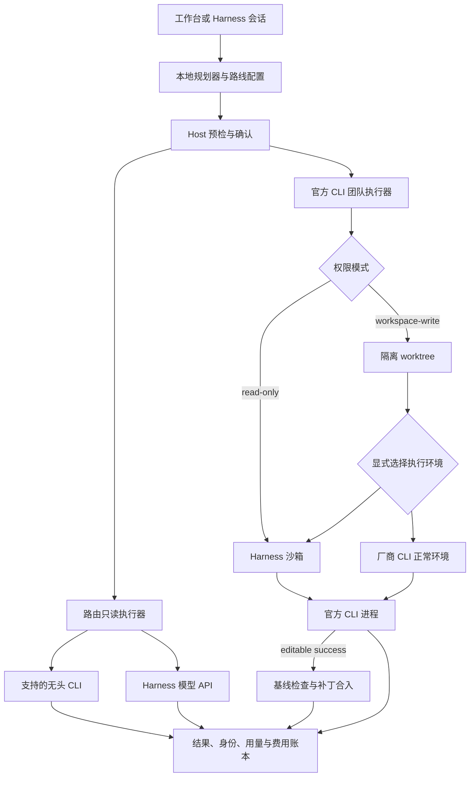

# 模型路由 · DeepSeek Harness Desktop

[English](README.md) · [简体中文](README.zh.md)

[](https://www.npmjs.com/package/@ljwei-stak/dsh-model-router) [](https://dshfind.com/zh/plugins/alice-marx/dsh-model-router?ref=badge) [](https://dsh-plugin.org/plugins/alice-marx/dsh-model-router) [](https://awesome-dsh-plugin.com)

[](https://dshfind.com/zh/plugins/Alice-Marx/dsh-model-router?ref=badge)

想跟进版本更新？点右上角 **Watch → Custom → 勾选 Releases**（不必 Watching 全部活动）。

面向 **DeepSeek Harness Desktop** 的成本感知模型路由工作台。在本地规划任务、比较已配置路线、检查执行权限，并通过模型 API 或支持的厂商官方 CLI 执行有依赖关系的工作包。

当前版本：**0.23.1**（`@ljwei-stak/dsh-model-router`）。重跑预算现在覆盖实际会执行的未完成下游，进度和取消请求挂起后可恢复。工作台支持实时耗时、逐工作包进度和取消，保留已完成结果与已报告费用；关闭重开面板可接管原任务。支持“按算法推荐分配 / 手动调整分配”：拆分后的工作包可逐个指定模型 API 或官方工具，保留依赖、重新预览费用，并保存重跑目标。同时接入任务相关质量证据、模型与推理档位联合选择、历史资源 P90 估计与依赖感知搜索。手动混合执行当前只读；官方工具使用自身默认模型，原有官方团队编辑流程保留。继续兼容 **DeepSeek Harness Desktop 0.2.0-rc.1 / 0.2.0-rc.2 / 0.2.1-rc.2**，沿用 Hermes/Pi 安装与终端支持；两者仍无经过验证的托管执行器。真实厂商执行证据仍见 **0.20.0** 报告，本版未新增模型实测。路由器与 [GAL](https://github.com/Alice-Marx/deepseek-harness-galgame) 自 0.12.0 起已拆分为独立插件。

官方 CLI 协作按依赖顺序逐包执行、传递依赖上下文，不会自动回退到模型目录 API。可编辑团队需明确选择 Harness 沙箱或厂商 CLI 正常环境。后者通过 Git worktree 收集修改，但不限制操作系统访问。未显式设置模型映射时，各 CLI 沿用自身配置的模型。参见[真实 Windows 验证及其局限](docs/releases/0.20.0-validation.md)。

两个 README 版本同步说明接口、公式、默认值与限制。[更新日志](CHANGELOG.md)保留版本历史。更多操作说明：[工作台](docs/WORKBENCH_USER_GUIDE.zh.md)、[安装](docs/INSTALLATION_GUIDE.zh.md)、[迁移](docs/archive/MIGRATION.md)、[实验规程](docs/ROUTING_SELFTEST_STEPS.zh.md)。

<a id="quick-evaluation"></a>

## 提交前快速评估

**一句话价值：** 面向 DSH 的成本感知模型路由工作台，可本地规划任务、选择模型路线，并在明确权限下执行有依赖关系的工作包。

**类别：** **模型与推理（Models & Reasoning）**，是[社区目录分类](https://www.alldsh.com/categories/)中最贴切的一类；这是社区分类，并非 DSH 官方分类。

**安装（DSH Plugin Hub / web profile）：** 确保 DSH CLI 可用，然后安装已发布的 npm 包：

```sh
dsh plugin --profile web add @ljwei-stak/dsh-model-router@0.23.1
```

**安装到 Harness Desktop：** 首次先启动一次 Desktop 初始化 `desktop` 配置，再彻底退出 Desktop，运行：

```sh
dsh plugin --profile desktop add @ljwei-stak/dsh-model-router@0.23.1
```

也可以在 **Harness Desktop → 插件 → 添加插件** 中粘贴包名。安装后重启 Desktop。单独运行全局 `npm install -g` 不会注册 Desktop 插件。

**发布包与入口：** [npm 上的 `@ljwei-stak/dsh-model-router@0.23.1`](https://www.npmjs.com/package/@ljwei-stak/dsh-model-router) 已发布。根目录[`package.json`](package.json)声明包名和 bundle patch；[`.dsh-plugin/index.mjs`](.dsh-plugin/index.mjs)导出所需的 `apply(ctx)` 入口。[许可证：MIT](LICENSE)。

**配置文件与配置入口：** 当前不支持导入用户编写的 JSON/YAML 配置文件。Provider、模型和凭据在 Harness **模型**页面配置；路由档案与偏好在插件设置中配置。路由器持久状态存于 `$DSH_HOME/model-router/state.json`（默认：`~/.dsh/model-router/state.json`）。Provider CLI 沿用各自的登录和配置；路由器不会把 API 密钥复制进模型档案或终端日志。

**截图与证据：** [工作台截图](docs/assets/workbench-task-preview.jpg)使用固定的模型、价格和健康状态数据，是模拟 UI 预览，不是实时 Harness 或模型运行。[路由流程图](docs/assets/routing-workflow.svg)展示执行路径。[真实 Windows 验证报告](docs/releases/0.20.0-validation.md)记录了 0.20.0 的具体执行及局限；0.23.1 尚无经过验证的端到端厂商运行。[实时进度截图](docs/assets/workbench-run-progress.png)是离线模拟；取消、重开恢复与验证边界见[0.23.1 验收报告](docs/releases/0.23.1-validation.md)。

**权限与风险：** 任务规划在本地完成，不调用模型。实际执行会把选定任务和上下文发送到所选模型 API 或厂商 CLI，并可能产生费用。默认使用 Harness 受限环境；只读运行不修改工作区，`workspace-write` 需要用户明确批准。明确选择 `cli-native` 的可编辑团队会在 Harness 进程沙箱之外，以当前操作系统用户权限运行；Git worktree 只收集修改，不限制操作系统访问。外部 Provider 和 CLI 服务各自适用其数据处理及计费规则。

**兼容性：** 声明支持 DeepSeek Harness Desktop **0.2.0-rc.1**、**0.2.0-rc.2**、**0.2.1-rc.2**。Node.js **>=22.19** 与 pnpm **10.34.6** 仅为源码开发/构建要求，不是插件运行时前置条件；不承诺超出上述 Host 版本的兼容性。

**目录：** [快速评估](#quick-evaluation) · [功能](#capabilities) · [安装](#install) · [工作台](#workbench) · [架构](#architecture) · [会话工具](#session-tools) · [官方工具](#official-tools) · [团队生命周期](#team-lifecycle) · [费用](#costs) · [路由算法](#routing) · [数据](#data) · [开发](#development) · [排障](#troubleshooting)

<a id="capabilities"></a>

## 当前功能

| 能力 | 当前行为 |
| --- | --- |
| 任务规划 | 本地任务分类与复杂度分析；支持单路线推荐、有依赖关系的团队工作包或显式指定已配置模型。 |
| 模型配置 | 从 Harness 读取精确的 `provider/model` 路线；可补充质量、美元价格、擅长领域、CLI 模型名、执行与计费偏好。 |
| 路由预设 | 省钱优先、均衡和效果优先；结合质量下限、估计 token 费用和有界分配搜索。缺失价格保持未知。 |
| 只读执行 | 在工作台预览并确认路由执行，或在 Harness 官方会话中调用。支持的无头 CLI 与模型目录 API 调用均记录结果。 |
| 可编辑 CLI 执行 | 从工作台执行顺序 CLI 团队，或在会话中调用单个受支持 CLI；使用获批的隔离 Git worktree，并有条件地合入补丁。 |
| 官方工具 | 对注册表中的十二种工具检测、安装/更新、检查启动就绪和登录状态；安装任务提供日志和取消功能。 |
| 交互终端 | PowerShell/系统 shell 与十二种注册表 CLI 目标（经过验证的 Windows 桌面安装支持 ZCode TUI）；包含固定登录命令、实时输出和多会话。 |
| 费用与订阅 | 日/月预算检查、降级为省钱预设或暂停、订阅优先路由、额度冷却，以及对其他订阅失败的显式处理。 |
| 历史与质量 | 逐包结果、依赖视图、失败详情、重跑/改派、评分与可选的更强模型复核。 |
| 执行边界 | 显示每条路线可读写的范围，以及进程是否使用 Harness 沙箱。 |

生成路由建议在本地完成：不会启动厂商 CLI，也不会调用付费模型。实际执行可能产生费用。


<a id="install"></a>

## 安装到 DeepSeek Harness Desktop

打开 **插件 → 添加插件**，输入：

```text
@ljwei-stak/dsh-model-router@0.23.1
```

镜像缺少该精确版本时，使用官方 HTTPS npm 源 `https://registry.npmjs.org/`。启用插件，然后完全退出 Harness（包括托盘进程）并重启。插件详情应显示 **0.23.1**，侧栏应出现 **模型路由**。仅执行全局 `npm install -g` 不会把插件注册到 Desktop。

也可以通过插件管理器安装本地 `.tgz` 压缩包，或解压后的内部 `package` 目录。两者都必须包含 `package.json` 和 `.dsh-plugin`。历史构建见 [Releases](https://github.com/Alice-Marx/dsh-model-router/releases)，也可按下文从源码构建。

### 从旧包名升级

旧名称 `@ljwei-stak/model-router-galgame` 停留在 0.13.0。保留配置档/应用数据，移除旧插件条目，再添加 `@ljwei-stak/dsh-model-router@0.23.1`。不要同时保留两条插件：它们共用内部插件 id `model-router-galgame` 和工具名。保留该 id 能让现有路由设置与历史记录继续使用。

从合包 0.11.x 升级前，先备份配置档，并导出需要保留的 GAL 存档。剧情播放、立绘、音乐与存档现属于独立的 `@ljwei-stak/dsh-galgame`。详细存档限制见 [MIGRATION.md](docs/archive/MIGRATION.md)。

<a id="workbench"></a>

## 使用工作台

工作台按流程分为四个导航页签。页头汇总已注册路线、检测到的工具和今日已记录的 API 费用。

| 页签 | 用途 |
| --- | --- |
| **任务与执行** | 描述任务、生成建议、选择路由只读执行或官方 CLI 协作、预览并确认，然后查看历史。 |
| **模型配置** | 刷新/搜索模型目录，编辑精确路线的配置。 |
| **官方工具** | 完成入门检查，查看/安装工具，使用交互终端。 |
| **预算与安全** | 设置路由、费用、复核策略，检查订阅状态与执行边界。 |

切换页签时面板保持挂载，正在进行的安装与终端状态不会因此丢失。


*截图来自本地 UI 预览，使用预置模型、价格与健康数据，未连接真实模型或 Harness。展开工作包可查看目标、依赖和验收项。*

1. 在 Harness 官方的 **模型** 页面配置供应商、模型和凭据，然后到 **模型配置** 刷新目录。路线出现在列表中，不代表凭据、网络或模型权限已可用。
2. 可选：为需要比较的路线填入质量与价格。价格单位是 **美元/百万 token**；质量是用户给出的 **0–100** 估值。未知价格请留空，不要填零。
3. 在 **任务与执行** 中描述具体交付物、约束与验收标准。选择 **单任务**（单个推荐）、**团队分工**（请求足够复杂时生成依赖工作包）或 **指定模型**（只使用一条精确路线，不比较其他路线）。只选择团队模式不会启动任何团队。
4. 设置本次估算预算；`0` 表示移除该规划约束。点击 **生成路由建议**，结果直接显示在规划区下方。检查路线、复杂度、费用、执行通道及各包的依赖/验收清单。
5. 在 **在工作台执行** 中，选择 **模型路由（只读）** 使用现有路由执行器；或先选择 **团队分工**，再选择 **官方工具协作**。官方协作可选择 **只读检查** 或 **编辑文件**。可编辑团队还需选择 **Harness 受限环境**（默认沙箱）或 **厂商 CLI 正常环境**（在 Harness 沙箱外运行）。填入已存在的工作区绝对路径，或沿用上次运行路径。点击 **预览执行计划**，查看各包、权限与所需确认，然后显式确认执行。Host 启动前会重新检查计划；条件变化可能要求重新确认。
6. 在 **执行记录与子任务** 查看实际通道、回答、失败、费用与评分。官方协作仅使用已安装、且在所选权限模式下就绪的 CLI 重新规划。编辑需要批准和干净的 Git 仓库；成功的 worktree 修改有条件地合入。该模式下，不可用或失败的 CLI 不会静默变成 API 调用。

执行开始后，工作台显示已耗时、当前工作包与每包状态。**取消执行**会请求停止当前调用，并阻止后续工作包启动；执行器完成收尾前持续显示**正在取消**。已完成结果和已报告用量仍保留在历史中。取消不能撤销已经产生的费用或已经整合的改动。关闭面板不会取消执行；同一浏览器会话重新打开后，可在 Host 仍保留该任务时重新连接。Host 重启会清除内存任务，已保存的历史记录仍可查看。

预览、进度和取消请求最长等待 15 秒。进度读取超时后继续查询同一任务；取消未确认时可手动重试。网络等待超时不代表 Host 任务已停止，也不会自动重发 `startRun`。重跑历史步骤前，预算覆盖该步及实际会执行的全部未完成下游；改派使用所选路线估价，未知价格仍保持未知。[超时恢复截图](docs/assets/workbench-run-timeout.png)为离线模拟。

修改任务文本、规划模式、路线配置、目录或相关设置，会使旧建议失效。修改执行输入也会丢弃待确认或已完成的预览，必须对当前请求重新预览。执行预览使用 Host 当前状态，因此可能与先前本地计划不同。

任务示例：

```text
审查本项目并准备实施计划。
1. 梳理入口，识别主要 UI 流程。
2. 在宽、窄视口检查界面，列出布局问题。
3. 检查执行与计费边界。
4. 汇总为按优先级排列的改进清单，并给出验证步骤。
```

路由器规划并委派文本/代码任务。它本身不渲染视频、不生成美术，也不操控创作软件。

<a id="architecture"></a>

## 架构与执行契约

Host 负责路线发现、设置、审批、工作区验证、进程启动和持久化账本。React 客户端请求预览并展示 Host 结果。规划、托管执行与安装 RPC 请求使用固定字段，不能指定任意可执行路径、安装包或下载地址。交互终端是独立确认的通道，允许向已启动的 shell/CLI 输入任意用户文本。



| 路径 | 选择与权限 | 失败/回退行为 |
| --- | --- | --- |
| 模型路由执行 | `model_router_execute` / 工作台 `executor: "routed"`；只读；按执行/计费策略使用 CLI 或 Harness 模型 API。 | 符合条件的 API 回退遵循已配置的订阅策略。 |
| 官方 CLI，Harness 环境 | 单工具 `model_router_tool_run` 或团队执行；仅支持当前已适配且就绪的 CLI 模式；必须使用 Host 沙箱。 | 缺少约束能力或未就绪时阻止启动。不自动回退 API。 |
| 官方 CLI，正常环境 | 仅限可编辑官方团队：`official-team + workspace-write + cli-native`；单独要求用户确认。 | 以当前用户权限运行，`sandboxEnforcement: "none"`。不会自动切换环境，也不自动回退 API。 |

**检测到不等于执行验收通过。** 安装版本、可信启动入口、登录状态、支持的权限模式、网络连通性和模型权限是不同检查。交互终端中可用的 CLI，在受限任务中仍可能不可用：适配器、平台、沙箱与所选安装必须全部匹配。

### 工作台 RPC

经过认证的 Host remote 是 `ctx.remote.modelRouterOfficialTools`，定义于 [official-tools-remote.mjs](.dsh-plugin/shared/official-tools-remote.mjs)。它是挂载客户端使用的内部接口，并非独立的公共 HTTP API。预览请求结构如下：

```json
{
  "task": "Analyze this repository's logging, implement a small improvement, and verify it.",
  "executor": "official-team",
  "planMode": "team",
  "executionMode": "workspace-write",
  "executionEnvironment": "cli-native",
  "workspace": "C:/work/example-repository",
  "budgetUsd": 1,
  "preset": "balanced"
}
```

将工作区替换为已存在且干净的 Git 根目录。调用 `previewRun(request)`，用客户端 `unwrapRemote` 辅助函数解码响应，展示计划和 `reasons`；被阻止时停止。预览不调用模型，也不创建 worktree；入口、版本和完整性检查可能联网。只有用户接受所有当前原因后，客户端才可调用 `startRun({ ...request, confirmedReasons: preview.reasons.map(r => r.code) })`。

正常环境编辑通常要求 `workspace-write` 和 `unsandboxed` 确认；超预算还会增加 `over-budget`。不要硬编码该列表，也不要未经同意自动填入。`startRun` 会重新规划和预检，不会消费一个冻结的预览令牌。出现新的确认要求时，返回 `needs-confirmation`，并给出 `missing` 与更新后的原因。修改任务、模式、工作区或路线配置后必须重新预览。工作台请求使用已保存路线的 `cliModel` 映射；临时 `cliModelsJson` 绑定属于下文的会话工具。

`startRun` 接受执行后，在任务完成前返回含 `jobId`、`status` 和 `progress` 的任务快照。通过 `runStatus({ jobId })` 读取状态，通过 `cancelRun({ jobId })` 请求取消。任务状态为 `running`、`cancelling`、`completed`、`cancelled` 或 `failed`。终态快照的 `result` 包含最终工作台响应，以及成功保存后的账本 `runId`。`completed` 表示后台执行已结束，任务实际结果仍查看 `result.status`。进度仅包含工作包身份与状态，不包含回答正文。读取状态失败不代表执行已停止，客户端不得因此自动重发 `startRun`。

<a id="session-tools"></a>

## 会话工具

请在 Harness 官方会话中调用这些工具。访问本地文件的任务应先配置会话工作区。

| 工具 | 用途 |
| --- | --- |
| `model_router_routes` | 列出已配置路线；不验证账号/网络可用性。 |
| `model_router_plan` | 生成本地 `single` 或 `team` 计划。 |
| `model_router_consult` | 通过模型 API 向一个已配置模型请求真实的第二意见。 |
| `model_router_execute` | 执行只读路由计划，或显式指定的 `provider`/`model`，并记录结果。 |
| `model_router_tools` / `model_router_health` | 检查安装/就绪，或版本/登录/计费健康状态。 |
| `model_router_tool_install` | 从官方来源安装一个固定注册表工具。 |
| `model_router_tool_run` | 以 `read-only` 或获批的 `workspace-write` 模式运行一个支持的 CLI。 |
| `model_router_team_execute` | 在当前可执行 CLI 路线中重新规划，再顺序执行工作包。 |
| `model_router_rerun_step` | 重跑失败步骤及未完成的后续依赖、恢复符合条件的可编辑团队，或重复失败的单工具执行。 |
| `model_router_rate` | 对一条已存结果记录 `up`、`down` 或 `clear`。 |

会话命令：`/router <task>`、`/tools` 和 `/tools install|cancel <tool-id>`。

本地规划请求：

```json
{"task":"Review the architecture and prepare a verification checklist","mode":"team","budgetUsd":10}
```

只读单工具请求：

```json
{"tool":"codex","task":"Inspect the repository and list UI layout issues; do not edit files","mode":"read-only"}
```

向 `model_router_team_execute` 提交可编辑正常环境团队请求：

```json
{
  "task": "1. Analyze the logging module and propose a small improvement. 2. Implement it and report verification results.",
  "mode": "workspace-write",
  "executionEnvironment": "cli-native",
  "budgetUsd": 1
}
```

工作区由会话提供；请先将它配置为获准编辑、且干净的 Git 根目录。工具的审批钩子会请求所需确认。会话工具参数使用 `mode`，不是工作台的 `executionMode`，也不接受 `workspace`、`executor` 或 `planMode`。临时模型绑定使用 `cliModelsJson`，它是 JSON 编码的**字符串**，例如 `"{\"claude-code\":\"<verified-cli-model-name>\"}"`；将占位符替换为该安装支持的模型名。此映射不会强迫规划器选择该工具。

选择精确目录路线时，必须同时提供 `provider` 和 `model`。所有 CLI 默认沿用自身配置的模型；目录推荐绝不会自动作为 CLI 模型参数传入。如需显式切换，在路线配置中保存已验证的 **官方 CLI 模型名**，为单工具调用传入 `cliModel`，或为团队使用 `cliModelsJson`。团队绑定优先采用工作包 id，其次工具 id，最后才是已保存的路线映射。ZCode 使用自身默认模型，不支持逐次调用切换。历史分别记录推荐模型、请求的 CLI 名称和报告的实际模型；请求本身不能证明实际使用了该模型。未报告实际模型时，应查看厂商记录。

CLI 团队运行器是插件自身的顺序依赖执行器，不控制 Harness 内置 Agent Teams 的模型选择或生命周期。

<a id="official-tools"></a>

## 官方工具与执行模式

| 注册表 id | 工具 | 托管单工具/团队模式 |
| --- | --- | --- |
| `kimi-code` | Kimi Code | 获批的 `workspace-write` |
| `claude-code` | Claude Code | Windows：`read-only`、获批的 `workspace-write` |
| `codex` | Codex CLI | Windows：Harness 环境 `read-only`；显式选择正常环境的可编辑团队支持 `workspace-write` |
| `minimax-code` | MiniMax Code | 获批的 `workspace-write` |
| `mimo-code` | MiMo Code | Windows：`read-only`、获批的 `workspace-write` |
| `grok-build` | Grok Build | Windows：`read-only`、获批的 `workspace-write` |
| `gemini` | Gemini CLI | 路由无头适配器；不属于托管单工具/团队运行器 |
| `opencode` | OpenCode | 安装、探测和登录检查；尚无经过验证的受限执行入口 |
| `stepcode` | Step Code | 安装、探测和登录检查；尚无经过验证的受限执行入口 |
| `hermes` | Hermes Agent | Windows/POSIX 官方安装脚本、版本检测、交互终端；使用 `hermes auth` 登录；尚无经过验证的托管执行器 |
| `pi` | Pi | 官方 npm/pnpm 安装、版本检测、交互终端；启动后输入 `/login`；尚无经过验证的托管执行器 |
| `zcode` | ZCode | Windows；获批的 `workspace-write` |

Hermes 使用[官方源码安装器](https://hermes-agent.nousresearch.com/docs/getting-started/installation)的非交互模式，安装后运行 `hermes auth`。设置统一根目录后，源码安装到 `<根目录>/hermes-agent`，插件绑定该源码的 `.hermes/bin` 入口，不会改用其他旧的全局副本。配置、登录和历史仍保留在原 Hermes 数据目录；未设置统一根时沿用厂商默认位置。官方安装器可能将全局便利命令更新为指向所选源码。源码安装请通过 `hermes uninstall` 卸载。Pi 使用 [`@earendil-works/pi-coding-agent`](https://github.com/earendil-works/pi/tree/main/packages/coding-agent)，npm/pnpm 安装带 `--ignore-scripts`，要求 Node.js 22.19 及以上。启动 `pi` 后输入 `/login`。这两种工具的登录状态显示为未知，以各自界面为准；插件不会读取它们的凭据。

安装器使用各厂商 `@latest` 对应的固定官方 npm 包、厂商自有安装脚本，或带官方发行者签名的 Windows ZCode 安装器。已安装版本高于查询到的最新版本时不降级。最新版本查询约缓存 12 小时；查询不可用时版本保持未知。厂商新版本不会自动获得本项目的验证。ZCode 安装窗口仍需用户选择目录并完成安装。

**统一安装设置。** **官方工具** 页顶部（插件设置表单中也有）可一次设置所有工具的安装地址：统一安装目录（留空表示各厂商默认位置）、npm 源，以及各工具的厂商安装脚本镜像覆盖项。目录必须是绝对路径，源必须是 HTTPS。每一行分别选择 `npm`、`pnpm` 或厂商脚本（`curl | bash` 或 `irm | iex`）；当前平台无法运行的方法会在该行说明，不会静默换成其他方法。执行前会在按钮上方显示精确命令。

**脚本安装不会把远程内容直接管道传入解释器。** 插件先下载脚本，检查所需厂商标记，拒绝 HTML 页面与冲突内容，再运行本地副本。这些检查是启发式检查，不能单独证明脚本来自官方；镜像应转存厂商脚本，不应替换程序。Step Code 脚本接受安装目录；OpenCode 脚本将路径固定为 `~/.opencode/bin`，因此自定义目录只在通过包管理器的全局目录配置安装它时生效。可以完全禁用脚本安装，仅保留包管理器。


**更新目标。** 修改统一目录或来源后，点击 **保存安装设置**。工具操作会等待保存和命令刷新完成。npm 使用 `--prefix`；pnpm 使用自己的 `global-dir`、`global-bin-dir` 与 store 设置。即使其他设置页在任务排队期间修改了配置，安装任务仍保留当时选择的配置。更新会检查所选命令目录，PATH 上其他位置的现有副本不会让缺失的目标被误判为已安装。固定路径的厂商脚本会说明真实目标；ZCode 仍需在带签名的安装窗口中选择目录。

[工作台指南](./docs/WORKBENCH_USER_GUIDE.zh.md#厂商安装渠道)列出各厂商的实际渠道与原生安装执行限制。

未设置统一目录时，普通检查会在 PATH 上查找所选包管理器的包。安装、更新、修复或移除任务，会先解析并锁定该管理器的默认全局目标，再比较版本。如果无法安全解析，请先填写并保存统一目录。

**一键修复与卸载。** 修复会重新执行同一条固定官方命令；即使版本已是最新，损坏的安装仍需要这种重新安装。卸载只移除程序：包管理器安装通过同一管理器卸载；脚本安装移除其登记的命令入口和受支持的 PATH 记录，厂商版本目录可能保留。Windows Codex 原生目录联接没有通用的删除式卸载；工具行会说明这一限制。**配置、凭据和会话历史始终保留。**

安装、可信启动就绪、账号登录和模型权限是分别检查的。登录状态未知不代表已退出。信任检查取决于工具及安装来源：

| 入口 | 已实现的验证 |
| --- | --- |
| Windows Claude / Codex | 可执行文件上的有效厂商 Authenticode 签名；Codex 还检查包装器/平台包布局。Claude 要求 2.1.259 或更高版本。 |
| MiMo / Grok | 将原生可执行文件与精确的官方 npm 平台归档比对；Grok 还验证压缩成员及其解压后的可执行文件。 |
| Windows MiniMax 厂商脚本布局 | 将已安装包代码与精确 npm 版本比对，检查版本指针/布局，以及必需原生模块是否存在。 |
| Kimi / 普通 MiniMax npm 或 pnpm，`cli-native` | 对包代码、manifest 和真实入口额外进行注册表检查。Harness 环境中的这些普通副本不走这一额外路径。 |
| Windows ZCode | 带签名桌面可执行文件、同根目录 bundle 元数据，以及按签名构建保存的首次所见脚本 SHA-256。桌面签名**不**覆盖 JavaScript；首次所见脚本信任是单独的假设。 |

这里的“npm attestation”指与精确注册表发布的一致性：使用注册表 `dist.integrity` 的 SHA-512 验证 tarball，再比较所选成员的 SHA-256/大小，也可使用已验证缓存。它不是 npm provenance/Sigstore 验证、独立发行者签名，也不能证明每个依赖或本地文件。Gemini 的路由适配器以及 OpenCode/Step 终端不继承这些托管入口的保证。参见[注册表](.dsh-plugin/shared/official-tool-registry.mjs)、[执行器](.dsh-plugin/shared/official-tool-executor.mjs)、[npm 检查](.dsh-plugin/shared/npm-attestation.mjs)与 [ZCode 信任](.dsh-plugin/shared/zcode-bundle.mjs)。

版本和 CLI 登录状态检查使用所选安装的具体入口。不能用 PATH 上的另一条命令替代缺失的所选副本；无法检查该入口时，其登录状态保持未知。

会话中的 `/tools install|uninstall|repair|method <tool-id> [method]` 执行同样操作；agent 也可调用 `model_router_tool_install`、`model_router_tool_repair` 和 `model_router_tool_uninstall`。安装目录与下载来源始终来自用户自己的插件设置，不经 RPC 传入，因此调用不能把安装重定向到任意包或 URL。

`model_router_execute` 为 Claude、Codex 和 Gemini 提供固定无头适配器。除非适用受支持的订阅路线，其他供应商使用模型目录 API。CLI 缺失或不可用时可回退到该 API；订阅失败遵循下文策略。

可编辑执行需要干净的 Git 根目录与 Host 批准。默认 Harness 环境还要求进程约束；显式确认的 `cli-native` 团队在该沙箱之外运行。两者都保留下文的 worktree 与条件补丁合入检查。只读 CLI 标志不一定把读取限制在工作区内；请检查 **安全边界**，尤其是 Codex 较广的可读范围。

Harness 环境下，Claude 只读使用受限模式，仅允许 Read/Glob/Grep，无 shell、斜杠命令或现有 MCP 配置。可编辑 Claude 保留正常工具/配置。执行器转发基础环境、代理和厂商配置/凭据变量白名单，而非所有 Host 变量；仅订阅启动会移除 API 凭据。正常环境执行保留厂商原有状态/配置，CLI 支持并加载时可以使用其 skills/MCP。这不代表所有已配置 skill 或 MCP 服务都已验证可用。

Windows Codex 在 Harness 环境中仅支持只读：外层 ACL 沙箱授予原始 `CODEX_HOME` 状态目录和私有临时目录的相应权限，同时 Codex 保持 `--sandbox read-only`。显式确认的正常环境可编辑团队可使用 Codex 自身的 workspace-write 策略。Codex 网络就绪仍取决于账号/环境，本批真实连接检查未通过。

### 交互终端

在 **官方工具 → 官方工具终端** 中，选择 shell 或已安装 CLI，按可用选项选择交互/登录模式，输入已存在的绝对目录，并查看启动确认。经过验证的 Windows ZCode 桌面安装提供内置 TUI 作为终端目标。

这些会话在 **Harness 沙箱外**运行，使用 Host 用户的登录环境、代理与 API-key 变量。输入的命令能以该用户权限读写文件。终端启动与路由执行及其审批/计费策略相互独立。

可选依赖 `@lydell/node-pty` 提供真实伪终端。加载失败时，卡片会显示管道模式：全屏界面、调整大小和方向键可能无法使用。最多同时运行四个会话；未读取的会话约两分钟后过期，单会话最长六小时。完成后请显式结束；关闭工作台或卸载插件也会结束会话。

插件不持久化终端输入/输出，仅保存会话元数据。选中文本时 Ctrl+C 为复制，否则为中断。Ctrl+Shift+V 为粘贴。

<a id="team-lifecycle"></a>

## 团队生命周期、模型身份与恢复

团队运行时按拓扑顺序**串行**执行依赖图，不并发执行。各包接收总任务、自身目标/验收项，以及直接依赖的输出（每个依赖最多 2,500 字符）。第一个非成功包会停止全部剩余工作，包括独立工作包。这是插件的执行器，与 Harness 内置 Agent Teams 独立。

### 模型身份

三个字段含义不同：推荐的目录 `provider/model`、请求的 `requestedCliModel` 和 CLI 报告的 `actualModel`。目录推荐不会自动成为 CLI 参数。显式选择遵循 **工作包绑定 > 工具绑定 > 已保存 route.cliModel > 厂商 CLI 默认值**。ZCode 不支持逐次调用切换模型；MiniMax/MiMo 映射必须使用其支持的 `provider/model` 格式。

如果显式绑定与 CLI 报告的实际模型冲突，该包变为 `model-mismatch`，后续工作停止。没有无歧义的实际模型报告时，身份保持未知；进程成功并不能证明运行了请求的模型。改派失败包时，会使用新路线保存的映射，不保留旧工具的映射。

### 可编辑 worktree 与合入

1. 规范化源路径、检查会话授权，要求源路径是干净的 Git 根目录且已有 HEAD 提交。记录该基线。
2. 创建 detached 的隔离 worktree。Windows 使用 Host 派生存储位置 `os.tmpdir()/.model-router-workspaces/<source-path-hash>/run-<uuid>`；拒绝源/worktree 重叠和重定向的存储位置。这样可避开无法初始化 Harness 边界 ACL 的源盘。其他平台保留其受支持的作用域内 worktree 策略。
3. 在该 worktree 中执行各包。取消会停止进程树；失败会保留 worktree 和先前包结果。
4. 全部包成功后暂存修改，并针对**原始源基线**计算二进制 diff，包括 CLI 在 worktree 内提交的修改。Git 忽略的输出不包含在内。
5. 重新检查源仍干净且 HEAD 未变。运行 `git apply --check`，然后把补丁应用到源目录，不自动提交。冲突、源变化或需要手工处理的输出会保留 `integration-pending` 结果/worktree。

worktree 用于分离和收集修改；只有所选 Harness 环境提供操作系统边界。正常环境中的工具/MCP 可影响边界以外的文件或服务。内部执行限制：任务 64,000 字节、捕获输出 32,000,000 字节、输出尾部 32,000 字符、默认超时 45 分钟、最大超时两小时。Kimi/ZCode 还对最终提示词设有 16,000 UTF-8 字节的入口限制。这些是进程限制，不是计费上限。

### 失败与重试

历史保存包状态、退出码、经过脱敏且有长度限制的诊断、入口/模型证据，以及可用的用量/费用。后续适配器异常不会丢弃先前结果。`cli-completed` 表示运行时完成了进程/补丁流程；交付物仍需通过验收。`blocked`、`cancelled`、`incomplete` 和 `integration-pending` 分别区分预检阻止、中断、包失败与合入问题。

重试针对失败包和未完成的后续依赖，保留其他成功结果。符合条件的可编辑 `incomplete/cancelled` 运行要求记录的源目录、保留的 worktree 与基线：Host 验证后创建新 worktree，播种先前尚未合入的修改，再继续执行。已经合入或 `integration-pending` 的团队不能使用这一步骤恢复路径。正常环境重试仍需写入和沙箱外执行的同意（工作台重跑请求中的 `confirmWrite` 与 `confirmUnsandboxed`）；关闭旧设置 `confirmUnsandboxedCli` 也不能绕过。先前尝试的费用保留在支出总额中。

实现：[official-team-runtime.mjs](.dsh-plugin/shared/official-team-runtime.mjs)、[official-tool-executor.mjs](.dsh-plugin/shared/official-tool-executor.mjs) 与 [run-ledger.mjs](.dsh-plugin/shared/run-ledger.mjs)。

<a id="costs"></a>

## 成本、订阅与质量

- **预算：** 单次规划目标加日/月检查。超预算路由可以尝试省钱预设，或暂停等待确认。未知价格保持未知。这些是本地核算/估计控制，不是厂商的硬性计费上限。
- **订阅优先：** 默认优先检测到的 CLI 账号订阅或已配置 coding-plan 路线。CLI 订阅尝试会移除 API-key 环境变量。`billing` 可为 `subscription-first`、`api-only` 或 `subscription-only`；`subscription` 可为 `cli-login`、`plan-key` 或 `none`。
- **回退：** 检测到额度耗尽/限流时，将订阅标记为冷却，并可按策略与可用性在已配置 API 路线上重试该路由步骤。其他已尝试的订阅失败默认暂停（`onSubscriptionFailure: "ask"`）：可在历史中选择 API 重试、订阅重试或取消。托管可编辑/单工具/团队运行不会自动在 API 上重试。
- **核算：** API 费用计入预算。订阅运行单独显示参考费用。有效的 CLI 报告金额（包括零）优先采用。按 token 计算 CLI 费用，需要完整用量，以及报告的实际模型匹配某个已配置模型或其显式 CLI 映射；身份未知或不匹配时费用保持未知。仅有推荐路线价格不能确定实际 CLI 费用。厂商账单为准。0.15.0 起保留已淘汰详细运行和被重试替换结果的支出，因此裁剪历史或重试步骤不会抹掉先前费用。更早版本已丢弃的费用无法重建。
- **质量与偏好：** 可选 `off`/`sample`/`always` 更强模型复核可能增加付费调用，且不作为人工反馈。显式评分以时间衰减和小样本收缩，调整精确路线、任务类型对应的独立主观效用（默认上限 ±0.04，可配置至 ±0.1）。评分不改变客观质量分或其硬下限；可禁用学习、撤回评分或重置学习起点。

Coding-plan 密钥与端点保留在 Harness 供应商设置中。`plan-key` 配置可将已配置的精确 `apiRoute` 指定为回退；路线编辑器不接受凭据或任意命令。厂商套餐资格与条款需向厂商核实。

### 实际费用与规划估计

有效的 CLI 报告美元金额（包括明确的零）优先于 token × 单价计算。否则，按 token 核算 CLI 费用要求完整、归一化的用量，已知非负价格，以及报告的实际模型匹配计价路线或其显式 CLI 映射：

<!-- formula:actual-cost -->
```math
C_a = \frac{I_u p_i+O p_o+R p_r+W p_w}{10^6}
```

$`C_a`$ 对应 `actualUsd`；$`I_u`$、$`O`$、$`R`$、$`W`$ 分别对应 `inputTokens`、`outputTokens`、`cacheReadTokens`、`cacheWriteTokens`，$`p_i`$、$`p_o`$、$`p_r`$、$`p_w`$ 分别为输入、输出、缓存读取和缓存写入单价，单位为美元/百万 token。

经适配器归一化后，这些账本计数互不重叠；不要把缓存 token 再加到已包含缓存的输入计数中。缺少可选缓存单价时，使用输入单价。用量不完整、价格缺失或身份未知/不匹配时，金额保持 `null`，不是零。完整的终态证据可在失败、取消、超时后保留；部分事件标记为 `usageIncomplete`。

例如，完整 API 结果含 1,000 个未缓存输入 token（\$1/百万）和 500 个输出 token（\$5/百万），费用为 \$0.0035。订阅结果可把该金额显示为 `referenceCostUsd`，而 `costUsd` 保持 null；参考费用不加进 API 支出。厂商报告的 \$0 是该次尝试的明确证据，不能证明先前费用未知的尝试免费。实际厂商账单为准。官方团队模式不自动回退 API，防止的是路由器自身的回退；厂商 CLI 仍可能使用它自己配置的 API 凭据。

<a id="routing"></a>

## 路由算法

手动分配：生成任务建议后，可选择按算法推荐执行，或逐包指定模型 API / 官方工具。参见[手动分配使用说明](docs/MANUAL_TASK_ASSIGNMENT.zh.md)。

规划器是确定性的本地启发式算法，不是训练得到的成功率预测器。它对文本分类、估计复杂度、创建适当的分析/执行/验证/汇总工作包，发现精确的已配置路线，叠加路线配置，并应用能力/质量约束。显式指定路线会跳过与其他路线的比较。目录质量/延迟/风险提示是实验性先验，不是实测成功概率或厂商实时报价。执行当前以文本为主；vision 标签不能证明已有端到端多模态流水线。

### Token 与价格估计

没有匹配资源证据时，基础输入 token 为 $`\max(80,\lceil n/3.7\rceil)`$，再乘以工作包阶段系数。基础输出为 900，按阶段/推理强度调整，最少 220。其中 $`n`$ 对应 JavaScript 的 `text.length`。这是按文本长度估算，不是厂商 tokenizer。匹配的完整历史记录达到样本门槛后，改用经验 P90 资源估计，不再重复乘档位和阶段系数。令 $`I`$ 为估计输入总数，$`R`$/$`W`$ 为缓存读取/写入部分，$`O`$ 为输出，价格单位为美元/百万 token：

<!-- formula:planning-cost -->
```math
C = \frac{(I-R-W)p_i+O p_o+R p_r+W p_w}{10^6}
```

<!-- formula:cost-utility -->
```math
U_c = \frac{1}{1+C/\max(C_{\mathrm{ref}},10^{-12})}
```

$`U_c`$ 对应 `costUtility`，单价符号与上文一致。$`C_{\mathrm{ref}}`$ 使用固定参考价（输入 1、输出 5、缓存读取/写入 1 美元/百万），不是厂商报价。固定尺度防止一个无关的昂贵候选把所有费用惩罚压平。未知价格的公开估计为 `null`，费用效用为 0。内部无预算约束搜索使用费用哨兵值 0，但有限预算分配会排除价格未知候选；哨兵值绝不代表执行免费。

### 候选目标与质量下限

使用归一化质量 $`q`$，以及归一化延迟、领域匹配、推理匹配和风险代理值：

<!-- formula:latency-utility -->
```math
L = \begin{cases}
\dfrac{1}{1+t/10\,000}, & t\text{ known}, \\
1-\min(1,\max(0,\ell e_\ell)), & \text{otherwise}.
\end{cases}
```

<!-- formula:candidate-utility -->
```math
u = w_q q+w_c U_c+w_\ell L+w_s s+w_r r-w_k k-\alpha\max(0,f-q)+\Delta_p
```

<!-- formula:assignment-score -->
```math
S = \sum_{j=1}^{n}u_j - 0.015\sum_{(i,j)\in E}\mathbf{1}[\rho_i\ne\rho_j]
```

$`L`$ 为延迟效用：$`t`$ 是匹配历史的 P90 耗时，单位为毫秒；未知时使用延迟代理值 $`\ell`$ 及档位系数 $`e_\ell`$。效用式中，$`s`$/$`r`$/$`k`$ 分别是领域匹配、推理匹配和风险，$`f`$ 为质量下限，$`\alpha`$ 为关键性，$`\Delta_p`$ 为有界的 `preferenceAdjustment`；各 $`w`$ 为对应权重。$`S`$ 对应 `assignmentScore`，$`E`$ 为依赖边集合，$`\rho_j`$ 为工作包 $`j`$ 的 `provider/model` 路线；指示函数在路线不同时取 1，否则取 0。

质量优先使用足量且匹配的任务客观证据，再回退对应任务类别的 LiveBench 分数、整体 LiveBench、路线配置/目录估值。至少两个 API 档位各有可用任务证据时，才联合比较模型与档位；经验耗时可替换延迟代理项。公共数据刷新默认关闭，需主动启用。人工评分仅影响有界的 `preferenceAdjustment`，不能提高客观质量或满足质量下限。

| 工作包基础类型 | 质量 | 费用 | 延迟 | 领域 | 推理 | 风险 |
| --- | --- | --- | --- | --- | --- | --- |
| 简单 | 0.28 | 0.45 | 0.14 | 0.04 | 0.07 | 0.02 |
| 均衡 | 0.40 | 0.26 | 0.10 | 0.09 | 0.10 | 0.05 |
| 复杂 | 0.48 | 0.14 | 0.06 | 0.14 | 0.11 | 0.07 |
| 汇总 | 0.58 | 0.08 | 0.04 | 0.08 | 0.16 | 0.06 |

简单/均衡/复杂任务的基础质量下限分别为 **0.75 / 0.78 / 0.82**；关键复杂包会提高下限，复杂任务的汇总包至少为 0.84。省钱预设把质量/费用/延迟权重分别乘以 0.75/1.6/1.1，并把下限降低 0.04。效果优先把质量/费用/领域/推理权重分别乘以 1.35/0.5/1.2/1.2，并把下限提高 0.04。倾斜后的权重重新归一化到原总量；调整后的下限限制在 [0.5, 0.97]。均衡不作倾斜。

### 候选裁剪与分配搜索

1. 优先保留达到各工作包质量下限的候选。若没有合格候选，保留质量最高的至多三个回退候选，并报告约束放宽。
2. 每包最多保留 **12 个候选**，包含最低已知费用、最大效用与最高质量的锚点。存在依赖时禁用局部 Pareto 裁剪，因为路线身份会影响交接。
3. 验证工作包 ID 唯一且依赖按拓扑排序。保留候选的笛卡尔空间大小不超过 **4,096** 时精确搜索；否则采用 **beam width 256**。搜索按未来依赖的模型边界压缩被支配前缀，并用未来交接的乐观估计排序。剩余最小费用用于裁剪不可行前缀；有限预算时，beam 会保护最便宜的可行前缀。
4. 按字典序比较分配：更少放宽包、更小质量缺口、更高效用、更低费用、更少路线切换，最后稳定的路线顺序。最小费用模式先比较费用，再比较效用。每条跨越 `provider/model` 路线的依赖边从效用中扣除 0.015。
5. 报告搜索元数据与可行性。正预算下若不存在可行分配，仍可返回最小费用备选，但标记 `budgetFeasible: false`。显示了计划不代表预算已满足。

“精确”仅适用于保留下来的候选空间与代理目标。候选上限和 beam 裁剪意味着不能声称在所有已配置模型上全局最优。单元/合成测试验证机制，不证明真实回答质量提升。研究审查使用的公开 2026-06-25 LiveBench 分数/费用表属于汇总数据；未取得逐题配对的质量/费用矩阵，因此不主张真实路由收益。参见[研究](docs/ROUTING_RESEARCH.zh.md)、[推导/实验](docs/ROUTING_DERIVATION_EXPERIMENTS.zh.md)与[验证规程](docs/ROUTING_LIVEBENCH_VALIDATION.zh.md)。

证据导入、回退条件、推理档位与可选 JSON 验收升级的设置参见[算法优化使用说明](docs/ROUTING_ALGORITHM_OPTIMIZATION.zh.md)。验收升级默认关闭，启用后仍需通过计费与预算检查，最多增加一次普通 API 调用。

实现：[router.mjs](.dsh-plugin/shared/router.mjs)、[assignment-solver.mjs](.dsh-plugin/shared/assignment-solver.mjs)、[routing-evidence.mjs](.dsh-plugin/shared/routing-evidence.mjs)、[harness-plan.mjs](.dsh-plugin/shared/harness-plan.mjs) 与 [quality-gates.mjs](.dsh-plugin/shared/quality-gates.mjs)。

<a id="data"></a>

## 数据与隐私

路由配置/偏好保存在 Harness 插件设置中。运行时状态写入 `<DSH_HOME>/model-router/state.json`（默认 `~/.dsh/model-router/state.json`）：健康/入门状态、订阅冷却、评分、最多 200 条近期运行、50 条终端元数据，以及主动启用的公共数据快照。运行记录会冻结采用的单价、数据/反馈策略版本。偏好属于共享的本地 DSH_HOME，不是经过认证的独立用户账号；公共数据请求不会上传任务或反馈。

0.15.0 起还保留有界支出汇总，最多覆盖 90 个有数据的日历日期与 24 个月。只包含金额/计数，不含任务或回答内容。

运行历史包含任务文本、输出节选、路线/工作区、失败与费用。保存的任务最多 20,000 字符，每条回答最多 4,000 字符，因此重跑可能依赖被截断的已存上下文。插件不把 API key 存进模型配置，也不保存终端转录。任务执行仍会把所选任务/上下文发送给相应供应商或 CLI。

状态写入使用锁和原子替换。无法解析的状态保留为 `state.json.corrupt-<timestamp>` 备份，并显示提示。迁移前请备份状态/配置档数据；不要分享未经脱敏的历史或日志。

<a id="development"></a>

## 从克隆源码开发

Git 克隆包含完整源码；npm 包是运行时发行包，不含客户端源码、脚本、测试和实验项目。

要求：**Node.js 22.19+** 和 **pnpm 10.34.6**（`packageManager` 已固定）。在 PowerShell 中，从克隆目录的上级目录执行：

```powershell
cd .\dsh-model-router
pnpm install --frozen-lockfile --strict-peer-dependencies
npm run build:client
npm test
npm run check:client
npm run pack:local
```

若已在仓库中，省略第一个 `cd`。压缩包生成于 `dist`；通过 Desktop 插件管理器，在测试配置档中安装该 `.tgz` 的绝对路径。单元测试通过不能证明厂商账号可用、实际模型身份正确或计费已验证。

无需启动 Harness 或厂商工具，即可查看 UI：

```powershell
npm run preview:ui
```

打开[本地预览](http://127.0.0.1:4173)。它使用模拟模型、工具与历史，提供有数据、空状态、错误、入门引导与延迟预览等场景，用于检查布局/交互。模拟执行不会调用供应商、安装工具或启动终端。这不属于 Host 集成验证。默认端口被占用时可运行 `npm run preview:ui -- --port 4174`；刷新页面即可载入客户端源码修改。

| 位置 | 职责 |
| --- | --- |
| `.dsh-plugin/index.mjs` | Host 插件、会话工具、设置、执行与 remote 处理器。 |
| `.dsh-plugin/client/` | React 工作台源码与 CSS。 |
| `shared/router.mjs`、`assignment-solver.mjs`、`harness-plan.mjs` | 本地评分/搜索与 Host 模型目录集成（位于 `.dsh-plugin/` 下）。 |
| `shared/official-tools-remote.mjs`、`official-tools-runtime.mjs` | 固定 RPC 编解码、安装选择/任务与偏好。 |
| `shared/official-tool-executor.mjs`、`official-team-runtime.mjs` | 可信入口、权限/进程捕获、依赖执行与补丁合入。 |
| `shared/task-executors.mjs`、`subscription-billing.mjs` | 路由 CLI/API 执行、订阅策略与回退。 |
| `shared/run-ledger.mjs`、`router-state.mjs` | 身份/用量/费用记录、支出保留与加锁原子持久化。 |
| 其他 `.dsh-plugin/shared/` 模块 | 终端契约、工具健康、公共快照与有界反馈。 |
| `.dsh-plugin/client.js` | 生成的 Desktop 客户端 bundle；修改客户端后需重建。 |
| `scripts/` 与 `tests/` | 构建/打包/验证辅助脚本与回归测试。 |
| `experiment-plugin/` | 独立研究实验项目，不随路由插件发布。 |
| `docs/` 与带日期报告 | 用户文档与历史验证记录。 |

`check:readme` 检查六个展示公式、正文行内数学符号、小数前导零、双语公式一致性和审阅后的 blob 哈希；`npm test` 与 `prepack` 均会执行。修改公式后还须在 GitHub 页面查看实际渲染。公式块采用 [GitHub 官方支持的语法](https://docs.github.com/en/get-started/writing-on-github/working-with-advanced-formatting/writing-mathematical-expressions)。

`check:client` 在内存中重建并比较已提交 bundle；`prepack` 会拒绝过期 bundle。pnpm 10 没有 `pnpm peers check` 命令：请使用上述严格安装。Host SDK 包不可用/不兼容时，本地集成测试可能需要已安装的 Harness 运行时；[setup-harness-dev.mjs](scripts/setup-harness-dev.mjs) 从显式提供的 Host `node_modules` 链接缺失 SDK 包，[start-harness-preview.mjs](scripts/start-harness-preview.mjs) 启动独立的本地 Web Host 配置档。这些辅助脚本不能代替依赖验证或 Desktop 验收。

旧兼容/研究文件和带日期报告保留作参考；它们的存在不代表当前发行插件仍启用所有旧集成。发布与同步遵循 [AGENTS.md](AGENTS.md)；重现某次发布请使用带版本号的包或已验证的发布 tag。

### 验证层次与已知局限

| 证据 | 能证明什么 |
| --- | --- |
| 单元/预置数据测试 | 所覆盖场景下的本地规划器、契约、账本、状态和失败处理；不验证厂商账号访问。 |
| 独立 UI 预览 | 使用预置数据的布局和客户端交互；无经过认证的 Host 执行。 |
| 经过认证的 Desktop RPC | 所选运行的真实 Host 预检/审批/启动路径。 |
| 生产运行时 CLI 团队 | 该次调用的真实厂商进程、依赖上下文和文件；不自动等于 UI 或自动路线选择测试。 |
| 源文件读回 | 预期产物已到达源工作区；业务正确性仍取决于选定的检查。 |

0.20.0 Windows 记录包含真实 Claude 工作台 RPC 运行，以及另一次通过已安装生产运行时执行的 Claude → MiniMax 交接，检查了文件/shell 工具和补丁合入。交接使用显式选择的工作包，不证明自动路由质量。该批 Codex 连接检查失败。其他厂商、所有 skill/MCP 服务、跨平台行为、已结算总费用和质量–成本提升，并未全部由这些运行验收。[带日期报告](docs/releases/0.20.0-validation.md)保留准确范围。0.20.1 的续跑确认修复有契约/回归检查；本版不增加模型实验或费用。

维护文档时应在同一改动中更新两种语言：同步稳定章节锚点、API 字段、默认值、公式、能力表、示例与证据边界。在 [README.i18n.yaml](README.i18n.yaml) 中记录成对的 Git blob 哈希；哈希标识经过审阅的文本，不证明翻译正确。历史实验报告应始终关联实际测试的运行时版本。

<a id="troubleshooting"></a>

## 常见问题

| 现象 | 检查 |
| --- | --- |
| 没有路线或规划被禁用 | 配置 Harness 模型、刷新目录，并等待工具检测完成。 |
| 费用未知 | 为每条参与比较的路线同时填写输入/输出美元单价。 |
| CLI 已安装但不可执行 | 查看启动就绪原因、平台/模式支持和安装来源。 |
| 登录/模型权限仍失败 | 检查厂商账号、CLI 登录、网络和实际模型访问；仅安装成功不够。 |
| 前端提示 Host 版本较旧 | 完全退出 Harness（包括托盘进程）后重启。 |
| 预览与旧建议不同 | 目录、登录、额度或预算状态已变化；请查看新预览。 |
| 终端 TUI 不渲染 | 检查卡片报告的是 PTY 还是管道回退模式。 |
| 已登录但团队没有可执行路线 | 检查 `readyModes`、平台、所选安装和权限模式；仅终端已登录不能证明具备托管执行能力。 |
| Claude 只读中没有 skills/MCP | 受限模式会禁用它们；可编辑/正常环境选项权限不同，需要相应确认。 |
| 可编辑团队停止 | 查看失败包、退出/诊断字段与合入状态；符合条件的重试或手工检查前请保留 worktree。 |
| 修改未合入 | 检查源是否干净/HEAD 是否变化、补丁冲突与被忽略的输出。保留 worktree 不代表修改已经应用到源目录。 |
| CLI 模型不对或未知 | 比较推荐、请求映射与报告的实际模型；检查所选 CLI 自身默认值/配置。 |
| 正常环境运行再次请求确认 | 每次新启动/重试都要求当前的写入/沙箱外执行同意；预览不是长期有效的审批令牌。 |

提交问题时请附 Host/插件版本、所选模式、工具状态与脱敏错误：[问题跟踪](https://github.com/Alice-Marx/dsh-model-router/issues)。

许可：[MIT](LICENSE)。
