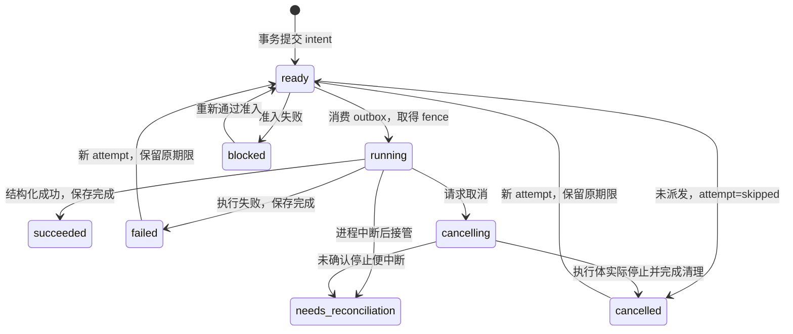

# 持久任务、执行归属与中断恢复（M0 实验合同）

本阶段在隔离的严格 DS/MR 组合中接入可复用的 Task 合同、SQLite journal、runner 和 DSH 工具适配器。冻结 DS 和 SDK 源码没有改动。生产 profile 尚未迁移，默认旧 MR 工具行为没有扩大授权。完整范围仍以方案1.1为准。

## 调用和归属

`bot_task_start/status/cancel/retry` 从 SDK 执行上下文中的真实 Agent 对象获取稳定 Bot 主体。请求不能携带执行者、模型、机器、工作区、命令或状态。start 只接受 `requestKey/backend/input`；retry 只接受 `taskId/requestKey`。backend 由可信宿主注册，固定版本、只读效果、机器/工作区、能力和准确 provider/model，并在提交、重跑及派发前核对。角色描述和模型输出不授予权限。

Task、Package、Attempt、Operation 使用不同 UUID。一个 Task 目前只有一个只读 Package；每次获准重跑保留 Task/Package/输入/执行目标，生成新的 Attempt 和 Operation，并记录 parent attempt。同 Bot 的幂等键跨提交与重跑共用命名空间，相同命令摘要返回原记录，内容变化冲突。规范 JSON 保留中文与换行、排序对象键，拒绝 getter、稀疏数组、非有限数、循环及不可无损表示的值；输入最多32KiB、4096节点、20层。

`retryLegacy` 先查询 Task journal 中的原 MR run→Task→Bot 映射。跨 Bot 或没有映射的旧 run 均拒绝，不能靠一个 runId 接管历史。映射只接受执行器实际返回的已存 run 引用，冲突归属使整个完成事务回滚。严格宿主的 backend 实际调用 `executeConfiguredAssignment` 和 `rerunRecordedStep`，并检查结构化执行/保存结果；模型回答“完成”不能作为 Task 成功依据。

这次没有建立第二个资金写入器。MR 旧运行账本仍记录其费用与收据；Task journal 保存运行引用和执行摘要。资金预占、receipt 去重、DS/CLI 双来源计量及跨库原子迁移仍待实现。若 MR 已完成但 Task 完成事务尚未提交便崩溃，Task 会保留 unknown；不能根据缺少关联引用推断未调用或零费用。

## 持久化与调度

原生 `better-sqlite3@13.0.3` 通过可信宿主注入，不新增根包原生依赖。驱动版本与实际加载、WAL、事务及中断恢复均单独验证。数据库要求 WAL、foreign_keys、FULL synchronous，schema user_version=1；未来版本拒绝打开。提交事务同时写入 Task/Package/Attempt/Operation、幂等命令、事件和 outbox；派发事务原子消费 intent。事件保留递增序号。

数据库租约只有一个 runner，带递增 generation 和有效期；所有执行写入核对 fence。旧 runner 不能在接管后写成功、释放新租约或重放。当前活动队列上限128、全局活动包最多4、每 Bot 最多1；每任务最多3次 attempt，总期限最多5分钟，重跑不延长原期限。backend 版本变化、撤权或目标不匹配在进入执行体前阻止派发。

HTTP/工具请求结束不会拥有后台 Task 的取消权。Task 自己持有截止时间和 AbortController，执行租约绑定 task/attempt/machine/workspace/location。所有权和能力再次验证后，MR 嵌套模型调用在同一主体上下文中执行。



未派发取消会将 attempt/package 记为 skipped、Task 记为 cancelled；已进入执行体时先保持 cancelling，等执行体返回并完成清理才写 terminal。迟到成功不能覆盖取消；已返回的旧 MR run 引用仍保留。非协作执行体不会被一个超时假报为已停止；原生进程树停止及远程核对须由后续执行适配器完成。

新进程接管将旧 generation 的 running/cancelling 操作标为 `needs-reconciliation`，保留 attempt/operation，不重新派发。该 Bot 的新提交和旧失败任务重跑也会被拦住；原命令幂等查询仍返回原记录。当前尚无人工核对/解除界面或 resolution API，不能把这个保守状态视作完整恢复功能。

## 已验证与复现

5项纯合同检查进入根套件；17项真实原生 journal/service 检查覆盖提交原子性/幂等冲突、独占租约、归属、重跑链、取消、deadline、队列容量、未知结果阻止执行、接管 fencing，以及真实子进程非正常退出。严格宿主检查实际 SDK 工具、原 MR 执行与重跑、清理期间取消及真实宿主崩溃重启。均为离线模型适配器，实际模型请求0。

Ubuntu 首次中断实验得到 cancelled：原通用停止函数使用 SIGTERM，宿主完成了正常清理。这不是结果未知的证明。崩溃场景已改为 SIGKILL 本测试自行创建的 detached 进程组；Windows 使用既有的自身进程树强制终止。普通结束路径保留原语义。

```sh
node --test tests/task-contract.test.mjs
# 原生驱动仅安装到隔离 probe 目录
npm install --prefix tmp/integration/probes/sqlite --ignore-scripts --no-audit --no-fund --strict-peer-deps --registry=https://registry.npmjs.org better-sqlite3@13.0.3
npm run integration:probe-tasks
node scripts/integration-combined-host.mjs --ds-root <frozen-DS-checkout> --host-root tests/fixtures/integration-host --tasks
```

`--tasks` 自动采用严格生命周期组合，使用新测试 home/数据库、固定离线模型和只读 MR backend。CI 在实际原生加载之后运行 native Task suite 和同一组合。平台结果、测试摘要及源码 Git blob 见[证据](evidence/20261027_m0_managed_tasks.json)。

## 后续落地顺序

1. 将此 Task 基础合同与统一预算/收据单写合同合并，补齐启动前、派发后和收据事务前的全部中断点与核对 API；再接入 DAG/审批/评审/重规划。
2. 用同一 Task/Attempt 归属承接 CLI 私有引导与真实进程树取消，完成实际 MCP 孙进程启动、准确模型身份和远程 operation 查询。
3. 接入真正 DSH OS worker、远程 agent 配对/撤销、Windows 账户及 GUI 会话边界，保留现有 partial/失败证据。
4. G1–G4 达标后迁移默认产品 profile、任务卡、旧兼容入口和存储。未知任务不能通过删记录或扩大授权恢复。

本轮仍不覆盖完整 DAG、远程动作幂等、资金迁移、默认产品配置和 UI、CLI、OS 隔离及部署/休眠。M0 保持9/12子步骤，施工包和产品场景不因探针通过而整体结项。
