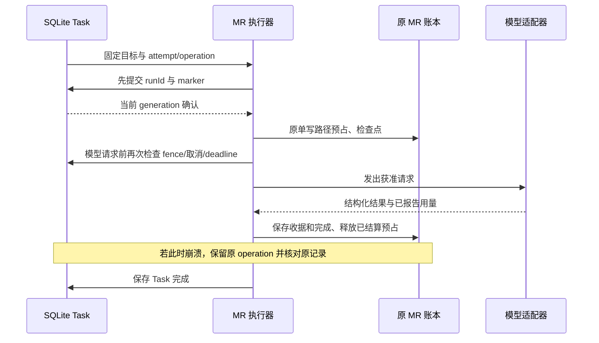

# 收据核对与待恢复任务（M0 实验合同）

接续 `610940c` 的单包只读 Task 基础。本阶段接通原 MR 入场前关联、实际 API backend、预算等待和只读收据核对。冻结 DS 与 SDK 源码不改，默认用户 profile 不启用这些实验模块。真实模型调用仍只允许 GPT；本阶段测试全部使用离线适配器。

本页记录a6df6cb检查点的JSON权威边界；后续严格profile已切到[SQLite资金权威](20261027_sqlite_finance.md)，仍不等于全部产品预算接入。

## 入场前关联与执行前检查

MR 的 `beginExecutionLifecycle` 增加仅供可信宿主调用的 `managedExecution` 接缝，原工具/RPC wire 参数不接受这个对象或回调。实际执行器和原记录重跑均传递这条接缝；没有启用接缝的旧执行保持原协议。

执行器生成 MR runId 后，在创建预算预占和发出模型请求前，必须成功提交 SQLite 关联。它绑定 `taskId/attemptId/operationId/targetHash`，把 runId 与原 Task/Bot 关联起来。初始、检查点、最终及中断记录都保存相同 managed marker；重跑换为新 attempt/operation 的 marker。回调失败会阻止入场，同一 attempt 不能重新绑定另一个 run。

`mr-read-backend.mjs` 是可复用的宿主适配器，替代只存在于 fixture 的执行逻辑。模型、工作区、机器、价格和日预算只来自可信配置；这些设置参与 backend 版本摘要，变化后旧 target 不自动继续使用。模型调用之前再次核对 SQLite runner generation、当前 attempt、running 状态及原 deadline，防止等待期间丢失租约或收到取消后继续发请求。官方 CLI、评审升级和跨路线执行均不在这个固定 API backend 的合同内。



这里仍是两个存储的衔接，没有宣称跨库原子事务。MR 资金、预占和收据仍只有旧账本这一写入权威；SQLite 保存关联、状态和核对证明摘要，不复制费用作为第二套余额。后续迁移必须一次性转移资金写入权威，不能把本阶段的读取投影当作已经完成迁移。

## 核对 API 与准入

新增 `bot_task_reconcile`，参数只有 `taskId/requestKey`。稳定 Bot 主体来自真实 SDK Agent 对象，模型不能提交成功状态、金额、runId、收据或证明。需要当前 `task/reconcile` 和对应 backend 的只读观察能力；跨 Bot 在进入观察器前拒绝。

同一命令键跨重启去重，重复键返回当前 Task 记录而不重新查询执行端；同键不同目标冲突。需重新观察时使用新键。最多4个观察在途，每次用5秒短期租约，每 attempt 每分钟最多64次新观察；限流窗口结束后可继续核对，不会因用满次数永久锁死。撤权或租约失效后，迟到的成功也不能写入。

核对只作用于 `needs-reconciliation` 的当前 attempt，不生成 attempt/operation，也不启动模型或重跑。原任务 deadline 过后仍可核对已发生的执行。若崩溃前已经请求取消，后来发现成功收据也保留 Task 的 cancelled 语义，收据关联和费用证据不会删除。

## 可确认与不可确认的证据

目前仅接受固定 API 单包、只读执行的结构化终态，必须同时满足：

- run 的 managed marker 与 SQLite 中本次 attempt/operation/target 完全相符；原 run 存在，所有权已经在入场前登记。
- 原账本完整，无对应 run 的活动或中断预占，也没有未核对的历史 attempt 费用。
- 原执行与包均为匹配的终态；不是运行中、暂停、等待、未确认停止、另一 attempt 或另一执行模式。
- 已运行请求的 provider/model、API 通道、已报告 token、价格快照和金额可核对；缺少价格/用量、金额矛盾及来源不明均保留 unknown。
- 成功还需结构化 `ok` 和存储结果；“完成”文本本身不能作证。明确未启动的记录不能夹带已发生用量或金额。

MR 价格快照会附加币种、来源、版本等元数据；固定 API 路由也可能用仅含 reason 的 fallback 字段说明路由理由，包状态随之为 fallback。观察器在准确模型、执行通道和数值费率均匹配的前提下识别这些实际格式，不把跨路线切换当作获准行为。

原文件读取最多32MiB，使用打开的文件句柄读取同一快照。损坏、缺失、未来版本、未释放预占或证据不足只记录 unknown 的原因，不修复文件、不删除预占、不凭 PID 消失推断零费用。证明只保存源记录摘要和关联摘要，不向模型回传原账本文件、凭据或完整回答。

这里以可信宿主保存的文件为依据；已知的 PTC partial 文件边界和 Win11 ACL 失败仍未解决，因此这不是对任意本机代码篡改的收据防伪证明。真正 OS worker 隔离继续作为门禁。

schema 从1升级为2，仅增加执行关联和核对表；已有 Task/attempt/operation/outbox 保留。未来版本拒绝打开，不覆盖原数据。旧版本没有入场前 marker 的历史任务不能自动补造证据；数据回退和产品迁移向导仍待后续实现。

## 预算等待

原 MR 预算准入拒绝时，Task 保持 `waiting-budget`，不伪装成执行失败，也不自动增加请求。所有者可以显式重试或取消；重试仍生成新 attempt，保持原输入、目标、次数上限及总 deadline。预算预览已拒绝、未建立原 run 的情形可从新的获准 attempt 入场，不能拿一个未创建的 runId 调用历史重跑。

真实宿主的独立微小预算 backend 验证：等待态出现，模型分派0次，运行/收据记录不变，所有者可取消。预算等待的自动到期收口、预览与审批 UI、全 DAG 资源等待尚未实施，过期任务不能通过重试延长原期限。

## 验证与后续

9项合同检查进入根套件；原生 journal/service suite 累计26项。新增覆盖持久入场关联、拒绝重新绑定、schema1→2保留、未来版本拒绝、原身份核对完成、取消意图、限流窗口恢复、跨 Bot/伪造结果、撤权后迟到证明拒绝，以及预算等待的显式重试/取消。

严格宿主同时保留两种任务再强制结束自己启动的宿主：工种 Bot 的请求仍在途、Main 的非零合成收据已保存但 Task 完成事务被测试闸门暂缓。新宿主对前者保持 unknown/预占，对后者恢复原 attempt/operation 的成功；核对期间模型分派0次，资金记录不变。这里的金额和 token 均来自离线 fixture，不代表真实厂商账单验收。

```sh
node --test tests/task-reconciliation.test.mjs
npm run integration:probe-tasks
node scripts/integration-combined-host.mjs --ds-root <frozen-DS-checkout> --host-root tests/fixtures/integration-host --tasks
```

详细平台结果与代码摘要见[本轮证据](evidence/20261027_m0_receipt_reconciliation.json)。M0仍9/12子步骤，没有把本轮证明计作全产品完成。

下一步依次推进：统一 SQLite 资金/预占/receipt 单写迁移与回退；前台 Bot/辅助模型的同一准入；审批与核对界面；CLI 私有引导和真实进程树；远程 agent 与真正 DSH OS worker。缺少厂商收据的未知任务没有“强制成功/免费重置”入口，仍需完整核对协议。
