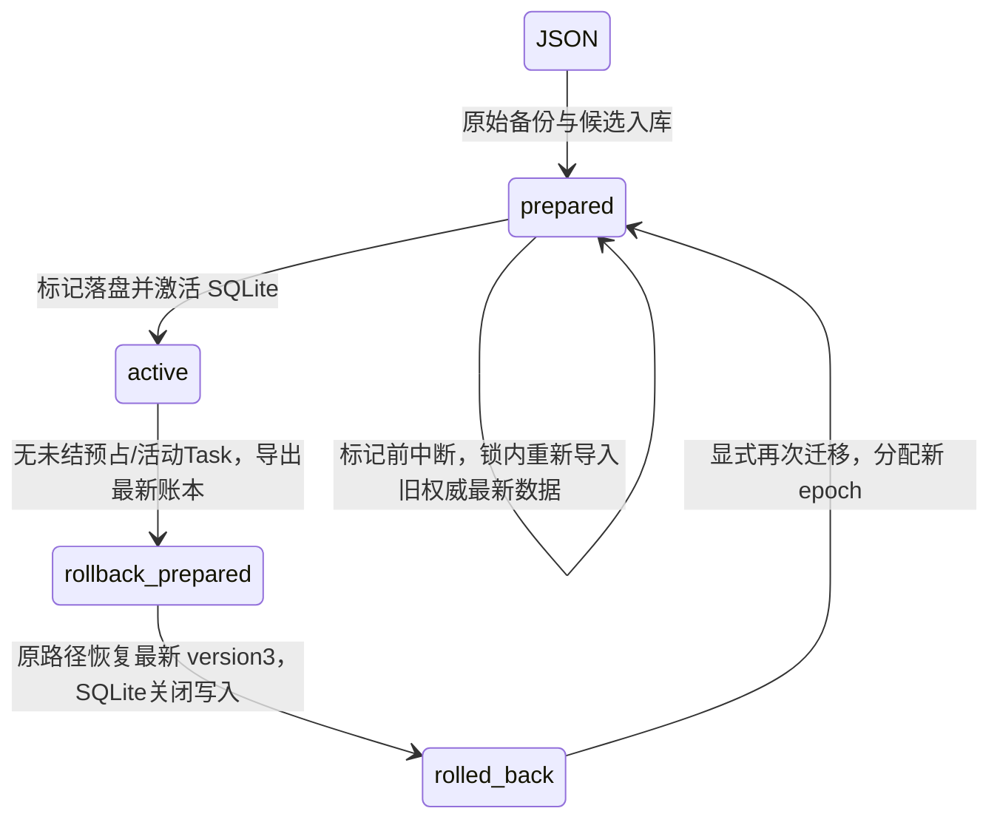

# MR 资金权威迁入 SQLite（M0 隔离合同）

接续 `a6df6cb`。严格 `--tasks` 宿主现在把 MR 运行账、金额/订阅档案、预算预占及状态更新交给同一 `orchestration.sqlite`，不再把原 JSON 作为资金写入权威。默认用户 profile 尚未迁移；冻结 DS 和 SDK 不改，实际模型请求0。

## 存储与并发

`sqlite-router-state.mjs` 复用原 MR 的预算、费用计算、未知语义、历史裁剪及订阅档案算法。`createRouterStateAPI` 供 JSON/SQLite 两个驱动共用业务方法；未迁移的旧 profile 继续原行为。

| 表 | 作用 |
|---|---|
| `router_runs` | runId 主键，完整原运行/收据负载；保留重跑历史与 managed marker |
| `router_holds` | reservationId 主键及 run 外键，保留 owner、已启动与未知预占 |
| `router_meta` | 配置型状态、金额/订阅归档、全局 revision，ledger schema=1 |
| `router_migration` | 唯一权威 epoch、源摘要、备份、切换/回退阶段 |
| `router_commits` | revision 与提交摘要审计；不作为第二套费用累计器 |

这些表与 Task schema2 共处一个数据库。run/hold 独立主键，完整历史字段用 JSON 负载保留原语义；尚未宣称完成所有来源的逐条 `usage_receipt` 协议。金额仍只从原 run/归档算法计算，不能把提交次数当费用次数。

读取在同一 SQLite 读事务内组装一致快照。更新先从 revision 取候选，异步回调在事务外运行，再以 `BEGIN IMMEDIATE` 检查 revision 和权威 epoch，把运行、预占、档案和 revision 一起提交；回调失败/冲突不泄漏候选。磁盘使用 WAL、foreign_keys、FULL synchronous。

默认回调遇到冲突只执行一次并明确失败。原预算管理器和共享业务方法只对纯状态变更标记 `retrySafe`，可在新 revision 上重新计算，最多16次；回调中不允许模型、命令或其他外部副作用。真正预算批准以成功提交的最新余额为准。两个原生连接及两个真实子进程竞争同一余额时只会批准一个；不会跨 await 持有 SQLite 写锁。启动 DDL 短暂等待其他进程；运行时获取写事务使用异步退让，避免阻塞本进程其他任务。

## 权威切换

1. 使用与旧 JSON 写入器相同的文件锁，读取有界原始文件。损坏/未来版本/历史不完整、活动执行会拒绝迁移；合法的 interrupted 未核对预占原样保留。
2. 保存逐字节原始备份，文件名带 SHA256，独占创建、同步并校验已有同名内容，不覆盖备份。
3. 一个 SQLite 事务写入候选账本和 `prepared` 迁移记录；此时 SQLite 不允许读写资金，JSON 仍是旧权威。
4. 原 JSON 路径原子替换为 version4 迁移标记。原插件只支持1/2/3，会拒绝读取/写入，不会把旧缓存或空账本写回。
5. 验证标记、备份和 migration epoch，提交 `active`；只在成功后给实际 MR runtime 安装 SQLite store。



若标记前崩溃，旧 JSON 后来产生的有效更新不会被旧候选覆盖；恢复重新读取旧权威并留下对应备份。若标记已写、激活未写，必须匹配原候选与备份才能恢复。标记缺失/改变、错误目标库或备份摘要不符均拒绝，不回落到空 JSON 余额。

生产锁仍要求“已过期且 owner 明确死亡”，迁移等待时间覆盖默认15秒 stale 间隔。测试最初遇到旧10秒等待先于15秒 stale 的问题，迁移等待已改为至少 stale+5秒。快速断点夹具仅缩短 stale 时间，保留死亡检查；另有真实子进程退出后按生产默认时间恢复的检查。

## 回退与旧版本

回退使用 SQLite 的**最新**账本，不用最初备份覆盖已发生费用。事务先确认没有未结预占和非终态 Task，把最新 version3 导出内容持久化并切到 `rollback-prepared`，阻止所有 SQLite 资金写入；随后原子恢复 JSON，最后记录 `rolled-back`。旧 SQLite 对象和旧 epoch 不能重新获权。

回退中断必须显式使用 `mode: 'resume-rollback'`；普通激活拒绝越过回退状态。恢复前核对标记或已导出的文件摘要，源已被另外修改则保留两边并拒绝猜测。回退不会删除 Task 数据。自动 profile 切换、完整 Task 导出/回退 UI 和历史配置向导仍待实施；没有面向模型的迁移/释放预占工具。

组件 ledger schema=1，Task schema仍2；未来 ledger/schema 不能被当前代码覆盖。JSON version4是阻止旧写入器的迁移标记，不是丢弃历史的空状态。

## 已验证

三机使用真实 `better-sqlite3@13.0.3`，资金原生检查19项，Task原生检查26项。资金检查覆盖：原始备份、金额/订阅档案与未知 token 保真、旧缓存写入拒绝、原生连接/真实子进程预算竞争、CAS纯回调重算/非纯回调拒绝、运行与预占同事务、重复结算不重复计费、归档与受保护 run、未知预占、未来版本/备份/标记异常、迁移三个阶段与回退两个阶段真实退出恢复，以及生产默认死锁文件恢复。

真实组合宿主使用 SQLite 权威，保留原执行、重跑、预算等待、取消及两个宿主硬中断窗口；冷启动延续原账本和 migration epoch。只读核对没有模型分派或第二次记账。三机完整回归各1311项、失败0；固定 strict 依赖和客户端检查通过。详见[平台与源码证据](evidence/20261027_m0_sqlite_finance.json)。

```sh
npm run integration:probe-finance
npm run integration:probe-tasks
node scripts/integration-combined-host.mjs --ds-root <frozen-DS-checkout> --host-root tests/fixtures/integration-host --tasks
```

## 仍未完成

本轮只验证受控隔离 home 的 MR 资金切换。迁移要求停下旧执行；没有证明能安全接管任意仍在运行的旧原生/CLI 工作。前台 Bot/辅助模型尚未接入同一预算；初始 Task/outbox 和资金准入尚未合成同一事务；逐来源 receipt、完整审批/DAG、人工核对/UI、自动等待态到期和默认用户迁移均待实现。SQLite CAS 不会自动重跑模型请求。

源文件以可信宿主为前提，不能防任意本机代码篡改；PTC partial、Win11 ACL、真实 OS worker/远程进程树、Electron ABI和物理断电仍未验收。本轮是进程退出恢复，没有宣称物理断电测试。M0仍9/12，没有新增产品passed。
