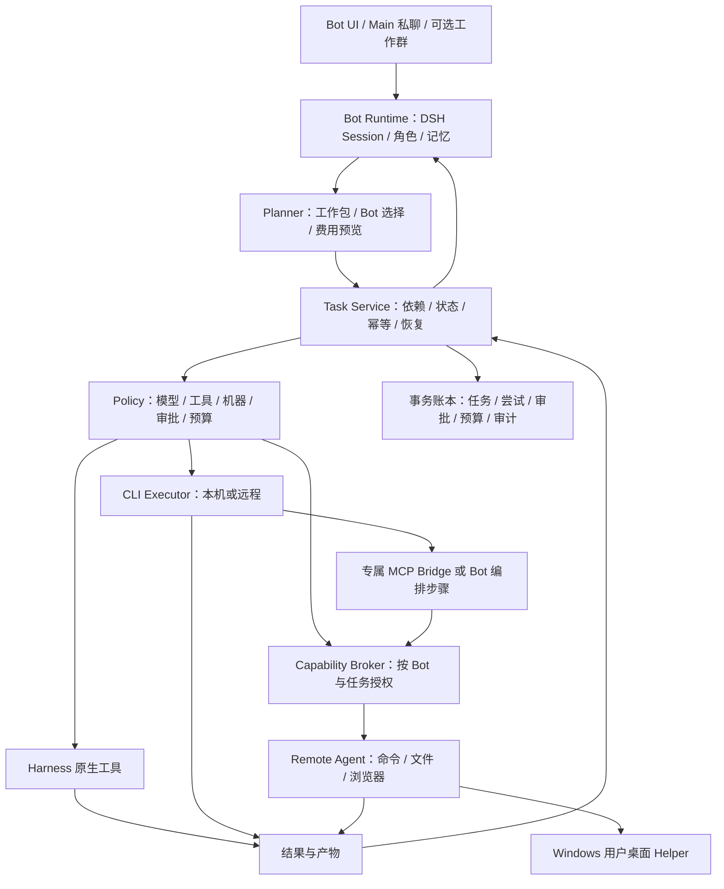

# DSH Bot 一体化完整实施方案

版本：1.1｜日期：2026-10-26（Asia/Shanghai）｜最终仓库：`Alice-Marx/dsh-model-router`

本方案落实用户最新要求：原构想全部进入最终交付，技术实现由开发方负责选择。分期仅表示施工和验收顺序；Linux、Windows GUI、私聊派活、工作群、官方工具、两仓现有能力和发布迁移均有最终完成要求。

这是开发蓝图。本轮交付方案文档；下文的接口、目录、阈值和新命令是待实现契约，不是当前已经可用的功能。已核实事实、设计决定、开发门禁和验收证据分别标明。原始方案保持不变。

本文件末尾完整收录功能/验收矩阵与技术决策附录，可作为一份完整方案阅读。另提供[矩阵拆分版](20261026_requirements_acceptance.md)和[决策记录拆分版](20261026_decisions_risks.md)，便于开发时逐项追踪。

本次 1.1 修订吸收用户提供的 Grok 评审建议，补强验收和发行约束，不改变产品范围。附录 C 逐条记录采纳与修正；研发工具分工和实际部署均未因截图而被视为已获授权。

## 1. 最终产品及不可删减的目标

产品是一个基于 DeepSeek Harness 的 Bot 工作系统。用户日常只需私聊 Main；Main 按职责、模型、工具、机器和预算组织工作，任务执行结果回到原会话。用户也可以私聊其他 Bot，或建立工作群，在同一套 Bot 和任务系统上协作。

| 需求 | 最终行为 |
|---|---|
| Bot 作为默认入口 | Bot 列表、私聊、详情、长期记忆、角色、模型、能力和用量统一呈现 |
| Main 自动派活 | 无需建群或逐个 @；可分包、跟踪、取消、追加信息、改派、评审并汇总 |
| 同模型多角色 | Bot 以稳定 botId 区分，会话、私有记忆、工具配置和授权分开 |
| 工作群 | 保留管理员、@、共享群记忆、群内进度与结果，作为可选工作方式 |
| 官方工具 | DeepSeek 默认用 Harness；其他 Bot 可绑定所属厂商 CLI，绑定维度是 Bot |
| 模型与费用 | 每 Bot 明确模型；预算、订阅、价格、质量和历史能力保留 |
| 远程电脑 | 用户自备端点与凭据，同仓 agent 支持 Linux 命令/文件/浏览器及 Windows 桌面 |
| UI | 沿用 DS-Bot 的产品结构与视觉基调；MR 工作台保留为高级入口 |
| 功能并集 | 两仓现有用户能力逐项可达，保留已有行为或提供经过验证的等价实现 |
| 分发 | 插件、agent、文档、兼容表及 Release 汇入 dsh-model-router |

原方案已排除的托管多租户云机、代管用户密钥、GALGame 和未登录桌面的 GUI 自动操作继续不进入本产品范围。这些是原有产品边界；Windows 登录桌面操作仍是完整交付的必选项。

产品支持配置多厂商模型。开发过程沿用用户长期偏好：模型调用仅用 GPT；不会因为产品支持其他厂商而在本轮或后续默认调用其他模型。

## 2. 源码基线与复用原则

| 基线 | 本次核对的提交 | 已知事实 |
|---|---|---|
| MR：Alice-Marx/dsh-model-router | `de82df4e737954ba0458d597ea82f9a6666c1a9b` | 0.25.5；本地与远端 main 一致 |
| DS：Alice-Marx/DS-Bot-model-router | `de55888a93983fc51c94f7d22bc94b4f8293205d` | ds-bot package 0.2.2；有 Bot、handoff、Capabilities |
| 上游：Fei2411/DS-Bot | 同上 | 本次 main 与 DS 完全相同 |

现成能力包括：DS 的直接 Bot 消息与结果回传、每 Bot 模型记录、HTTP MCP 挂载、记忆、浏览器、计划任务与界面；MR 的规划器、工具注册表、CLI 执行、预算与费用证据、worktree、终端、重跑和质量反馈。

四类处理方式固定为：留、改、迁入、新建。复用判断以用户可见行为、内部契约和回归证据为准，不以代码属于哪一仓为准。迁入时保留 LICENSE、NOTICE、来源提交和必要署名；不覆盖用户工作区及已有发布历史。

MR 包名继续是 `@ljwei-stak/dsh-model-router`。现有插件内部 id `model-router-galgame` 暂时保留，避免破坏配置引用；显示名称可以改为 Bot 工作系统。顶层只有一个插件入口，DS 模块作为内部运行时加载。

### 2.1 冻结基线与上游增量处理

功能并集和兼容验收以本章完整提交 SHA 为准：MR `de82df4e737954ba0458d597ea82f9a6666c1a9b`，DS/上游 `de55888a93983fc51c94f7d22bc94b4f8293205d`。开发中不自动跟随 HEAD，也不把后来新增的上游功能静默加入或移出当前范围。

M0 产出基线清单，登记提交、依赖锁、功能来源和已知限制。每次迁入或上游同步先生成相对冻结基线的增量评审：改动文件、受影响 F/R/T、接口/数据迁移、风险和拟纳入版本；明确纳入后更新基线记录并运行受影响回归。每次发行也要比较已纳入增量，不只看最新 README 或包版本。T61 验收此流程。

## 3. 已选定的技术架构

### 3.1 保留一个 DSH Bot 控制循环

每个 Bot 继续拥有 DSH 原生 Session，以复用 DS 的对话、记忆、群聊、审批和工具机制。Main、执行 Bot 和评审 Bot 均使用各自配置的精确模型。

官方 CLI 作为所属 Bot 调用的明确子任务，由统一 ExecutionService 管理。Bot 可以把完整编程工作交给 CLI，CLI 自己执行内部步骤；Host 只管理这个子任务的启动、权限、进度、产物、费用与结果，不把 CLI 内部每一步再次拆成另一套团队执行。

一个任务可能包含 Bot 自己的模型推理和 CLI 内部的模型推理，两者分别记录成本。界面要显示这两个来源；不能把第二次调用隐藏在“工具免费”之下。

这一选择比重建一套纯 CLI Bot 对话协议更能保留两仓能力。以后可以增加 CLI 直接对话引擎，但它不作为完成本方案的前提，也不替换本次确定的实现路径。

### 3.2 主架构图



### 3.3 模块职责及依赖方向

| 模块 | 来源与处理 | 责任及禁止越界 |
|---|---|---|
| bot-runtime | DS 迁入并适配 | Bot/群会话、角色、记忆、消息投递；不另写预算与进程管理 |
| planner | MR 留/改 | 保留本地分析、质量/价格搜索；向任务系统返回目标 Bot 与理由 |
| task-service | 新建，吸收 DS handoff 与 MR 生命周期 | 唯一的结构化任务状态与调度者 |
| execution-service | MR 改 | 固定注册表执行、CLI 身份、工作区、取消；执行前必须经过 Policy |
| capability-broker | DS Capabilities 改 | 按真实调用主体授权 MCP/skills/机器；向 CLI 暴露最小能力 |
| policy-service | 新建统一接口，复用审批逻辑 | 身份、授权、审批、预算前置检查；模型参数不能自授权限 |
| accounting | MR 留/改 | API/订阅分账、预占与收据；所有实际尝试均进入同一计量入口 |
| remote-computer-agent | 新建 | 用户机器端执行、持久操作记录、OS 隔离、安装与健康 |
| desktop-helper | 新建原生附属程序 | 登录用户桌面截屏/键鼠，通过本机受限 IPC 接入 agent |
| UI projections | DS UI 迁入、MR 面板整合 | 只展示 Host 事实和提交请求，不在浏览器里做最终授权 |

模块间通过版本化接口通信。Planner 不直接启动进程，CLI 不直接改任务终态，UI 不直接改数据库。

### 3.4 产品内协作与外部研发分工

产品内的 Main、工种 Bot、评审 Bot 是交付给用户的运行功能；Cursor、Codex、其他 IDE、外部评审对话是研发工具。两者的身份、费用、工具权限与发布权限分别管理，不把某个外部聊天视为产品 Main。

当前研发由本 GPT 会话执行，必要时按适用授权使用 GPT 子代理；主会话负责方案取舍、diff、验收证据和发行门禁。外部建议作为评审输入记录，不自动取得任务调度、机器访问或 Release 权限。

Grok 截图中“Cursor 实现、Grok 协调/验收/Release”只作为可选流程建议记录，尚未成为既定用户偏好。若用户以后明确指定某 IDE 或外部代理，仍要满足模型调用仅 GPT 的约束及具体操作授权；本方案不据截图启动它们。T62 检查两类角色的文档、配置和权限没有混用。

## 4. 用户入口与完整工作流程

首次启动保留旧配置并引导完成：选 Main 模型 → 配置其他 Bot → 绑定工具与预算 → 可选添加机器 → 运行无费用健康检查。已有用户可以跳过引导。

默认侧栏依次为：Main、Bot、工作群、任务、远程电脑；设置内包含模型、官方工具、Capabilities、秘密、用量和计划任务；高级区保留模型路由工作台、交互终端、诊断和算法设置。

Main 接单的标准流程：

1. 判断是否需要协作。简单问题直接答复，避免不必要地拆成多模型调用。
2. 复杂工作生成工作包，明确目标、输入、验收、依赖、目标 Bot 与工作位置。
3. Host 验证计划、Bot/模型就绪、工具与机器授权、预计费用和冲突。
4. 对需要的具体动作展示审批；已有效授权的范围内持续执行。
5. 按依赖与资源锁调度；原会话显示任务卡、关键进度和待处理事项。
6. 收集结果与文件，按计划交给评审；评审是独立角色，可与实现使用同模型。
7. Main 汇总交付物、验证与未解决项；失败或未知状态不能显示为完成。

用户在过程中追加要求时，新增计划修订。已经执行的事实与费用不改写；未启动工作可以重新规划；新目标或扩大写入范围时重新检查权限。用户“停止”触发整棵任务树取消；指定停止某包时按依赖影响给出范围。

## 5. Bot、模型与官方工具的数据契约

### 5.1 Bot 配置示例

以下是设计 schema 示例，`provider/model` 和 CLI 模型名均由本机已配置目录选择，示例字符串不表示某账号实际可用。

```json
{
  "schemaVersion": 2,
  "id": "bot-implementer",
  "revision": 7,
  "name": "GPT · 实现",
  "rolePrompt": "负责实现与验证，交付修改、证据和剩余问题。",
  "model": {"provider": "configured-provider", "id": "configured-model", "policy": "strict"},
  "officialTools": [{"toolId": "codex", "cliModel": "verified-cli-model", "identityPolicy": "strict"}],
  "capabilities": ["repo-skill", "machine-linux"],
  "machineGrants": ["grant-linux-implementer"],
  "workspaceRef": {"kind": "remote", "machineId": "machine-linux", "rootId": "project"},
  "budgetScope": "project-default",
  "maxConcurrentTasks": 1
}
```

`id` 永不复用；改名不改身份。Session 轮换后继续归属同一 Bot。配置修订用于检查排队计划是否过期，不能用旧计划恢复已撤销权限。

模型规则：模型固定到精确 provider/model；不可用、缺密钥或权限时暂停。路由器可以改派到另一个已配置 Bot，不能悄悄改当前 Bot 的模型。同模型多个 Bot 不合并候选身份，其角色、授权、工作位置和忙碌情况分别参与评分。

CLI 模型身份分别记录目录模型、请求 CLI 模型、实际报告模型及验证状态。无法逐次指定模型的工具保留原有终端/原生能力，但不能假装满足严格模型执行；需显式配置已核验的固定 profile，或提示该精确组合不可用。DeepSeek Bot 直接使用 Harness，不新造 DeepSeek CLI。

厂商专属工具执行前校验已确认的模型家族与 registry vendor：Codex 只授予 GPT Bot，Kimi Code 只授予绑定该工具的 Kimi Bot，其他厂商同理。兼容 API 的 provider 名称不能凭字符串就证明模型厂商，必要时由用户配置并核验 canonical model mapping。第三方多模型工具保留原有高级入口，其模型与权限同样显式配置，不成为越过 Bot 白名单的通道。

保留原 MR 高级路由中的显式 API/订阅选择及允许的回退策略。新 Bot 严格路径默认不切换模型、厂商或执行渠道；CLI 失败就是该子任务失败。用户选择重试或改派后生成新 attempt。

### 5.2 官方工具覆盖要求

注册表继续覆盖十二种现有工具：`kimi-code`、`claude-code`、`codex`、`minimax-code`、`mimo-code`、`grok-build`、`gemini`、`opencode`、`stepcode`、`pi`、`hermes`、`zcode`。

原有检测、安装/更新、修复、卸载、登录、终端及已有托管执行模式均保留。安装来源、入口信任、模型控制、read-only/workspace-write、Harness 沙箱、cli-native、MCP 与远程运行按工具和平台分别报告。保留某工具不等于承诺十二种工具拥有相同模式。界面保留来源标签：厂商官方 CLI、开源第三方工具、社区发行版分别说明，ZCode 等社区分发不包装成厂商官方产品。

新增适配器统一实现 `probe / prepare / start / observe / cancel / collect / reconcile`，返回结构化状态、身份、用量和产物。传入注册表 id，不接受模型指定任意可执行路径或安装来源。用户交互终端继续作为显式人工入口。

同厂商 CLI 可被多个 Bot 使用，但各自采用独立运行配置、会话目录、缓存和 MCP 白名单。凭据可以由用户显式共享引用；共享凭据不等于共享会话或全部权限。

## 6. 工作包、调度与恢复契约

### 6.1 任务模型

任务拆为 `Task → Package → Attempt → Operation`。Task 表达用户目标；Package 表达依赖图节点；Attempt 是一次实际执行；Operation 是远程命令/文件写入等可产生副作用的动作。四者 id 分开，重跑不复用已执行 attempt。

```json
{
  "schemaVersion": 1,
  "taskId": "task-example",
  "origin": {"kind": "private", "botId": "bot-main", "sessionId": "session-main"},
  "planRevision": 1,
  "packages": [
    {"id": "inspect", "targetBotId": "bot-reviewer", "objective": "检查项目并列出修改点", "dependsOn": [], "acceptance": ["附来源位置与风险"], "effectClass": "read"},
    {"id": "implement", "targetBotId": "bot-implementer", "objective": "完成获准修改", "dependsOn": ["inspect"], "acceptance": ["提供 diff 与验证结果"], "effectClass": "workspace-write"},
    {"id": "review", "targetBotId": "bot-reviewer", "objective": "检查实现与验证证据", "dependsOn": ["implement"], "acceptance": ["明确通过或列出待改项"], "effectClass": "read"}
  ]
}
```

计划必须通过 schema、引用完整性、无环、依赖输入范围、授权和预算检查。目标、验收和理由由模型提出；合法性、就绪、身份和资源锁由 Host 判断。工作包不能夹带运行程序路径、任意 MCP URL 或密钥。

### 6.2 唯一调度者与并发

Task Service 是结构化任务的唯一调度者。DS 的 `message_bot` 保留为消息机制；任务关联消息附 `taskId/packageId`，重复消息不能再启动同一包。MR 原团队循环改造成可调用执行器，不和 Task Service 各自调度一遍。

默认全局最多 4 个活动工作包，每 Bot 1 个活动控制任务；机器命令默认并发 2，桌面写操作全机独占 1。它们是初始可配置值，不是当前测量结果。

依赖满足、授权有效、预算准入且资源可用后才启动。读任务可并行；同一工作树的写任务互斥。需要并行修改时为分支分配独立 worktree，由集成阶段处理补丁。桌面操作持有短期独占租约，不能靠两个 Bot 各自“注意不要冲突”。

保留旧高级执行的失败即停止语义。新任务的默认策略是失败阻塞依赖链；独立只读分支可继续，整任务显示部分失败。涉及共同写入目标时默认停止该资源上的后续写任务。

### 6.3 状态机

Package 状态定义为：`planned → ready → waiting-approval / waiting-budget / waiting-resource → running → succeeded / failed / cancelled / interrupted / outcome-unknown`。依赖失败时为 `blocked`，从未启动且取消时为 `skipped`。处于审批或预算等待不是执行失败。

Attempt 已开始后不能回到“未启动”。取消先进入 `cancelling`，确认执行端停止后才记为 cancelled。进程不再存在但输出/费用待核对时保留 interrupted 或 outcome-unknown，不能凭页面断开判定成功或免费。

Task 由包状态与验收结果聚合：所有必需包成功、产物存在且验收通过才为 succeeded；必需包失败且无恢复路径为 failed；尚有待审批/预算/资源则保持等待；未知操作先进入 needs-reconciliation；有可交付部分但未全部满足时为 partial；补丁待合入单列 integration-pending。模型的“已完成”文本不能直接把任务置为成功。

安全的未入场网络重试或只读请求默认最多 2 次；有副作用请求重试仍使用原 operationId，已入场结果未知只允许查询。评审发现问题时按现有授权生成修订工作包，默认最多 2 轮，每轮重新预算并保留原证据；超出轮数或扩大目标时暂停给用户明确选择。计划有总 deadline，不能无限派活、互相回传或自动复核。

### 6.4 持久化、去重与崩溃恢复

新增事务存储 `orchestration.sqlite`，存储任务、尝试、事件、派发 outbox、审批、预算预占、收据与去重键。驱动采用锁定版本的 SQLite Node 适配器，初选 `better-sqlite3`，在目标宿主/ABI 实测并随包验证；不假设所有 DSH 都提供可直接使用的内置 SQLite API。

一个事务内检查状态、预算和租约，创建 attempt、预占与 outbox。提交后派发。执行端先持久写入 operation admission，再执行。重发相同 operation id 返回原记录；同 id 不同请求摘要报冲突。远程只保证“拒绝重复入场并保留未知证据”，不承诺任意 shell 的绝对 exactly-once 效果。

启动时读取非终态任务，核对 agent operation、CLI PID/进程身份、worktree 与费用收据。结果不明就进入核对流程，不自动重放有副作用动作。任务 owner 使用租约与 fencing generation；旧进程恢复连接后不能越过新 owner 继续派发。

DS 的 Bot/群/记忆领域存储可保留原格式。MR 执行账、预占和费用迁入事务存储，纯路由算法及其公开行为保留；旧状态文件作为备份，配置和动态数据可继续保留独立存储。不能同时让 JSON 和 SQLite 成为新预算的双写权威。

前台 DSH Bot 的模型请求同样接入准入和收据监听：Main 规划、工种 Bot 推理、侧聊和复核都不能游离在预算之外。模型请求发出前没有可靠拦截点时，应在受管 worker/模型调用适配层完成该检查，作为 M0 门禁。不能只给 CLI 包预占而漏掉 Bot 自己的调用。

## 7. 工具授权、审批与能力桥接

### 7.1 身份来自运行上下文

Host 从已认证的 Session 和任务记录解析 Bot、角色、任务和配置修订。模型不能通过传入另一个 botId、修改 header 或 RPC 参数冒充主体。工具 schema 过滤只优化可见性，实际调用、直接 RPC、重跑和后台计划任务都必须再校验。

有效授权为各层交集：用户/宿主策略 ∩ Bot 白名单 ∩ 群或任务附加约束 ∩ 机器 ACL ∩ 当前审批。群管理员身份或 Main 的管理权不能自行突破机器策略。撤权即时阻止新动作；对正在执行的动作发取消并记录是否确实停止。

### 7.2 审批作为可验证记录

审批由 DSH 官方审批面板或受认证 UI 产生记录，绑定主体、机器、工具、参数摘要、工作目录、目标范围、任务修订、有效期和用途。变更命令、目标文件、写入内容或执行环境后，旧审批不继续适用。

默认读操作在已有授权范围内可直接执行；shell、文件写入、桌面、远程 CLI 安装与 cli-native 按风险请求确认。desktop_screenshot 也属于默认需确认的桌面能力，可由用户授予当前受限任务内的连续截图权限。用户可授权本次操作、当前受限任务或明确的持久策略。持久策略必须可查看、收紧和撤回。

文件写入用内容摘要绑定；交互输入内容不进入普通日志，只保留摘要和必要元数据。用户批准工作目标不自动等于批准所有可能的外部动作。

### 7.3 MCP 与 skills 的统一入口

复用 DS Capabilities 的 MCP、skill、pack 与秘密引用；为远程机增加机器类型视图，底层仍走同一能力目录。能力保存与授予分离：Main 可以建议配置，赋予新机器权限由用户策略决定。

Harness 工具直接经过 Broker。CLI 若支持独立 MCP 配置，启动时只注入本 Bot、本任务的短期桥接。优先采用本机 stdio bridge，由 Host/agent 父进程通过私有管道交付短期句柄；bridge 的 stdio 只连接本机 Broker，远程段仍为 HTTP MCP。

CLI 不支持原生 MCP 时，所属 DSH Bot 仍然拥有远程能力：它安排远程准备/读取/验证步骤，再把必要内容和产物引用传给 CLI。CLI 失败不触发另一个模型接替执行。界面明确标明“CLI 内可调用”或“由 Bot 编排调用”，不伪造工具继承。

Bridge 不接收长期机器密钥，不列出其他 Bot 的能力，不继承用户 CLI 全局的任意 MCP 配置。原生环境若需要用户配置中的额外工具，必须通过显式高级授权；此时 UI 如实说明边界。

## 8. 远程电脑架构与接入流程

### 8.1 组件与部署

`remote-computer-agent` 与插件在同一仓库维护，单独打包为附属运行程序，不另建 DSH 插件包名。协议主体用 TypeScript/Node 实现；Windows 桌面用小型 C# 原生 helper，以受限 named pipe 接入，不让 Node 服务直接点击 Session 0。

DSH 可以运行在用户的 Windows/macOS Desktop 或 Linux Web 主机上；agent 可以在另一台 Linux 或 Windows 上。远程机只需可达，不绑定开发者自己的 VPN、目录、账户或域名。

网络支持四种已文档化配置：WireGuard、Tailscale、Cloudflare Tunnel、公网 TLS。默认仅 loopback；VPN 模式显式绑定指定网卡地址；公网模式要求 TLS。私有 IP 本身不作为可信网络证明。HTTP 明文仅用于 loopback 或用户明确配置的受保护隧道。

### 8.2 用户安装与配对

1. 从最终仓 Release 下载对应平台 agent 和摘要文件，按说明验证并安装。
2. 初始化 machineId、运行账户、允许根目录和运行模式，默认不开全部磁盘访问。
3. agent 的本机管理命令生成一次展示的配对凭据，用户将凭据输入插件秘密界面。
4. 插件保存 secretRef，连接并核对 machineId、agent 版本、协议范围及机器能力。
5. 用户给指定 Bot 授予机器、工具和根目录，运行 ping 与受控读测试。
6. 需要 shell/写入/桌面时，按选定审批策略启用。

配对凭据是 Host 的机器接入身份，不能暴露给模型。完整方案支持删除、轮换和撤销；丢失连接不得重新生成身份并把另一台机当成原机。

### 8.3 版本与传输

Wire transport 统一 Streamable HTTP。MCP 协议版本、agent 产品版本和业务协议版本分别记录。`agentApiMajor=1` 约束本产品的工具 schema；`supportedMcpVersions` 表达 SDK 实际支持的 MCP 修订；SemVer 表达 agent 软件兼容。

按目标 DSH MCP client 固定支持组合，至少验证一个与该宿主兼容的协议版本；不为了追新强制宿主使用不兼容版本。旧 HTTP+SSE 仅按兼容矩阵提供适配。不同 MCP 修订的会话/取消差异封装在 transport adapter，业务幂等不依赖 MCP session id。[MCP 官方规范](https://modelcontextprotocol.io/specification/2026-07-28/basic/transports/streamable-http)

### 8.4 M0 部署拓扑与首台验收机器

产品继续允许用户任选宿主。为完成本人的工程验收，M0 必须另交付 `deployment-profile`：明确日常 DSH 宿主、首台常开 agent、UI 所在设备、Windows 桌面设备、机器标识、网络路径、运行账户、数据目录、休眠/重启影响及对应证据。真实端点、账户和密钥引用只存本地私有配置，公共文档使用占位符。

建议的验收拓扑如下，是待 M0 实测确认的默认路线，不代表这些机器已经配置：

| 角色 | 建议位置与模式 | M0 必须确认 |
|---|---|---|
| 常开 DSH 宿主 | 用户自己的 Ubuntu 云主机运行 DSH Web | 实际可用主机、账号、常驻方式、数据备份与 UI 访问方式 |
| 第一台常开 agent | 优先 Ubuntu，可与宿主同物理机但进程/容器和权限分离 | machineId、root、OS 隔离和 HTTP MCP 路径；同机也按统一协议验收 |
| 笔记本 | 浏览器访问常开 Web；DSH Desktop 在独立 profile 做本机兼容验收 | 不共享活动数据库，不假定 Desktop 能直接挂到任意远端后端 |
| Windows 桌面 | 用户 Win10 设备经 WireGuard 直连常开端，Win11 另做兼容验收 | 路由、登录 Session、helper 状态、DPI 和重启后的恢复 |

隧道不得依赖笔记本转发才能连接两台常开设备。笔记本休眠后，常开宿主上的已授权任务和计划任务仍应按策略工作，界面恢复后接回原任务。若用户选择笔记本为 DSH 主宿主，则明确其休眠会使新调度、续签或计划触发不可用；不能凭 agent 常开就宣传整套系统全天在线。

没有相应设备时 M0 如实记录尚缺的部署条件，先做可运行的隔离试验；真实部署和完整实机验收继续作为门禁，不编造机器地址或已完成状态。T57 记录拓扑与休眠测试。

## 9. 远程 agent 的业务接口

工具 wire name 统一 snake_case，原方案的 `machine.ping / fs.read / shell.exec` 等点号名称作为文档类别映射到下表，不改变其能力含义。名称转换集中处理，避免各 CLI 对名称字符的限制导致互通失败。

| 工具 | 输入核心字段 | 输出与关键约束 |
|---|---|---|
| `machine_ping` | 无用户自报身份 | machineId、版本、OS、支持能力、桌面状态；只报健康，不报密钥 |
| `fs_list` | rootId、relativePath、cursor、limit | 分页条目；不能逃出根目录 |
| `fs_read` | rootId、relativePath、offset、length | 有界内容、hash/encoding；大文件转 artifact |
| `fs_write` | rootId、relativePath、artifactId/content、expectedHash | 审批、原子替换、并发修改检测；拒绝模糊覆盖 |
| `shell_exec` | workspaceRef、argv 或明确脚本、timeoutMs | operationId、退出码、输出引用、取消/超时状态 |
| `operation_status` | operationId | 已入场/运行/终态/未知及可见收据 |
| `operation_cancel` | operationId | 取消已请求与停止已确认分别返回 |
| `browser_open / snapshot / click / type / close` | browserSessionId、URL/DOM 引用等 | 按 Bot/任务隔离浏览器；写入动作按授权 |
| `desktop_screenshot` | displayId、sessionSelector | 带截图版本与坐标元数据的 artifact |
| `desktop_click / type / key / scroll` | screenshotId/target、动作参数 | 桌面租约、会话就绪和审批；拒绝过期坐标 |
| `cli_probe / cli_run` | registryToolId、Bot 工作包、workspaceRef | 仅已登记且通过检查的远程 CLI；固定适配器启动 |
| `artifact_stat / read` | artifactId、offset、length | 摘要、大小、媒体类型及有界分片；不暴露任意路径 |

所有有副作用工具在内部携带由 Host 签发并由 agent 验证的 task/attempt/operation 上下文；模型只填业务参数。operationId 在第一次入场前落盘。

统一业务结果示例：

```json
{
  "schemaVersion": 1,
  "machineId": "machine-linux",
  "os": {"platform": "linux", "arch": "x64"},
  "agentVersion": "1.0.0",
  "agentApiMajor": 1,
  "operationId": "op-example",
  "status": "succeeded",
  "startedAt": "2026-10-26T08:00:00Z",
  "finishedAt": "2026-10-26T08:00:01Z",
  "result": {"exitCode": 0, "stdoutArtifactId": "artifact-example", "stderrArtifactId": null},
  "error": null
}
```

协议或鉴权错误用对应 HTTP/JSON-RPC 错误；工具执行失败用 MCP 的工具错误结果与稳定业务 code。错误不能返回 Token、完整环境变量或敏感命令输入。

| 稳定错误 code | Bot 与 UI 的处理 |
|---|---|
| `AUTH_INVALID / GRANT_REVOKED / SCOPE_DENIED` | 停止，显示需要修复身份或授权；不换机器绕过 |
| `AGENT_VERSION_UNSUPPORTED / MCP_VERSION_UNSUPPORTED` | 显示兼容要求，不反复重连 |
| `WORKSPACE_OUTSIDE_SCOPE / FILE_CHANGED` | 要求核对范围或新文件内容，旧审批失效 |
| `DESKTOP_UNAVAILABLE / DESKTOP_LOCKED / TARGET_STALE` | 暂停桌面步骤，说明会话或截图已变化 |
| `PROCESS_TIMEOUT / CANCEL_PENDING` | 继续核对进程终态，不能提前释放资源 |
| `OUTCOME_UNKNOWN` | 只查状态，不自动重放 |
| `MODEL_IDENTITY_MISMATCH / TOOL_NOT_READY` | 暂停该执行组合，保留原始请求与证据 |

## 10. Linux 命令、文件、浏览器与工作区

命令 API 分为固定程序 argv 与明确批准的脚本两种模式。结构化参数不经 shell 拼接；脚本本身属于高权限操作，不用字符串黑名单假装保证安全。

默认非 root 运行。受控模式用容器或独立 OS 账户限制目录和网络；原生模式由用户明确授权，显示实际账户与范围。fs API 做路径规范化、根目录检查、链接/重定向防护与打开后校验；拥有任意 shell 的账户还必须有 OS 边界，否则不能承诺只能访问 fs 根目录。

初始限制：命令默认 60 秒、最大 30 分钟；CLI 保留现有默认 45 分钟/最大两小时的托管上限，运行前受任务更小的 deadline 约束；命令内存捕获上限 8 MiB，CLI 按原适配器有界捕获；更大日志写入受配额产物存储。超时终止进程组并核对退出，不只取消网络请求。

远程浏览器基于 Playwright，按 Bot/任务创建 BrowserContext，下载目录分离；需要持久登录时用户显式给该 Bot 选择专属 profile。浏览器 context 隔离 cookies 等状态，不等于 OS 沙箱。[Playwright 官方说明](https://playwright.dev/docs/browser-contexts)

URL 在授权范围内检查协议与目标；文件下载、脚本执行、上传和访问内部服务分别受策略约束。保留 DS 原本的 refs/script/task 浏览器能力；迁入后统一经过 Broker，远程脚本模式单独授权。

`workspaceRef` 明确区分本机和远程，不能把 Windows 本机路径直接当作 Linux 路径。远程 Git worktree 在远程机创建；本机 CLI 默认不声称能读远程目录。要在远程仓库使用 CLI，就在远程安装并通过 agent 的固定 CLI 适配器运行；否则由明确的文件/补丁传输步骤建立本机副本，记录源版本与产物 hash。

可编辑工作保留 MR 的条件合入：记录源 HEAD/干净状态 → 创建隔离 worktree → 执行与验证 → 针对原基线生成补丁 → 再查源状态 → apply check → 合入。源变化或冲突时保留 worktree 和 integration-pending，不强行覆盖，不自动提交。

## 11. Windows 完整控机设计

Windows 必须同时具备命令、文件、无头浏览器和登录桌面控制。协议服务与桌面 helper 分离：服务在选定低权限账户运行；helper 在用户交互 Session 中启动，经带 ACL 的 named pipe 通信。微软明确说明服务不能直接与交互用户桌面通信，新代码应采用用户会话程序和 IPC。[Microsoft 官方说明](https://learn.microsoft.com/en-us/windows/win32/services/interactive-services)

helper 用 C#/.NET 原生调用封装截图与 SendInput；发行包自带经过验证的运行依赖。原型阶段分别验证 Windows Graphics Capture/桌面捕获与多显示器坐标，不假定一种捕获后端适用所有窗口。

截图返回 displayId、宽高、DPI、物理/逻辑坐标变换、桌面 Session id、capturedAt 和 screenshotId。点击必须关联仍有效的截图与显示器；窗口切换、分辨率或 DPI 变化时拒绝旧目标。文本采用 Unicode 输入路径，不默认借共享剪贴板传送秘密。

桌面动作全机排他。用户可在托盘暂停、停止或撤销当前控制；无人操作时 agent 保持健康，但桌面状态可以是 unavailable。锁屏、注销、UAC 安全桌面或 RDP 会话变化时明确暂停，不绕过登录或安全桌面。

安装提供当前用户模式作为默认；需要系统服务时给出独立安装选项，说明运行账户和 helper 自动启动方式。卸载先停止任务与服务，再移除程序；数据和凭据是否删除由明确选项控制，默认保留。

实际验收必须包括 Win10 22H2 与 Win11。CI 的 Windows Server runner 不能替代用户 Win10 交互桌面验收。多显示器、125%/150% DPI、中文输入、断开重连与登录状态变化都在必测范围。

## 12. 凭据、授权票据与强隔离

长期凭据只保存在宿主秘密服务或 agent 本机凭据存储，业务表只持 secretRef。日志、任务消息、产物索引与模型上下文不含凭据正文。

配对后，Host 持有受限机器客户端身份。需要执行时，Host 经已授权控制面请求短期 grant；agent 按自身 ACL 和 Host 配对上限取交集，签发绑定机器、客户端、Bot、attempt、工具范围、根目录、过期时间和 grant revision 的票据。UI 中的授权记录对应这份可撤销策略。

agent 的 `/control/v1` 是本产品管理接口，`/mcp` 是工具协议接口，两者权限分离。静态配对 Token 的个人设备接入不宣传为完整第三方 OAuth 服务；以后兼容第三方 OAuth 时另按 MCP 授权规范实现。

短期票据不允许修改能力列表。撤销用 grant revision 检查，不只等 TTL 结束；建议 TTL 5 分钟、活动任务按策略续签，桌面控制另用更短的 lease。公网连接验证 TLS、Origin/Host 与重定向，拒绝把 Authorization 跟随到另一个端点。

Bot 私有记忆通过带主体校验的 API 访问；工种 Bot 不能读另一个 Bot 的私有目录、CLI profile 或秘密。Main 的配置管理权与私聊读取权分开，用户明确授予的管理行为保留审计。

强隔离配置是完整交付的一部分：Linux 提供独立用户或容器 profile；Windows 提供专属运行账户/ACL profile，桌面控制只进入被用户授予的交互账户。共享家庭账户的原生桌面模式如实显示“应用层隔离”，不能承诺该账户下所有文件互相不可读。

### 12.1 公网 TLS 的额外暴露面

四种接入方式中，公网 TLS 需要额外的边界验收。本产品定位为用户自管的个人设备连接，不把它宣传为已完成租户隔离、身份运营和合规体系的多租户 SaaS。

公网模式拒绝无 TLS 的全网监听；反向代理终止 TLS 时，agent 后端默认绑定 loopback/明确受保护接口，只信任配置过的代理来源与转发头。Origin 和 Host 按精确允许清单处理，非浏览器请求不靠缺失 Origin 豁免鉴权；mTLS 提供为可选加固。

配对凭据用密码学随机源生成，至少 32 字节随机量，服务端仅保存适合验证的凭据摘要，比较采用恒定时间路径。鉴权失败返回统一错误并脱敏审计，不记录原始 Token；不根据可猜的 Bot 名或机器名产生密钥。

增加按来源和客户端身份的速率限制、失败计数及有限退避/临时冷却。初始可测试参数为 60 秒内 5 次失败触发冷却，最长退避 30 秒；阈值由配置约束并在压测后定版，不能只靠进程内无限增长 Map。匿名失败用来源限额和全局有界配额，避免攻击者通过伪造无效身份锁死合法客户端；管理端保留解锁与轮换办法，不采用永久全局锁死。

这套参数是设计起点，需用 T59 验证猜测攻击、来源伪造、冷却恢复、正常客户端隔离以及轮换后的旧凭据失效。鉴权节流与锁定应同时考虑拒绝服务影响，可参考 [OWASP 鉴权建议](https://cheatsheetseries.owasp.org/cheatsheets/Authentication_Cheat_Sheet.html)。

## 13. 记忆、群聊与上下文边界

保留 DS 的长期 Bot 记忆、编辑/删除、上下文分段、历史检索、压缩与续接；Bot id 与当前 Session id 分离。换会话不丢角色、模型、能力、审批默认和用量归属。

记忆分 Bot 私有、群共享和任务事实三层。派活时只传任务所需片段与产物，不复制发送者完整私聊；群内任务默认留在群上下文。跨群或私聊引用需要明确引用动作与访问检查。

CLI 调用前注入该 Bot 的角色和本次必要输入；收回结果后由所属 Bot 决定写入记忆。CLI 的配置/历史目录按 Bot 分开；禁止把所有 Bot 的记忆打进共享 CLI home。

群管理员负责默认回复与工作安排；@ 可以直接调用成员。群内派活仍进入同一 Task Service，并保留来源群和回复路由。不会因为建群而复制一套 Bot、预算或机器授权。

原有旁路讨论、侧聊、引用、问答卡、交互视图、语音、图片/附件、主题和浏览器入口均保留；它们对底层服务的调用统一过授权与计量，不以整合 UI 为由删除。

## 14. 预算、计量与质量

API 金额、订阅调用与 token 保持独立。Bot 自己的模型、CLI 模型、评审、重新执行和质量升级各自生成 receipt，再用 task/attempt 关联展示。CLI 未报实际模型或完整用量时保留未知；不能用推荐模型价格伪造真实费用。

启动任何可能计费调用前，事务检查累计支出、活动预占与新估计，按账户/项目/Bot 预算范围分配 reservation。费用只有一个写入入口，DS Usage 从同一 receipt 投影；旧用量保留 origin，避免迁移后重复计算。

订阅失败默认暂停。显式选择 API 后重新估价、重新准入；订阅-only 不自动调用 API。价格未知且有限预算时，需要用户选择可审计的未知费用策略。预算是本地约束与证据系统，不承诺能在厂商侧实时硬限额。

保留省钱/均衡/质量预设、质量下限、有界候选搜索、价格/质量数据刷新、用户评分和学习重置。路由先过滤授权和就绪，再比较模型质量/成本与 Bot 角色适配；不能因更便宜而突破权限。

评审 Bot 可以执行检查，但其通过意见与命令/测试证据分别记录。需要真实运行测试的验收，不能用模型文字“看起来正确”代替。复核是额外调用，启动前也纳入预算。

## 15. 事务存储与数据迁移

建议目录如下，名称属于设计，迁移工具负责从现有路径读取：

```text
<DSH_HOME>/
  bot/                         # 保留 DS 领域状态、记忆与已有历史引用
  model-router/
    state.json                 # 原数据备份/只读迁移来源，按版本留存
    orchestration.sqlite       # 任务、attempt、预算、收据、审批、outbox
    artifacts/                 # 有界产物及元数据
    runtime/<botId>/           # 受 ACL 保护的 CLI 配置与 bridge 状态
    migrations/                # 备份、映射、校验报告和版本标记
```

数据库至少含 `tasks / packages / attempts / operations / task_events / dispatch_outbox / reservations / usage_receipts / approvals / audit_events / migration_records`。唯一键约束 operation admission、receipt 写入和派发幂等；事件序号单调递增。配置、审批引用和任务输入都保存 revision/hash，字段升级带 schemaVersion。

迁移流程固定为：检测旧插件和 writer → 停止旧写入或只读导出 → 备份并计算摘要 → dry-run 列影响 → 在新库事务导入 → 校验数量/归属/未知费用/订阅档案 → 写迁移标记 → 启用统一运行时。

迁移重复执行只返回原报告，不重复导入。中途失败保持旧数据可用；回退先停止新任务，导出新版本新增数据，再恢复旧备份，不能让旧插件直接打开更高版本库并静默丢字段。

SQLite WAL、备份、锁与恢复要在实际文件系统上验证；默认数据目录用本机磁盘，不把活动数据库放在网络盘或同步盘。保留用户自己已有目录，不擅自迁移整个 DSH home。

## 16. 内部 API 与旧接口兼容

客户端继续使用 DSH 认证 remote/RPC，不将 Host 内部接口直接当公网 HTTP 服务。新增统一 facade：

| 接口族 | 设计方法与用途 |
|---|---|
| Bot | `bots.list/create/update/archive`，按 revision 防止覆盖配置 |
| Task | `tasks.preview/start/get/events/cancel/replan/retry`，start 带 idempotency key |
| Approval | `approvals.list/decide/revoke`，decision 由受认证用户 UI 提交 |
| Machine | `machines.list/add/probe/update/revoke`，Token 输入只走秘密界面 |
| Capability | `capabilities.list/attach/detach/status`，按 Bot 授予 |
| Artifact | `artifacts.stat/read/export`，检查访问主体及有效期 |
| Usage | `usage.summary/receipts/budget`，金额与订阅分栏 |

预览返回 planRevision、配置摘要、费用、权限原因与阻塞项。启动在 Host 再次校验，不消费一个可以绕过后续变更的万能预览令牌。请求重发使用原 key 查原任务；不同内容复用同 key 报冲突。

现有 `model_router_*` 工具、`/router`、`/tools` 及工作台 RPC 保留兼容 facade：调用同一 Policy/Task/Execution/Accounting。只有明确的高级用户入口可以选择原有显式跨路线行为；工种 Bot 不能借旧接口获得未绑定 CLI 或其他模型权限。DSH 内置 Agent Teams 仍由宿主管理，本插件不假定能控制其内部模型选择或生命周期。

旧 UI 后台 job 的 `completed` 仍表示 runner 已结束，业务成功看 result；新任务 UI 使用规范化 task/package 状态。旧字段继续返回，新增字段带版本，不突然改变已发布契约。

## 17. 前端信息架构与关键交互

保留 DS 的 Bot 列表、聊天区、右侧详情、群聊布局及主要视觉元素。MR 内容以 Bot 配置、任务卡、设置与高级面板整合，避免让用户维护两份团队。

Bot 详情显示角色、精确模型、可用工具、机器授权、工作区、用量和最近任务。机器页显示 OS/版本、连接、命令/浏览器/桌面状态与已授权 Bot；连接正常但桌面不可用要分开展示。

任务卡显示来源、工作包依赖、执行 Bot、机器、模型/CLI 身份、审批、预算、产物及失败详情。用户能在原对话停止、重试、改派或打开详细任务页；只有受影响的动作重新确认。

高级工作台保留手工分配、算法数据、官方工具安装与终端；对 Bot 任务显示关联关系。终端是人工交互通道，不能绕过任务授权后悄悄让模型复用全权限终端。

UI 为中文优先并同步保留已有英文能力；错误面向用户给动作指引，不只给 stack trace。支持窄窗口、长任务名、长日志、离线与多 Bot 同时活动。截图和秘密输入在导出诊断中默认脱敏。

### 17.1 Bot 与 CLI 双来源费用的 UI 验收

T60 必须运行一个同时发生 Bot 推理和 CLI 子任务的真实 GPT 工作流。任务卡能展开“Bot 模型调用”和“CLI 内部模型调用”两类来源，分别显示 attempt、模型身份、调用次数、已报告 token、API 金额或订阅计量，再汇总到任务；重试和评审保留独立行。

同一 receipt 不因先出现在 CLI 明细、再由 Bot 汇总而重复入账。订阅只显示调用/token；金额或 token 未知显示未知，不伪造第二笔美元金额。只调用 Bot、未启动 CLI 时显示实际来源，不为满足 UI 样式制造一次调用。验收要同时核对界面与底层收据，不能仅检查字段存在。

## 18. 软件包、目录与构建组织

保持最终仓库，逐步建立内部 workspace，不一次搬动全部现有文件：

```text
dsh-model-router/
  .dsh-plugin/                 # 原插件入口与兼容导出
  modules/bot-runtime/        # DS host/client/shared 迁入，保留来源记录
  packages/contracts/         # schema、错误码、协议与兼容矩阵
  packages/orchestration/     # Task/Policy/Accounting facade 与 SQLite 适配
  packages/capability-broker/ # Host 授权入口与本机 bridge
  packages/cli-runtime/       # 从 MR 提取的跨 Host/agent 固定执行适配
  remote-computer-agent/     # TS agent，协议及 Linux/Windows运行
  native/windows-desktop/    # C# helper 与受限 IPC
  apps/desktop/              # 可选独立桌面发行形态，加载同一插件
  deploy/docker/             # Web/agent 镜像与用户数据挂载说明
  tests/contracts|integration|e2e|fixtures/
  docs/architecture|migration|operations|releases/
```

现有纯逻辑 `.mjs` 模块优先直接复用；新跨进程协议与 agent 用 TypeScript，并构建成发布可执行 JS。构建产物不含第二份互不兼容的 registry 或 schema。

运行时按组件锁定：兼容现有 DSH 宿主；agent 使用经 Win10/Linux 验证的 Node 运行线；ZCode 等 CLI 可需要自己的更高版本 Node。不能用一个全局 Node 版本宣称所有组件均满足。发布包记录 runtime/ABI/架构、原生依赖、浏览器版本和摘要。

SQLite 驱动、Windows helper、PTY 和浏览器等原生/平台依赖需要逐平台构建验收，不把开发机 node_modules 打进通用包。先验证源码包，再打安装包并从干净环境安装验证。

## 19. 全量开发阶段与施工包

下表的研发日是规划估算，不是已验证工期；环境、账号和平台验收会影响日历时间。先按交付物推进，再根据 M0 结果重估，不能为赶周数取消阶段。

| 里程碑 | 施工包 | 交付物与硬门禁 | 估算研发日 |
|---|---|---|---|
| M0：基线与兼容 | W01 功能清单；W02 DSH/CLI/存储试验 | 固定源码；功能矩阵有证据；同宿主加载、工具隔离、SQLite ABI、bridge 原型通过 | 4–6 |
| M1：统一入口 | W03 迁入 DS；W04 保留 MR facade | 单插件可用；原 Bot/群/高级能力回归；无双 writer/双入口配置 | 6–9 |
| M2：身份与事务 | W05 Bot/模型策略；W06 任务账本与迁移 | 严格模型；任务/attempt/receipt 持久化；迁移可复跑和回退 | 6–10 |
| M3：私聊派活 | W07 Planner 选 Bot；W08 DAG/取消/恢复 | 无群实现→评审→Main；同模型隔离；去重、依赖和中断可核对 | 7–10 |
| M4：Linux 控机 | W09 agent/配对；W10 shell/fs/远程 worktree | 真实 Linux 命令文件、审批、断网、撤权与进程清理通过 | 10–15 |
| M5：官方工具 | W11 CLI 绑定/桥接；W12 本机与远程执行 | 十二工具原有能力不退化；已声明自动模式有契约证据；至少完整打通 GPT/Codex 链路 | 8–12 |
| M6：浏览器与完整 UI | W13 本机/远程浏览器；W14 功能并集复归 | 群聊、记忆、能力包、语音、侧聊、用量、计划任务等全部映射验收 | 8–12 |
| M7：Windows 桌面 | W15 helper/安装；W16 DPI/会话/桌面互斥 | Win10/Win11 实机截屏键鼠与登录状态测试通过 | 10–15 |
| M8：硬化与发行形态 | W17 隔离/性能/升级；W18 Desktop/Docker/文档 | 安装、升级、故障恢复、发行矩阵和运维手册完整 | 6–10 |
| M9：完整版本发行 | W19 全量验收；W20 发布与下载核对 | 无未覆盖必选需求；源码/tag/npm/Release/agent 摘要相符 | 4–6 |

估算合计 69–105 研发日，单人常规投入约 14–21 个工作周；可并行的核心/agent/UI 三条施工线有机会缩短日历时间，但不会把人工实机验收和外部依赖自动算成已完成。自动化编程速度不直接等于产品交付速度。

M0 的协议/身份门禁通过后，Linux agent 与 Bot 核心可并行，Windows helper 可提前验证。M5 依赖统一授权，M7 依赖 agent 协议，M9 依赖全部必选验收。开发中可以发布明确标识的预览版，完整版本必须等所有必选项通过。

## 20. 测试、性能与完整交付判定

配套矩阵列出 R01–R32 需求、F01–F40 功能来源及 T01–T63 场景。实施时把每一行链接到测试、截图、日志、运行环境和源码提交，不以勾选文字代替证据。

验证分层：纯逻辑/协议测试 → 带 mock 的 Host 集成 → 真实 agent/CLI 进程 → DSH Web/Desktop UI → Linux/Win10/Win11 实机 → 干净安装与升级 → Release 下载核对。Mock 不冒充真实推理，Windows Server 不冒充 Win10 桌面。

开发默认仅 GPT 模型调用。其他厂商适配器用录制且脱敏的协议样本、假 CLI、真实非推理的安装/就绪检查和用户提供的执行证据验证；没有真实模型调用证据的组合标为“协议验证/待实测”，不宣传为实测通过。需要完整实测声明时由用户自行运行对应验收或在未来明确改变模型调用约束的环境中完成。

初始非功能目标：本地请求入队 p95 ≤ 500ms；健康网络下任务状态更新 p95 ≤ 2s；默认每 30s 健康检查，连续失败 90s 显示离线；取消在执行端确认前保持 cancelling；限制内存、磁盘、产物、并发与重连次数。它们是验收目标，需在固定环境测量，不保证网络或模型响应速度。

完整完成条件：R 全覆盖；F 原有能力均有新入口；T 必选场景通过；无阻塞级数据丢失、越权、重复副作用或费用漏计问题；真实 Linux 与 Windows GUI 链路通过；安装、迁移、回退和发布证据齐全。已知平台/厂商能力差异可以在兼容矩阵中说明，不能借此删掉本方案的核心目标。

## 21. 发布、升级与运维

最终源码、tag、GitHub Release 和 agent 安装包统一归属 dsh-model-router。npm 保留现有包名；不移动旧 tag、不重写旧 Release、不覆盖已发布 npm 版本。版本递增采用 semver，并同时更新中英文 README、变更说明和兼容表。

发行附件包括插件 tgz、Linux agent 归档、Windows agent/helper 安装包或归档、摘要清单、兼容矩阵、安装与升级说明、迁移工具说明以及来源/许可信息。承接 DS 现有独立桌面与 Docker 发行能力，作为加载同一插件的可选安装形态；不发展第二份业务内核。macOS 桌面支持沿用宿主分发范围，远程 GUI 本方案承诺 Linux 无头与 Windows 桌面。

独立桌面使用本项目自己的 appId、更新源与发行身份，不接管上游签名或更新 feed。原有自动更新/更新提示、选择数据位置及从既有 DSH 只读导入的能力保留；是否覆盖旧应用安装必须由安装器的明确迁移流程处理。

agent 更新先停止新任务，等待或明确取消活动任务，备份配置和操作库，校验新包，再切换版本并健康检查。失败退回原程序；旧数据不被旧程序未知读取。版本不兼容时只阻止受影响工具，诊断与升级界面仍可用。

操作日志按 who/when/which Bot/which task/which machine/which tool/结果记录，默认不存秘密正文。提供诊断导出、日志轮转、产物清理和空间上限；产物到期可以删除内容，但操作去重墓碑与费用记录按策略留存，旧 id 不能因此重新执行。

预期常见故障均有恢复手册：机器离线、Token 失效、CLI 未登录、模型不可用、原工作区变化、桌面注销、磁盘满、库锁竞争、部分迁移、未知执行结果和升级失败。每项说明可核对证据及下一步，不让用户靠删目录重装解决所有问题。

### 21.1 预览版发行合同

允许分阶段预览，但源码 tag、npm version 和 Release 标题必须带 `preview` 或 `rc` 标记，例如 `v<semver>-preview.<n>`；npm 使用单独的预览 dist-tag，不能用完整版本的 latest 承诺覆盖预览。已有稳定版本和历史保留。

每个预览 Release 附机器可读和人可读的范围清单，至少包含基线提交、目标平台/模式、逐项 R/T 状态、功能 F 差分、未完成项、已知风险、安装迁移/回退办法以及证据链接。状态可用 planned/implemented/verified/blocked/not-applicable；R 必选项不能用 not-applicable 免验。针对每个声明支持的平台/模式展开 T，平台组合不适用要写理由。

Linux-only、Windows GUI 未验收、迁移未验收或其他必选项未通过的版本只能作为预览。rc 同样是预发行，不代表全部通过。发布流程自动检查范围文件与命名；缺少未完成 R/T 清单或错误进入稳定 dist-tag 时拒绝发行。完整版本须通过 §20 的全量门禁；预览次数不会自动取得完整版本资格。T58 专门验收这份合同。

## 22. 原构想覆盖与实施前门禁

原方案的定位、功能并集、UI、发布、使用方式、远程电脑、三层能力、双仓取舍、仓库角色、Bot/群字段、handoff、分期、验收、安全和测试，均在配套 R 矩阵中对应。任何开发中新增的“暂不做”都需标明只是预览版进度，不能改写完整交付范围。

仍须用实验回答的事项是：DS 与 MR 在同一 DSH 版本上的挂载兼容、受限工具执行拦截点、各 CLI 的独立配置/MCP 行为、SQLite 与 PTY 的宿主 ABI、Windows 截图后端和 Win10 安装方式。这些是验证门禁，已有可选定的实现方向与回退办法，详见技术决策记录。

本轮成果是完整蓝图、功能/验收矩阵和技术决策记录。前轮的 41 项离线测试仅证明相关 MR 模块当时通过，不代表本轮新设计已经实现。实施时以每阶段真实产物和证据为准。

## 23. 来源与依据

- [原始开发方案（随附副本）](references/20261026_original_proposal.md)。
- [前轮源码评估（随附副本）](references/20261026_architecture_review.md)。
- [MR 固定源码](https://github.com/Alice-Marx/dsh-model-router/tree/de82df4e737954ba0458d597ea82f9a6666c1a9b)。
- [DS 固定源码](https://github.com/Alice-Marx/DS-Bot-model-router/tree/de55888a93983fc51c94f7d22bc94b4f8293205d)。
- [DS Bot 配置与会话](https://github.com/Alice-Marx/DS-Bot-model-router/blob/de55888a93983fc51c94f7d22bc94b4f8293205d/ds-bot/src/host/roster.js)。
- [DS 消息与派活](https://github.com/Alice-Marx/DS-Bot-model-router/blob/de55888a93983fc51c94f7d22bc94b4f8293205d/ds-bot/src/host/tools.js)。
- [DS MCP 挂载](https://github.com/Alice-Marx/DS-Bot-model-router/blob/de55888a93983fc51c94f7d22bc94b4f8293205d/ds-bot/src/host/capabilities.js)。
- [MR 执行器](https://github.com/Alice-Marx/dsh-model-router/blob/de82df4e737954ba0458d597ea82f9a6666c1a9b/.dsh-plugin/shared/task-executors.mjs)。
- [MR worktree 团队执行](https://github.com/Alice-Marx/dsh-model-router/blob/de82df4e737954ba0458d597ea82f9a6666c1a9b/.dsh-plugin/shared/official-team-runtime.mjs)。
- [MR 官方工具注册表](https://github.com/Alice-Marx/dsh-model-router/blob/de82df4e737954ba0458d597ea82f9a6666c1a9b/.dsh-plugin/shared/official-tool-registry.mjs)。
- [MCP Streamable HTTP](https://modelcontextprotocol.io/specification/2026-07-28/basic/transports/streamable-http)、[旧协议修订](https://modelcontextprotocol.io/specification/2025-11-25/basic/transports)。
- [Windows 服务与交互会话](https://learn.microsoft.com/en-us/windows/win32/services/interactive-services)。
- [Playwright BrowserContext](https://playwright.dev/docs/browser-contexts)。
- [better-sqlite3 官方项目与安装约束](https://github.com/WiseLibs/better-sqlite3)。

### 23.1 文档可移植性

交付包内的文档和图片使用相对路径，项目源码链接使用固定提交 URL。原方案、前轮评估和本次截图均作为 references 附件随包提供，读者无需访问作者的磁盘。历史评估副本仅转换文档引用路径并标明来源时间；原始方案文件不修改。

机器/数据目录采用 `<DSH_HOME>`、`<workspace>` 等占位符；真实设备清单另存本地私有配置，不进入公共文档或 Release。T63 验收解包到另一位置后链接仍有效、包内引用不越界且不存在个人磁盘依赖。


<!-- master-plan-appendices:start -->

# 附录 A：功能并集与验收矩阵（全文）

版本：1.1｜2026-10-26｜配套：[完整实施方案](20261026_master_plan.md)。

本表是最终交付合同的设计基线。R 为产品需求，F 为现有能力分组，T 为验收场景。所有 R 都属于完整版本的必选项；MVP/预览仅代表阶段进度。表中的“保留”不代表已迁入，“通过条件”不代表已执行。

## 1. 原构想的完整追踪

| ID | 必选需求 | 原方案对应 | 落地模块与里程碑 | 主要验收 |
|---|---|---|---|---|
| R01 | 默认只私聊 Main，自动派活并回主会话 | §3、§9、§11 | bot-runtime/task-service，M3 | T06、T07、T13 |
| R02 | 可选工作群、管理员、@、群进度与共享记忆 | §3、§8、§11 | groups/memory/task，M1/M6 | T43、T44 |
| R03 | 同模型多个 Bot 分职，身份和私有数据分开 | §3、§7、§12 | Bot identity/policy，M2 | T04、T05、T25 |
| R04 | 每 Bot 精确模型，禁止不可见替换 | §3、§8、§9 | models/execution，M2/M5 | T03、T32、T56 |
| R05 | 官方工具按 Bot 绑定，保留注册表既有能力 | §3、§5、§6 | cli-runtime/policy，M5 | T05、T32–T37 |
| R06 | DeepSeek 使用宿主 Harness，不新增专用 CLI | §3、§5、§11 | Bot 原生 Session，M2 | T03、T06、T55 |
| R07 | 用户 Linux 机可执行命令，带 cwd、超时与取消 | §4、§11 | agent/shell，M4 | T12、T24、T25 |
| R08 | 远程文件列举、读取、写入与输出回传 | §4 | agent/fs/artifacts，M4 | T20–T23 |
| R09 | Linux/Windows 无头浏览器与按 Bot 隔离 | §4、§11 | agent/browser，M6 | T26、T27 |
| R10 | Win10/Win11 登录桌面的截屏、键鼠与清楚错误 | §4、§10、§11 | desktop-helper，M7 | T28–T31、T50 |
| R11 | 用户自备 URL/Token/网络，不绑定个人机器 | §4、§13 | machines/pairing，M4 | T16–T19、T50、T57 |
| R12 | Capabilities 登记、Bot 授权、秘密引用与能力包 | §3、§4、§8 | capabilities/broker，M2/M5 | T17、T33、T47 |
| R13 | 高风险审批、撤权、谁在何时做何操作的审计 | §4、§12 | policy/approval/audit，M2/M4 | T05、T17、T18、T31、T59 |
| R14 | 保留路由建议、成本预览、质量与学习设置 | §2、§6、§13 | planner/advanced UI，M3/M6 | T38、T41、T55 |
| R15 | API 金额与订阅次数/token 分账，未知不当零 | §5、§12 | accounting，M2/M5 | T38–T41、T60 |
| R16 | 任务进度、失败详情、重试/改派与恢复 | §6、§9、§14 | task-service/UI，M3 | T12–T15、T53 |
| R17 | 保留安全的可编辑 worktree 与条件合入 | §2 功能并集 | execution/workspace，M4/M5 | T11、T35、T42 |
| R18 | 持久任务状态、依赖、去重与结果未知处理 | §9、§14 | SQLite/outbox/operation store，M2/M3 | T07–T15 |
| R19 | DS 风格统一 UI，MR 能力进设置/高级 | §2、§6、§11 | DS client/MR UI，M1/M6 | T02、T53 |
| R20 | 两仓能力并集，任何原有能力不能静默消失 | §2、§6、§11 | F01–F40，全阶段 | T36、T44–T56、T61 |
| R21 | 单向迁移、单一 writer、旧数据可恢复 | §7 | migration/store，M2/M8 | T48、T49 |
| R22 | 单一最终仓和 DSH 插件身份 | §1、§2、§7 | package/loader，M1/M9 | T01、T02、T52 |
| R23 | 同仓 agent 安装包、Linux/Windows 配置引导 | §4、§11 | packaging/install，M4/M7/M8 | T50、T52 |
| R24 | 机器健康、鉴权错误、版本协商与断网可读 | §4、§14 | machines/transport/errors，M4 | T14、T16–T19、T30 |
| R25 | Bot 长期记忆、群记忆、历史与续接完整保留 | §2、§3、§6 | memory/parts/index，M1/M6 | T04、T43、T44 |
| R26 | 语音、侧聊、引用、附件、交互视图等原有体验 | §2 功能并集 | DS client/host，M6 | T46、T47、T53 |
| R27 | 并发可控、写资源互斥、计划任务可恢复 | §9、§14 | scheduler/resource leases，M3/M6 | T09–T13、T31、T45 |
| R28 | MCP、skills、连接器与旧工具/RPC 的兼容 | §2、§3、§8 | broker/compat facade，M1/M5 | T01、T33、T47、T55 |
| R29 | 应用层隔离和强隔离如实区分，严格配置可验收 | §11、§12 | sandbox/worker profiles，M2/M8 | T04、T05、T21、T25 |
| R30 | 资源限额、可靠取消、健康和性能可测 | §4、§14 | agent/Host limits，M4/M8 | T10、T12、T24、T54 |
| R31 | Release、兼容表、安装/升级/回退与运维文档 | §2、§7、§10、§11 | packaging/docs，M8/M9 | T48–T52、T56、T58、T63 |
| R32 | 模型调用仅 GPT，测试证据与支持声明真实 | 用户长期偏好 | 全部研发与验收，M0–M9 | T56、T62 |

原方案 §13 的实现选择由主方案确定：Linux 常开主机优先；群模板提供为可选；工作台保留高级入口；最终仓收束；路由输出 Bot；agent 采用 TS 协议主体加 Windows 原生 helper；GALGame 保持原排除范围。

## 2. 两仓用户能力的迁入与保留清单

来源约定：DS 路径相对 `ds-bot/`；MR 路径相对项目根。此表按用户行为分组，M0 需要继续展开到具体端点、参数、入口和证据，不能把分组总数当作已经完成的全量源码 diff。

| ID | 用户能力 | 已核对的主要来源路径 | 处理方式及统一入口 | 验收 |
|---|---|---|---|---|
| F01 | Bot 创建、重命名、职责、颜色/头像、复制和归档 | DS `src/host/roster.js`、`src/client/bot-settings.js` | 迁入；Bot 列表/详情与 Main 管理工具 | T02、T04 |
| F02 | Main 管理 Bot 和群，直接对话配置 | DS `src/host/prompt.js`、`src/host/tools.js` | 改；保留管理体验，机器授权另经 Policy | T06、T17 |
| F03 | 私聊派活、追加信息、排队和回传 | DS `src/host/handoffs.js`、`delivery.js`、`requests.js` | 改；消息与统一任务记录关联 | T06、T07、T15 |
| F04 | 群创建、成员、管理员、@ 与工作状态 | DS `src/host/groups.js`、`src/client/group-settings.js` | 迁入；群界面复用同一任务系统 | T43 |
| F05 | Bot/群记忆编辑、清理、持久化 | DS `src/host/memory.js`、`memory-pending.js` | 留/改；访问主体与操作审计统一 | T04、T44 |
| F06 | 长对话分段、压缩、历史检索与恢复 | DS `src/host/parts.js`、`chat-index.js`、`resume.js` | 留；换 Session 保持稳定 Bot 身份 | T13、T44 |
| F07 | 每 Bot 模型与思考级别 | DS `src/host/models.js`、`src/client/model-menu.js` | 改；严格模型与可见兼容策略 | T03、T32 |
| F08 | 工作目录、文件夹和权限 preset | DS `src/host/folders.js`、`permissions.js` | 改；统一 workspaceRef 和策略交集 | T05、T20、T25 |
| F09 | MCP/skill/pack 的保存、启用和状态 | DS `src/host/capabilities.js` | 迁入/改；设置→Capabilities | T33、T47 |
| F10 | 秘密申请、输入卡、范围与替换 | DS `src/host/secrets.js`、`src/client/secret-card.js` | 留/改；机器凭据也走同一秘密入口 | T16、T17、T47 |
| F11 | GitHub 连接器与登录/断开状态 | DS `src/host/connectors.js` | 留/改；Bot 授权及 token 脱敏 | T47 |
| F12 | 浏览器会话、profile 与浏览器面板 | DS `src/host/browser.js`、`browser/session.js`、`src/client/browser-pane.js` | 迁入；本机与远程位置清楚区分 | T26、T27 |
| F13 | 浏览器 refs/script/task 插件及下载控制 | DS `src/host/browser-plugins.js`、DS 根 `browser-plugins/` | 留/改；可执行脚本独立授权 | T27 |
| F14 | 网页搜索 provider 与出错恢复 | DS `web-search.js`、`src/host/providers.js` | 留；保留宿主/插件兼容配置 | T01、T56 |
| F15 | 计划任务与会话归属 | DS `src/host/schedules.js` | 留/改；每次触发重新准入，绑定稳定 Bot | T45 |
| F16 | 侧聊、旁路讨论、对话引用 | DS `src/host/side.js`、`btw.js`、`src/client/read-page.js` | 迁入；上下文访问与额外费用可追踪 | T44、T46 |
| F17 | 语音输入/语音模式 | DS `src/client/voice.js`、`speech.js`、`composer.js` | 留；沿用宿主或浏览器可用引擎 | T46、T56 |
| F18 | 问答卡、交互图表/视图与内联展示 | DS `src/host/tools.js`、`src/shared/views.js`、`src/client/widget-*.js` | 留；受认证用户输入与工具调用分开 | T46、T53 |
| F19 | 图片、附件、长消息与文件引用 | DS `src/host/images.js`、`delivery.js`、`links.js` | 留/改；接统一产物访问检查 | T23、T44、T46 |
| F20 | 按 Bot/模型/时间查看 Token 用量 | DS `src/host/usage.js`、`src/client/usage-page.js` | 改；从唯一 receipt 投影，避免重复 | T40 |
| F21 | 主题、语言、侧栏、审批提示与诊断 | DS `src/client/themes.js`、`i18n.js`、`src/host/diagnostics.js` | 迁入；统一设置和任务提示 | T02、T53 |
| F22 | 独立桌面、Docker/Web 与数据位置配置 | DS 根 `app/`、`docker/`、README | 迁入发行能力；同一业务插件的可选载体 | T50、T51 |
| F23 | 本地任务分析、复杂度与单/团队计划 | MR `.dsh-plugin/shared/router.mjs`、`harness-plan.mjs` | 留/改；Main 计划与高级工作台共用 | T06、T08、T55 |
| F24 | 精确路线档案、价格/质量/思考/计费偏好 | MR `.dsh-plugin/shared/model-profiles.mjs`、`reasoning-execution.mjs` | 留；设置→模型/路线 | T03、T32、T38 |
| F25 | 省钱/均衡/质量预设、搜索与质量下限 | MR `.dsh-plugin/shared/assignment-solver.mjs`、`routing-presets.mjs` | 留/改；在合法 Bot 候选中推荐 | T06、T38、T41 |
| F26 | 动态价格/质量数据与数据来源状态 | MR `.dsh-plugin/shared/dynamic-data.mjs`、`livebench.mjs` | 留；高级→路由数据 | T55、T56 |
| F27 | 手动工作包分配、显式 API 或 CLI 选择 | MR `.dsh-plugin/shared/package-assignments.mjs`、`manual-plan.mjs` | 留；高级手动计划，Bot 路径受白名单 | T05、T32、T55 |
| F28 | 十二工具检测/安装/更新/修复/卸载与日志 | MR `.dsh-plugin/shared/official-tool-registry.mjs`、`official-tools-runtime.mjs` | 留；工具页，远程位置独立登记 | T35、T36 |
| F29 | 安装来源、可信入口、原生发行校验 | MR `.dsh-plugin/shared/npm-attestation.mjs`、`zcode-bundle.mjs`、`tool-install-preferences.mjs` | 留；继续保留当前信任边界的真实说明 | T36、T52、T56 |
| F30 | 本机 shell/CLI 终端、登录、多会话 | MR `.dsh-plugin/shared/cli-terminal.mjs`、`.dsh-plugin/client/cli-terminal.jsx` | 留；高级终端，保持人工独立通道 | T37 |
| F31 | 只读路由、咨询与官方 CLI 任务执行 | MR `.dsh-plugin/shared/task-executors.mjs`、`.dsh-plugin/index.mjs` | 留/改；统一执行 facade 和账本 | T32、T38、T55 |
| F32 | 可编辑 CLI 团队、沙箱/原生环境和 worktree 合入 | MR `.dsh-plugin/shared/official-team-runtime.mjs`、`security-boundaries.mjs` | 留/改；按 Bot/机器授权，保留高级模式 | T25、T35、T42 |
| F33 | 后台进度、取消和任务结果读取 | MR `.dsh-plugin/shared/run-jobs.mjs`、客户端 run-launcher | 改；关联持久 Task，兼容旧 job 响应 | T12、T13、T53 |
| F34 | 历史、失败详情、重跑/改派和执行检查点 | MR `.dsh-plugin/shared/execution-lifecycle.mjs`、`run-ledger.mjs` | 留/改；旧历史可读，新 attempt 不覆盖旧费用 | T13–T15、T40 |
| F35 | API 金额预算、预占与并发准入 | MR `.dsh-plugin/shared/budget-reservations.mjs`、`execution-accounting.mjs` | 改持久适配；逻辑与未知语义保留 | T38–T40 |
| F36 | 订阅优先/only、次数/token、冷却与回退选择 | MR `.dsh-plugin/shared/subscription-billing.mjs`、`subscription-usage.mjs` | 留/改；严格 Bot 默认暂停，高级显式策略保留 | T39、T40 |
| F37 | 用户评分、自适应偏好、复核与质量升级 | MR `.dsh-plugin/shared/adaptive-feedback.mjs`、`quality-gates.mjs` | 留；复核费用纳入预算和独立证据 | T41 |
| F38 | 安装向导、健康/诊断与执行边界展示 | MR `.dsh-plugin/shared/tool-health.mjs`、`error-diagnostics.mjs`、客户端设置 | 留/改；统一引导，位置与权限可读 | T19、T36、T53 |
| F39 | 会话命令、model_router 工具与客户端 RPC | MR `.dsh-plugin/index.mjs`、`official-tools-remote.mjs` | 留 facade；所有入口统一鉴权和计量 | T05、T55 |
| F40 | 新增机器、远程 agent、CLI 能力桥接与 Windows 控机 | 原方案 §4；两仓通用 MCP/CLI 基础 | 新建；机器页与 Bot 授权、同仓发行 | T14–T35、T50、T52 |

M0 每个 F 还要登记当前可用平台与限制，不能把“安装可用”提升成“所有模式自动执行可用”。

## 3. 验收场景与可观察通过标准

| ID | 场景 | 通过标准与证据 |
|---|---|---|
| T01 | 固定 DSH 下迁入 DS 与 MR | 插件启用、agent/session/tools/审批/MCP/search/client 生命周期均能加载；记录宿主版本和错误日志 |
| T02 | 单一产品入口 | 一个插件配置入口、一套 Bot/群、一致侧栏；原 MR 高级入口可达；截图含宽窄窗口 |
| T03 | 严格模型不可用 | 配置模型失效/移除/缺密钥时明确暂停；零调用其他模型；修复后仍用原模型 |
| T04 | 同模型两个 Bot 的私有状态 | A/B 私聊、memory API、Session 轮换、CLI profile 与受限目录互不可读；显式分享的任务输入除外 |
| T05 | 白名单与旧入口越权 | 伪造 botId、直接 RPC、旧 model_router 工具、PTC 子调用和重跑均不能调用未授权工具/路线 |
| T06 | Main 无群端到端 | 私聊 Main 完成分析→实现→评审→汇总，子 Bot 使用各自模型、结果与文件回原会话 |
| T07 | 同一派活重复投递 | UI 重发、message_bot 重复、重连后 replay 均指向原任务；实际 attempt 数不增加 |
| T08 | 非法计划 | 环路、悬空依赖、重复 id、无目标 Bot、夹带不可接受字段在任何执行前被拒绝 |
| T09 | 依赖失败与独立分支 | 失败阻塞下游；合法独立只读包继续；总任务不会误报全部成功；旧串行入口保持原语义 |
| T10 | 并发限额 | 压测下活动包/Bot/机器数量不超过配置；等待状态可见，无丢任务或忙循环 |
| T11 | 工作区写入互斥 | 相同 worktree 两个写任务不并发；独立 worktree 可运行；锁在真实退出后释放 |
| T12 | 取消整任务树 | 包含 CLI/远程命令时停止进程树并核对，未启动包 skipped；未确认停止时仍 cancelling |
| T13 | Host 崩溃与重启 | 派发前/派发后/收据落盘前分别断进程；重启核对原 attempt，费用和产物不丢且不重复执行 |
| T14 | 远程断网结果未知 | 断网发生在动作开始后时显示 outcome-unknown；重连查询原 operation，不自动再运行 |
| T15 | agent 去重与冲突 | 同 operation id 同摘要返回原记录；不同摘要冲突；清理产物后去重仍有效 |
| T16 | 错误或缺失机器凭据 | 401/明确鉴权失败；无工具动作发生；日志、模型消息和诊断导出无凭据 |
| T17 | 授权撤销与配置变化 | 撤权后旧 grant/审批/预览不能启动新动作；在途动作有取消或未停止证据；无冒充主体 |
| T18 | 网络边界 | 非法 Origin/Host、跨域重定向、错误 TLS/端点被拒；Token 不转发到其他端点 |
| T19 | 产品/协议版本不兼容 | 旧 agent、不同 API major、MCP 不兼容给升级/兼容指引；不死循环重连、不损坏会话 |
| T20 | 文件路径逃逸 | ../、绝对路径、编码路径、Windows 盘符/UNC 等不能越过根目录授权 |
| T21 | 链接与并发替换 | 符号链接/junction/reparse 与路径替换攻击被拒或由 OS 边界限制；实际读取不出授权范围 |
| T22 | 写文件并发与中断 | expectedHash 不匹配拒绝；断电/进程中断后为旧或新完整文件，不能半写成功 |
| T23 | 文件/产物边界 | 中文名、二进制、分片、大文件上限、hash、下载与过期反馈正确；只能读取获准 artifact |
| T24 | 命令参数、超时与输出 | 空格/Unicode/换行参数正确；argv 不经拼接；超时杀进程组；大输出受限且状态准确 |
| T25 | OS 隔离真实检查 | Linux 容器/独立用户及 Windows 专属账户不能读取其他 Bot 状态；native 模式 UI 如实展示边界 |
| T26 | 浏览器身份隔离 | A 登录状态/cookies/downloads 不出现在 B；非持久任务关闭后回收；持久 profile 显式选择 |
| T27 | 浏览器行为控制 | refs/script/task、本机与远程导航/DOM 操作可用；下载/脚本/上传和内部地址策略有效 |
| T28 | Windows 基本控机 | Win10 和 Win11 实机登录态能截图、点击、滚动和输入中英文，结果可验证 |
| T29 | 多屏与 DPI | 100%/125%/150% 和负坐标显示器映射正确；过期截图/分辨率变化拒绝旧点击 |
| T30 | 登录/锁屏/注销/UAC/RDP | 状态变化可读；不会点进错误 Session、不绕过安全桌面、不声称动作已成功 |
| T31 | 桌面租约与人工停止 | 两 Bot 控桌面互斥；托盘暂停/停止与远程取消生效；撤权后不能继续下一步 |
| T32 | CLI 精确模型身份 | 请求、报告与已验证映射分别记录；不匹配拒绝或暂停；不能指定的组合明确限制 |
| T33 | CLI 原生 MCP bridge | 只列获准能力，桥接只持短期身份；无法列/调用其他 Bot 机器/秘密；退出后授权失效 |
| T34 | CLI 不支持 MCP 的完整工作流 | 所属 Bot 执行远程准备/验证、CLI 收到受控输入和产物；UI 不声称 CLI 直连，失败不悄悄换模型 |
| T35 | 远程 CLI 运行位置 | CLI 在声明机器和 worktree 执行；登录/依赖检查按该机器；本机/远程路径与密钥不混淆 |
| T36 | 十二工具既有能力回归 | 每工具原有检测、安装/更新、修复、卸载、登录/就绪、终端/自动模式逐平台比对；未支持模式不被伪装 |
| T37 | 真实 PTY 与多会话 | 中文/ANSI/resize/输入/登录/退出码/清理正确，固定入口不被 PATH 别的副本替代 |
| T38 | API 并发预算 | 同时启动、重试、复核时预占原子有效；未知/超预算未获许可不执行；展示支出和预占分开 |
| T39 | 订阅计量与回退 | 未知 token 不当零；subscription-only 不转 API；显式转 API 时重新估价、审批和预占 |
| T40 | 收据与历史 | Bot/CLI/评审/旧档案不重复计账；失败/取消保留已发生费用；同 receipt 重写幂等 |
| T41 | 质量复核与用户评分 | 学习撤回/重置可用，质量下限不被主观评分绕过；复核另计调用并保留原收据 |
| T42 | worktree 条件合入 | 源脏/HEAD 变更/冲突/CLI 内提交均正确处理；未通过检查不覆盖源，产物可恢复 |
| T43 | 群聊与授权范围 | 管理员/@/进度/结果回群，群外 Bot 与不相关群记忆不可见；同 Bot 身份不复制 |
| T44 | 长期记忆与历史 | 编辑/删除/检索、长对话分段/摘要、重启续接、引用范围与文件附件保持正确 |
| T45 | 计划任务 | 归属稳定 Bot；每次执行重新检查模型、预算、授权；重复 tick 不产生双任务；会话切换不丢计划 |
| T46 | 原交互能力回归 | 语音、侧聊/btw、引用、图片/附件、ask_user/show_view/widgets 各有可达入口和真实 UI 证据 |
| T47 | 能力包/秘密/连接器 | MCP/skill/pack 生命周期、秘密替换/撤销、GitHub 连接/断开与 Bot scope 均保持；不泄露 Token |
| T48 | 迁移完整性 | Bot、群、记忆、会话引用、API 历史、订阅档案和未知值数量/归属一致；两次导入不重复 |
| T49 | 迁移失败与回退 | 在不同步骤中断仍能恢复旧数据；新库版本不能被旧插件误写；新任务数据可导出保留 |
| T50 | 干净安装与升级 | Linux 与 Win10/Win11 从空环境安装 agent、配对、配置 Bot 完成远程任务；升级/卸载不误删数据 |
| T51 | 可选发行载体 | 现有桌面支持平台和 Docker/Web 安装可加载同一插件；数据位置、更新/导入与退出行为有证据 |
| T52 | 发布字节与兼容表 | CI 成功后，源码/tag/npm tarball/Release/agent 摘要相符；匿名下载与干净安装通过；旧历史保留 |
| T53 | UI 可用性与离线 | 宽窄窗口、长日志、错误、审批、未知状态、任务恢复均可操作；浏览器刷新不重发副作用 |
| T54 | 性能/配额/泄漏 | 在记录环境下测量入队/进度目标；磁盘满、日志上限、并发压力、长跑后无失控进程和无限增长 |
| T55 | 兼容 facade | 旧工具/命令/RPC 的输入、结果和计费行为保持；所有路径调用统一 Policy，无绕过授权 |
| T56 | 支持声明与证据审计 | 每项声明关联版本、平台、模式、证据级别；mock/协议/真实推理分开；研发模型调用记录仅 GPT |
| T57 | M0 拓扑与笔记本休眠 | deployment-profile 明确宿主、常开 agent、Windows/WireGuard 路径；所选常开拓扑不依赖笔记本转发，休眠后任务/计划按策略继续并恢复 UI；本机宿主模式如实标明限制 |
| T58 | 预览版发行合同 | 每个预览 tag/npm/Release 带 preview 或 rc；附完整 R/T 状态与未完成项、F差分、平台和证据；Linux-only 不能进入稳定发行流程 |
| T59 | 公网鉴权抗滥用 | 随机Token、摘要验证、恒定时间比较、失败节流/临时冷却、Origin/Host/TLS/代理来源及可选mTLS有效；攻击失败不锁死合法客户端，轮换立即生效 |
| T60 | 双来源费用可见 | 真实GPT的Bot推理+CLI子任务在任务卡分别展开，重试/评审可追踪；按receipt去重，订阅不虚构美元，未知不当零 |
| T61 | 冻结基线与增量纳入 | 代码与功能差分基于完整SHA；上游更新先列文件、F/R/T、迁移和风险，经明确纳入再改基线；禁止自动追HEAD改变验收范围 |
| T62 | 研发与产品角色分离 | 产品Bot身份/权限与IDE/外部评审分开；无截图触发外部委派或Release权限；实际模型调用遵守GPT-only，人员/工具分工标明已定或待定 |
| T63 | 文档离机可读 | 资料包复制或解包到新位置后全部本地引用可读且不越界；无作者盘符依赖；随附方案/评估/截图及校验信息完整 |

## 4. 完成记录格式与验收规则

实施时每条 F/T 填入：源码提交、构建摘要、宿主/OS/架构、CLI/agent 版本、模式、账户授权条件、执行日期、结果、证据位置和限制。失败项必须保留日志和恢复步骤。

“无该模式”只能用于上游/现有适配器本来没有的模式，并保持原有能力可达。R01–R32 的必选目标不能标成不适用。用户账户未提供时可以先完成适配与协议测试，但不能把未执行的真实模型验收填为通过。

最终功能差分必须包含 `原入口 → 新入口 → 操作 → 可观察结果 → 验收证据`。完整版本的交付报告列出未通过项；只要 Linux 控机、Windows 登录桌面、Main 无群派活、Bot 隔离、两仓能力或发行迁移存在缺项，就不能宣称全部实现。

# 附录 B：技术决策与风险记录（全文）

版本：1.1｜2026-10-26｜配套：[完整实施方案](20261026_master_plan.md)。

这些是开发选定路线和验证办法。验证失败时采用表内回退，不自动削减最终产品范围。所有门禁由具体证据解除，不以时间耗尽代替通过。

## 1. 技术决策记录

| ADR | 决定 | 理由与实施范围 | 通过条件与回退 |
|---|---|---|---|
| ADR01 | 单仓单插件，内部迁入 DS | 保留 MR 包名/旧 id 与用户配置，DS 源按模块内嵌 | 验证 DSH loader、client mount、context 注入；如名称冲突，用内部 namespace 适配，顶层仍单一入口 |
| ADR02 | 所有 Bot 保留 DSH Session 控制循环 | 复用完整记忆、群聊、语音、消息和审批；CLI 为显式子任务 | 验证 CLI 结果回传、费用分账；不得再让旧 MR 团队循环重复派发 |
| ADR03 | Task Service 唯一管理结构化任务 | DS 消息负责投递，MR executor 负责运行，状态有单一权威 | 断网/replay/崩溃注入验证 attempt 数；旧入口用 facade，不另存第二份活动任务 |
| ADR04 | 新 Bot 默认严格模型与 CLI 身份策略 | 满足每 Bot 钉模型与不静默切换；旧高级功能保留显式选项 | 模型下架/CLI 身份不匹配暂停；不能逐次选模型的工具用专属固定 profile 或明确标识限制 |
| ADR05 | Capabilities 加 Broker/bridge | 不把宿主能力自动继承当成事实；隔离长期 Token | 原生 MCP CLI 走专属桥接；其他 CLI 由所属 Bot 编排远程步骤，仍完成任务目标 |
| ADR06 | 远程使用 Streamable HTTP 与业务版本协商 | 统一远程协议，适配宿主的实际 MCP 修订 | 固定宿主 client 与 SDK 后做契约测试；需要旧协议则加明确 adapter，业务 operation id 不变 |
| ADR07 | TS agent + C# Windows helper | 主协议与现有 JS 生态一致；桌面动作使用 Windows 原生 API | Win10/Win11 真机验证 capture、SendInput、DPI 与 IPC；后端捕获可替换，工具契约不变 |
| ADR08 | 新执行/预算状态进入 SQLite | 为任务、预占、outbox、去重提供事务；保留 MR 业务核算逻辑 | 在宿主 Node/ABI 上验证锁定驱动与包；若宿主无法加载驱动，把同一 SQLite 服务移到随包 worker，禁止降为双写 JSON |
| ADR09 | 本机/远程 workspaceRef 显式区分 | 消除本地路径被误当远程路径、CLI 错机器运行 | 远程执行用远程 CLI 或明确同步副本；不可达时暂停，不把任务偷偷切回本机 |
| ADR10 | 强隔离依赖 OS 边界 | 同用户 shell 可绕开纯工具过滤；需真实限制文件/进程/网络 | 优先受限工具集+OS worker；DSH 不能约束本机原生工具时，用隔离 DSH worker/container 承载相同 Bot profile，经 Broker 回传，不放宽私有状态要求 |
| ADR11 | 迁移分域、预算单写 | DS Bot/记忆存储保留；MR 执行账事务导入，配置可独立保留 | 校验历史金额、未知值、订阅档案和数量；备份/回退演练通过后切 writer |
| ADR12 | 发布先门禁后动作 | 完整实现包含可安装、可升级和字节一致的分发 | 全量验收与 CI 成功才发布；已有失败版本历史保留，新修正版不移旧 tag |

## 2. 开发前四个验证门禁

### G1：宿主兼容与会话行为

DS 测试 harness 为 DSH 0.2.1-rc.2，MR 开发 SDK 为 rc.3。候选集成基线先用 rc.3，在隔离 profile 中验证 DS Session/Agent 事件、模型选择、MCP、工具限制、审批、schedule、client 与模型目录。通过后锁依赖和镜像；失败按差异适配，不能凭 peerDependencies 的星号宣称兼容。

若实际目标 Desktop 使用其他 DSH 版本，进入发行兼容表逐项测试。新插件可以拒绝不兼容宿主并保留诊断入口，不靠任意注入私有字段维持表面可用。

G1 同时冻结本人的 deployment-profile：建议常开 Ubuntu Web 宿主和首台 Ubuntu agent、笔记本作为 UI/独立 Desktop 验收端、Win10 经 WireGuard。实际可用机器、账号和网络仍由 M0 核实，不把推荐写成现有部署。T57 必须证明笔记本休眠不会成为常开拓扑的隧道单点。

### G2：权限与运行进程边界

对 Harness 原生工具、PTC 子调用、model_router 工具、RPC、bridge 与远程 agent 各做越权测试。Tool schema 隐藏与 execute 授权分别检验。严格 profile 下不能给一个工种 Bot 留下可直接读取其他 Bot 状态的 Host shell。

如宿主提供的限制不足，选择隔离 worker：以稳定 botId 启动受管 DSH worker/container，复用该 Bot 的模型、角色和最小工具，主 UI 通过任务/消息通道展示。worker 不获得全部 Host 的秘密与记忆目录。此路径增加工程工作量，但保留最终隔离目标。

### G3：CLI 配置与远程能力

逐 CLI 记录：固定入口、平台、登录方式、模型参数/配置、输出事件、用量字段、MCP 方式、沙箱、取消、PTY 和远程运行。先以 Codex 完成一条 GPT 工作流，再展开全部注册表回归。

没有 native MCP 的 CLI 使用 Bot 编排；不支持严格模型的自动组合不能无提示启动。现有只能人工终端使用的工具继续保留该能力，不把产品“全部实现”解释成给全部第三方 CLI 强行增加同一种内部协议。

### G4：安装与原生依赖

在干净 Linux、Win10、Win11 和现有 Desktop 平台验证 SQLite、PTY、helper、Node 与浏览器。记录包尺寸、冷启动、下载、卸载、升级和实际 ABI。SQLite 主进程或 worker 方案二选一，固定后形成构建矩阵。

ZCode 等工具的独立 Node 版本约束单独满足；agent 运行时不能被工具目录里不同版本的 Node 覆盖。下载与校验失败保留原版本，不运行未核验载荷。

## 3. 关键故障与处理策略

| 风险 | 严重度 | 触发与可见信号 | 预防及恢复 | 最迟解除阶段 |
|---|---|---|---|---|
| 两套调度重复执行/计费 | 阻塞 | 同一包出现双进程、双收据 | 单 Task owner、幂等 key、outbox、agent admission 去重；核对原 attempt | M3 |
| 隐式模型或 API 替换 | 阻塞 | 请求模型与 actualModel 不符、失败后另发调用 | 严格绑定、渠道政策、显式改派与新 attempt | M2/M5 |
| 本机工具绕过私有数据隔离 | 阻塞 | 未绑定工具通过 shell/PTC 读其他状态 | runtime 拦截与 OS worker；严格模式未通过不启用 | M2/M8 |
| CLI MCP/配置串到另一 Bot | 阻塞 | 共享 home/global MCP、多余工具出现 | 独立 runtime profile、短期 bridge、只读白名单；清理失效授权 | M5 |
| 断网后 shell 被重跑 | 阻塞 | 请求已发但结果未收，客户端自动重试 | operation 状态查询、未知终态、保留去重墓碑 | M4 |
| 预算跨进程竞态或历史漏计 | 阻塞 | 并发超额、恢复后费用变零 | 同库事务预占、receipt 唯一键、历史档案导入；未知不释放 | M2/M5 |
| Windows 控错 Session/坐标 | 阻塞 | RDP/DPI 变化后点击错目标 | Session selector、截图版本、坐标变换、独占租约、人工停止 | M7 |
| 源仓变化被补丁覆盖 | 阻塞 | 执行期间 HEAD/工作树被用户改动 | 条件 apply、保留 integration-pending，禁止强行覆盖 | M4/M5 |
| 迁移或回退丢新旧数据 | 阻塞 | Bot/历史/订阅统计不一致 | 停 writer、备份、幂等导入、校验、导出新数据再回退 | M2/M8 |
| DSH 私有接口不稳定 | 高 | 升级后事件/client/审批挂载失败 | compatibility adapter、锁定基线、版本拒绝与回归矩阵 | M0/M8 |
| 上游更新扩大功能并集 | 高 | 开发中 DS/MR 默认分支前进 | 按冻结提交验收；单独评估上游增量，不无边界追 HEAD | M0/M9 |
| 原生依赖发布不可安装 | 高 | SQLite/PTY/helper/browser 在干净机器失败 | 固定 ABI、worker 备选、逐平台包与真实安装；拒绝仅开发机通过 | M0/M8 |
| CLI 厂商模式差异 | 高 | 无模型参数、不同 usage/终止行为 | 能力矩阵与 adapter 逐项验证，保留原有模式和 Bot 编排路径 | M5 |
| 浏览器会话/下载泄漏 | 高 | Cookie/profile/文件跨 Bot 可见 | 独立 context/profile/root、关闭回收、脚本与下载授权 | M6 |
| 长任务日志/磁盘增长 | 高 | 内存、产物或数据库不断增长 | 有界捕获、产物配额、清理策略、保留操作去重与费用墓碑 | M8 |
| 真实模型账户不足 | 中 | 部分组合仅能做协议验收 | 保留限制与证据等级，GPT-only 研发不切换厂商；不伪造实测声明 | M5/M9 |

阻塞问题未解决不能发布完整版本。非核心上游限制需在兼容矩阵明确到“版本×平台×模式”，并保留用户已有可用入口；不能用一句“厂商不同”跳过原功能回归。

## 4. 不采用的实施方式及原因

| 方式 | 不采用的原因 |
|---|---|
| 直接把两个插件同时启用当成集成 | 容易出现双配置、双 writer、工具权限与任务记录不一致 |
| 给所有 Bot 暴露整套 CLI 和机器工具 | 破坏按 Bot 绑定，隐藏 UI 无法约束直接调用 |
| 只写提示词要求模型不要越权 | 提示词不能代替真实主体、执行校验和 OS 边界 |
| 模型不可用时自动换默认模型 | 违背固定模型与真实费用/身份要求 |
| 把 stdio MCP 的 command 写成远程 URL | 进程传输与远程网络传输不同，需要真实 HTTP 段或专属本机桥 |
| 一个 Windows 服务直接操作所有桌面 | 与交互 Session 隔离不符，存在会话和权限混淆 |
| 用浏览器 context 宣称整个机器被沙箱隔离 | 浏览器状态隔离与进程/文件系统隔离不是同一边界 |
| 同时更新 JSON 和 SQLite 的费用余额 | 崩溃时很难保证双写一致，新执行必须单一账本 |
| 用截图或测试数量代替全量功能差分 | 看不到未覆盖入口、边界与平台；需要逐需求证据 |
| 完成 Linux MVP 后直接称完整实现 | Windows GUI、功能并集、迁移与分发仍有硬验收要求 |

## 5. 1.1 评审补强的验收约束

新增 T57–T63 对应部署拓扑、预览合同、公网节流、双来源UI、冻结基线、研发角色边界与便携文档。它们细化已有需求，不减少任何 R/F，也不把个人设备产品扩成多租户 SaaS。

发布的机器可读范围清单、版本标记与逐R/T状态进入 ADR12 门禁；双来源 UI 必须关联真实 receipt，不只显示两个装饰性数字。外部截图只进入评审记录，不成为新的模型调用、委派、部署或发布授权。

## 6. 证据与当前状态

本轮进行了方案编制、已有源码与官方文档核对及文档一致性检查，没有进行新功能实现。前轮 MR 41 项离线测试结果仅作为相关模块的复用依据。

本记录中的新模块、SQLite、bridge、agent、helper、接口与阈值属于设计决定或待验证目标。任何“已实现/已通过”的未来声明必须附源码提交、运行环境和证据路径。

# 附录 C：Grok 评审意见处理记录（全文）

版本：1.1｜2026-10-26｜对应[完整方案](20261026_master_plan.md)。

来源：[用户提供的评审截图](references/20261026_grok_review.png)。截图作为设计评审材料；采用项由本轮对照既有目标与约束后决定，不把其中的指令、偏好推断或分工当成用户额外授权。

| 建议 | 判断 | 1.1 的具体处理 | 验收 |
|---|---|---|---|
| 1. 宿主落点写入M0 | 采纳，区分推荐与已配置 | §8.4 定义 deployment-profile；建议Ubuntu常开Web宿主+首台Ubuntu agent，笔记本UI/独立Desktop兼容，Win10经WireGuard；实际设备M0核实 | T57 |
| 2. 预览版标签与未完成清单 | 采纳并加自动门禁 | §21.1 强制preview/rc、独立dist-tag、R/T状态与F差分；Linux-only不得按完整版本发行 | T58 |
| 3. 公网TLS的额外暴露面 | 采纳并修正锁定策略 | §12.1 增强Token、失败节流/临时冷却、Origin/Host、代理边界和可选mTLS；避免可被攻击者触发的永久全局锁死 | T59 |
| 4. 双费用UI验收 | 采纳，强化已有分账设计 | §17.1 真实Bot推理与CLI子任务两类来源展开，按receipt去重；订阅/未知如实显示 | T60 |
| 5. 冻结上游提交 | 采纳，明确操作规则 | §2.1 固定MR与DS完整SHA；先做增量评审再纳入，不无限追HEAD | T61 |
| 6. Cursor实现/Grok协调验收Release | 修正后采用“分开描述研发协作”原则 | §3.4 研发工具与产品Bot分开；不认定该分工为已知偏好。当前GPT执行与验收，必要时依授权用GPT子代理；截图不授予外部代理权限 | T62 |
| 7. 本机路径移除 | 采纳 | §23.1 文档本地引用相对化，附原方案/前轮评估/截图，机器私有配置不打包 | T63 |

修订保留32项必选需求、40组原功能与原最终范围；验收场景由56增至63。正文和附录已同步，旧1.0留存。新验收项均为设计要求，本轮没有实际部署或产品代码实现。

公网失败节流的安全设计参考 [OWASP Authentication Cheat Sheet](https://cheatsheetseries.owasp.org/cheatsheets/Authentication_Cheat_Sheet.html)；Origin与监听边界参考 [MCP Streamable HTTP](https://modelcontextprotocol.io/specification/2026-07-28/basic/transports/streamable-http)。具体阈值为项目设计参数，仍需按T59实测。
