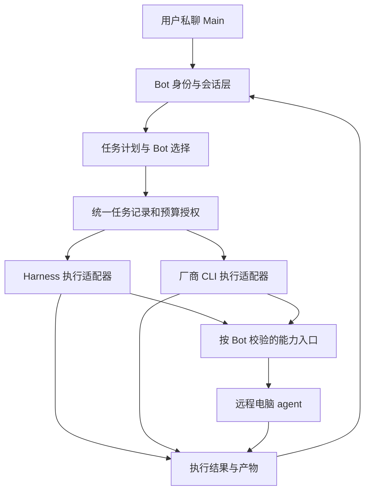

# DSH Bot 一体化：架构与落地顺序评估

日期：2026-10-26（Asia/Shanghai）

范围：用户明确选择“先评估架构与落地顺序”。本文评估附件的产品目标与技术假设，不执行附件里的开发、发布或迁移指令；不构成完整 M0 功能清单，也不代表已完成集成验证。

输入：[用户方案](20261026_original_proposal.md)。

## 1. 结论

方向可行，现有代码具有较好的复用基础。建议保留方案的三个产品目标：Main 私聊作为默认入口、两仓用户能力保留、远程电脑作为核心能力。最终继续使用 dsh-model-router 发布入口。

工程重点是统一 Bot 身份、任务执行和授权。Bot 界面、消息转交和 MCP 接入已有实现；真正需要补齐的是跨执行器的能力传递、严格模型绑定、任务账本与执行端权限校验。

建议尽早完成一条可验收链路：Main 私聊 → 指定工种 Bot → 获准的 Linux 远程机 → 结果回 Main。先用 ping、echo 和受控文件读写验证这条链路，再扩充浏览器、CLI 远程能力和 Windows 桌面。

## 2. 本次核实的代码基线

| 对象 | 本次读取的 main 提交 | 观察 |
|---|---|---|
| Alice-Marx/dsh-model-router | de82df4e737954ba0458d597ea82f9a6666c1a9b | package 0.25.5；本地 HEAD 与远端 main 一致，起始工作树干净 |
| Alice-Marx/DS-Bot-model-router | de55888a93983fc51c94f7d22bc94b4f8293205d | ds-bot/package.json 为 0.2.2 |
| Fei2411/DS-Bot | de55888a93983fc51c94f7d22bc94b4f8293205d | 与上一仓本次 main 提交完全一致 |

两份 DS-Bot 源当前没有默认分支代码差异。因此，不应将 Alice-Marx/DS-Bot-model-router 视为已经完成路由改造的独立实现；目前可直接以同一份 DS-Bot 源为迁入基线。这里只比较本次 main，不覆盖其他分支或本机未提供的副本。[S1][S2][S3]

## 3. 方案需要修正的现状判断

### 3.1 无群派活已有基础

`message_bot` 已支持直接向另一 Bot 派活，默认 `reply_to: me` 把结果送回发送者；`handoffs.js` 保存父子工作关系，`turns.js` 处理等待下游结果后的回传。`prompt.js` 也已经要求 Main 用该工具安排单 Bot 工作。无群协作不需要从零实现。[S4][S5][S6]

需要新增的是结构化工作包的目标、验收、依赖、预算、取消和恢复规则，以及可观察的任务状态。已有消息网络可以承载任务通知；不能仅凭消息转交就宣称具备完整 DAG 调度。

### 3.2 每 Bot 模型已保存，但当前不是严格锁定

DS-Bot 创建时就保存模型，各 Bot 具有独立会话。问题在 `models.js:97–101`：配置模型不可用时，当前逻辑会尝试 `appliedModel`，再选择默认模型。它与方案的严格绑定要求存在差异。[S7]

建议新 Bot 使用显式 `modelPolicy: strict`：模型不可用就暂停并解释原因。改派应产生新的执行尝试，保留原 Bot 和模型记录。已有用户若依赖回退，要保留可见的兼容选项，迁移时说明变化。

### 3.3 远程 MCP 的插件入口已经存在

`capabilities.js` 已支持 `streamable-http`、URL、headers、秘密引用，以及按 Bot 的 Agent context 挂载 MCP。新建部分主要是远程 agent、机器配置与健康界面、版本兼容、权限和审计，而不是另一套通用 MCP 客户端。[S8]

### 3.4 现有路由执行器值得复用，但不能直接等同于 Bot 调度器

MR 已有手动工作包分配、CLI 注册表、执行器、预算预占、订阅计量、检查点、取消和 worktree 合入。现有团队执行按依赖拓扑串行运行，首个失败会停止后续包；它与 DS-Bot 的异步消息运行时是两种不同机制。[S9][S10][S11]

应先保留串行行为接通主路径；若以后增加并发，要单独解决 Bot 忙碌状态、共享文件写入、预算竞争及取消语义，不能把两套调度同时启动。

## 4. 建议的职责边界



图中的 CLI 到能力入口是建议新增的桥接路径，现有源码尚未证明已经接通。

| 层 | 推荐复用 | 统一后的责任 |
|---|---|---|
| Bot、群聊、记忆、UI | DS-Bot | 用户身份与会话、Bot 配置、可选群聊、能力和用量展示 |
| 任务计划 | MR 的分包与评分 | 在满足角色、工具、机器和预算条件的 Bot 候选中选择目标 |
| 调度与任务记录 | DS handoff + MR 执行生命周期 | 一份任务状态；消息用于投递和唤醒，执行记录用于确认运行事实 |
| 执行适配器 | Harness + MR CLI 执行器 | 按 Bot 的执行配置运行，记录请求模型和实际模型 |
| 能力与机器 | DS Capabilities + 新 remote agent | 挂载能力、执行端授权、健康、版本和审计 |

群聊复用同一套 Bot 与任务记录，仅改变讨论和结果呈现的位置。路由器向 Main 返回 `targetBotId` 与选择理由，Bot 保存的模型不会被路由建议直接改写。

## 5. 开发前必须澄清的五个契约

### 5.1 把模型、执行器和工具分开

建议 Bot 配置表达 `modelRoute`、`execution.engine`、`execution.toolId`、`execution.cliModel`、`capabilityIds`、`machineGrants` 和 `budgetScope`。这是字段职责建议，不是本次冻结的 schema。

Harness 是运行引擎，可以承载已配置的不同模型。厂商 CLI 则是另一个会调用模型、拥有自身配置的执行器。DeepSeek Bot 默认走 Harness 合理；产品模型来源不应隐式决定所有执行权限。

MR 已经区分目录 `provider/model`、`requestedCliModel` 与 CLI 报告的 `actualModel`，目录模型不能假定可直接作为 CLI 参数。对无法指定或无法验证模型的适配器，应显示“实际模型未知”或拒绝严格绑定任务，不能声称已精确锁定。[S9]

产品可以支持多厂商配置；本轮评估与验证仅使用当前 GPT 会话和离线测试，没有启动其他模型。

### 5.2 外部 CLI 不会自动继承 Harness 能力

现有 Capabilities 挂载在 Harness 的 Agent context；MR 启动的 CLI 是独立进程，使用自身厂商配置。这两者之间需要明确桥接。[S8][S12]

建议先提供 Harness Bot 的远程控机，再为需要的 CLI 生成专属 MCP 配置或连接到本机能力代理。代理依据 Host 绑定的 Bot/任务身份签发受限访问，不能相信模型自己传入的 `botId`。按厂商验证 MCP、取消和配置加载的实际支持情况；暂不支持的组合在配置界面说明。

模型失败或 CLI 失败时，新的严格路径默认暂停。MR 原有显式配置的 API/订阅回退能力可以保留在高级选项，但不能被新 Bot 路径静默套用。[S12]

### 5.3 工具可见性和执行授权同时校验

MR 会向宿主注册多个 `model_router_*` 工具，其中部分可选择 CLI 或模型路线。[S13] 合并后，仅隐藏某工具名称不足以证明越权调用会被拒绝。

必须在实际执行前，从宿主 Session 解析当前 Bot，核对目标 CLI、模型、机器和授权范围；检查直接工具调用、RPC 和重新执行入口。审批绑定具体动作及任务，不由 Main 转交消息自动继承到下游。

### 5.4 Bot 隔离有两种强度

独立 Session 和工具清单提供应用层隔离。拥有本机 shell、相同 OS 用户、共享 CLI home 或可读共享数据目录时，不能据此承诺互相绝对不可读取。

建议第一版明确定义应用层隔离：会话、记忆 API、CLI 配置目录和机器授权按 Bot 区分。需要强隔离的执行放入容器、独立用户或独立机器，并实际验证文件和进程边界。授予任意 shell 后，单独限制 `fs.read` 路径无法阻止通过 shell 读取同一文件。

### 5.5 任务结果未知不能自动变成重试

保留 DS 请求去重及 MR 的检查点与费用证据，用统一关联字段连接 `taskId / packageId / botId / attemptId / machineId`。任务至少区分等待、执行、待审批、成功、失败、取消、结果未知。

远程执行发生断网时，可能已产生副作用。需要 agent 返回 operation id 和可查询状态；未确认结果前不自动再次执行。DS 的本地消息去重不能替代远程操作去重。费用记录按实际执行尝试计，DS Usage 负责模型 Token 展示，MR 负责预算和订阅账，避免同一调用重复计入。

## 6. 远程电脑部分的调整

保留同仓附属 agent、用户自备机器、Linux 优先、Windows GUI 后续的方向。TypeScript 与现有 JS/Node 项目生态相近，但依赖体积、Playwright 浏览器下载及 Windows 安装体验应实测后再确定打包方式。

传输建议固定为 Streamable HTTP，并明确 MCP 协议版本和 SDK 版本。旧 HTTP+SSE 只为实际需要的客户端兼容；Streamable HTTP 内的 SSE 响应与旧 SSE 传输不是同一个选择。当前官方 2026-07-28 规范与 2025-11-25 的会话和取消机制已有变化，因此不能仅写“支持 HTTP MCP”就认为版本兼容。[S14][S15]

DS 的测试 harness 当前固定 DSH 0.2.1-rc.2，MR 的开发 SDK 固定 0.2.1-rc.3。这不证明二者不兼容，但要求 M0 先选定集成宿主并验证会话、工具、审批、MCP 与客户端挂载；agent 不能只追随最新 SDK。[S16]

把方案 P4 中的最小授权、审计与版本检查移到首次开放 shell 前。首版就应有鉴权、可信网络或 TLS、工作目录边界、进程超时与取消、输出限制、操作身份和明确审批。Origin/Host 等 HTTP 防护也应进入实现验收。[S14]

远程浏览器需要独立的浏览器会话与下载边界。Windows 键鼠需要交互桌面，服务进程和桌面 helper 的通信、锁屏/注销后的状态均应单独设计；不能把 Linux shell 完成视为 Windows GUI 已完成。

## 7. 推荐落地顺序

| 顺序 | 本阶段工作 | 退出条件 |
|---|---|---|
| 0：M0 与兼容试验 | 固定源码与 DSH 基线；列用户行为清单；确定 Bot、执行任务、能力授权和账单关联；试验插件内部挂载 | 保留项有来源与入口；Bot UI 和 MR 核心在同一宿主可共存；明确只有一个调度入口 |
| 1：单 Bot 严格执行 | 迁入 Bot 运行时；模型不可用暂停；执行器按 Bot 绑定；先使用已有串行能力 | 同模型两个角色的会话、工具与记忆 API 不串；不能用参数绕过绑定 |
| 2：最小远程链路 | 通过现有 Capabilities 接 Linux agent：ping → 受控 shell echo → 文件读写；同期接回 Main | 私聊 Main 派给指定 Bot，在已授权远程机完成动作，结果回 Main；鉴权、超时、拒绝授权可读 |
| 3：统一派活与 CLI | 接工作包依赖、预算、状态、取消与重启核对；先验证一个 CLI 适配器，再逐项扩展 | 主任务包含实现与评审；模型身份可追踪；失败不静默换渠道；CLI 需要的远程能力确实可用 |
| 4：功能并集与体验 | 按 M0 清单迁入群聊、记忆、浏览器、计划任务、能力包、用量及 MR 高级入口；完成数据迁移 | 功能清单逐项有可达入口与验证证据；旧数据保持可恢复 |
| 5：Windows 与发布 | 桌面 helper、安装包、兼容表、剩余硬化与发行验收 | 登录/锁屏/注销行为清楚；全量回归与安装验证通过后再发布 |

阶段 1 与 agent 原型可以并行开发，但需先固定身份、授权、结果和取消契约。避免各模块自行保存另一份 Bot/任务状态。

原方案的周数先保留为占位。决定工期的是宿主兼容试验、CLI MCP 桥接和 Windows 桌面环境；当前源码读取和离线测试不足以给出可靠日历承诺。

建议第一个真实验收用例：用户私聊 Main 请求检查远程 Linux 项目目录；Main 派给执行 Bot，在批准范围内列文件并运行 echo；评审 Bot 只读检查结果；Main 汇总。故意加入未授权 Bot、断网和重复请求，分别验证拒绝、结果核对与去重。整个用例无需建群，可配置为全部 GPT Bot。

## 8. 兼容与迁移原则

MR 现有 package 名为 `@ljwei-stak/dsh-model-router`，插件内部 id 仍是 `model-router-galgame`，源码明确说明这是兼容既有配置的选择。集成不应顺带无条件更名。[S17]

当前状态目录分别是 `<DSH_HOME>/bot/state.json` 与 `<DSH_HOME>/model-router/state.json`，并非已经冲突。可以先保留各自领域存储，通过稳定 Bot 和任务 id 关联；新增统一入口不要求马上合并所有 JSON。[S18][S19]

迁入前带上 DS 源中的 LICENSE、NOTICE 和来源记录。旧 DS 插件与内嵌运行时不能同时写同一套 Bot 数据；迁移应检查旧插件是否活动、先备份，再单向升级并保留版本标记。此处是实施要求建议，本轮未执行迁移。

“功能并集”要盘点到用户可见行为。附件初稿没有详列的 DS 浏览器/秘密、计划任务、引用对话、侧聊、语音和交互视图等也需要 M0 确定处理方式。DS 独立桌面应用、Docker 发行与插件功能的范围也应单独标明；不能凭 UI 菜单数量声称完成并集。

## 9. 本次验证与限制

已通过 GitHub 连接器核对三个仓库的 main、读取关键 Host 源码，并对照本地 MR 0.25.5。针对 MR 的手动分配、执行检查点和后台任务，运行以下已有离线测试：

```text
node --test --test-reporter=spec tests/manual-package-execution.test.mjs tests/execution-checkpoints.test.mjs tests/run-jobs.test.mjs
41 tests / 41 pass / 0 fail / 0 skipped
```

这些测试支持复用对应模块的判断，不证明 DS 与 MR 已集成。未运行完整回归、DS 整套测试、Desktop 联调、真实模型推理、远程 agent 或 Windows GUI。本轮未修改项目代码、未提交、未上传或发布，也未修改原始方案文件。

## 10. 来源索引

- S1：[MR 本次提交](https://github.com/Alice-Marx/dsh-model-router/commit/de82df4e737954ba0458d597ea82f9a6666c1a9b)。
- S2：[Alice-Marx DS 本次提交](https://github.com/Alice-Marx/DS-Bot-model-router/commit/de55888a93983fc51c94f7d22bc94b4f8293205d)。
- S3：[上游 DS 本次提交](https://github.com/Fei2411/DS-Bot/commit/de55888a93983fc51c94f7d22bc94b4f8293205d)。
- S4：[message_bot 实现](https://github.com/Alice-Marx/DS-Bot-model-router/blob/de55888a93983fc51c94f7d22bc94b4f8293205d/ds-bot/src/host/tools.js#L141)。
- S5：[handoff 工作关系](https://github.com/Alice-Marx/DS-Bot-model-router/blob/de55888a93983fc51c94f7d22bc94b4f8293205d/ds-bot/src/host/handoffs.js#L98)。
- S6：[结果回传](https://github.com/Alice-Marx/DS-Bot-model-router/blob/de55888a93983fc51c94f7d22bc94b4f8293205d/ds-bot/src/host/turns.js#L578)。
- S7：[模型回退](https://github.com/Alice-Marx/DS-Bot-model-router/blob/de55888a93983fc51c94f7d22bc94b4f8293205d/ds-bot/src/host/models.js#L95)。
- S8：[Capabilities](https://github.com/Alice-Marx/DS-Bot-model-router/blob/de55888a93983fc51c94f7d22bc94b4f8293205d/ds-bot/src/host/capabilities.js#L104)。
- S9：[MR 模型身份与执行生命周期说明](https://github.com/Alice-Marx/dsh-model-router/blob/de82df4e737954ba0458d597ea82f9a6666c1a9b/README.zh.md#团队生命周期模型身份与恢复)。
- S10：[MR 团队执行器](https://github.com/Alice-Marx/dsh-model-router/blob/de82df4e737954ba0458d597ea82f9a6666c1a9b/.dsh-plugin/shared/official-team-runtime.mjs)。
- S11：[MR 后台任务](https://github.com/Alice-Marx/dsh-model-router/blob/de82df4e737954ba0458d597ea82f9a6666c1a9b/.dsh-plugin/shared/run-jobs.mjs)。
- S12：[MR 任务执行与回退](https://github.com/Alice-Marx/dsh-model-router/blob/de82df4e737954ba0458d597ea82f9a6666c1a9b/.dsh-plugin/shared/task-executors.mjs#L808)。
- S13：[MR 工具注册](https://github.com/Alice-Marx/dsh-model-router/blob/de82df4e737954ba0458d597ea82f9a6666c1a9b/.dsh-plugin/index.mjs#L2519)。
- S14：[MCP Streamable HTTP 2026-07-28](https://modelcontextprotocol.io/specification/2026-07-28/basic/transports/streamable-http)。
- S15：[MCP transports 2025-11-25](https://modelcontextprotocol.io/specification/2025-11-25/basic/transports)。
- S16：[DS 测试宿主版本](https://github.com/Alice-Marx/DS-Bot-model-router/blob/de55888a93983fc51c94f7d22bc94b4f8293205d/ds-bot/dev/harness/package.json)；[MR package](https://github.com/Alice-Marx/dsh-model-router/blob/de82df4e737954ba0458d597ea82f9a6666c1a9b/package.json)。
- S17：[MR 插件 id 兼容约定](https://github.com/Alice-Marx/dsh-model-router/blob/de82df4e737954ba0458d597ea82f9a6666c1a9b/cordis.patch.yml)。
- S18：[DS 运行时与数据路径](https://github.com/Alice-Marx/DS-Bot-model-router/blob/de55888a93983fc51c94f7d22bc94b4f8293205d/ds-bot/index.js)。
- S19：[MR 状态路径](https://github.com/Alice-Marx/dsh-model-router/blob/de82df4e737954ba0458d597ea82f9a6666c1a9b/.dsh-plugin/shared/router-state.mjs#L39)。


> 随附历史评估副本：评估时间和结论保留，仅将原始方案引用转换为包内相对路径。
