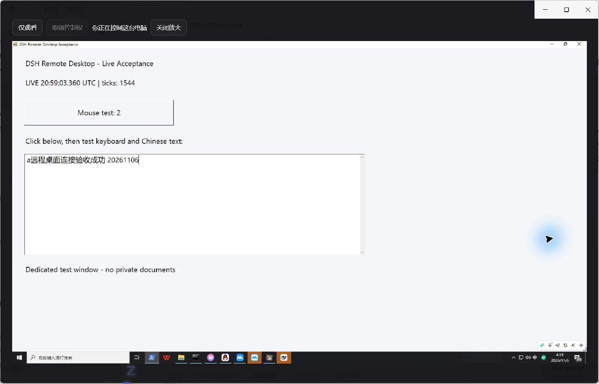

# 0.63.3 native desktop connection validation

The native Harness application now displays the remote Windows desktop and accepts mouse, keyboard and Chinese text input. Both ends are required: Model Router **0.63.3** and Remote Computer Agent **0.1.1**. The existing remote configuration, machine identity and credentials were preserved. The stable release is published on GitHub and npm (`latest=0.63.3`). The anonymous registry download matches the verified package. The final installed program has all 462 files verified, and its profile dependency and both locks are updated to 0.63.3. [Publication and restart receipt](0.63.3/final-acceptance.json).

## Cause and change

Native DevTools showed `Origin: dsh-app://app` on the desktop WebSocket. Read-only inspection of the installed Electron application confirmed that its protocol bridge removes the ordinary request Origin before forwarding API calls to the local HTTP Host. The old Host therefore bound desktop tickets to its HTTP listener origin rather than the native viewer origin.

The native client now carries one exact viewer-origin hint on desktop open/renew calls. The Host still requires its real authenticated owner admission before using it. The Agent accepts `dsh-app://app` only for an authenticated live desktop ticket; its HTTP API allowlist is unchanged. Opaque origins, other custom hosts, altered origins and closed tickets remain refused. Pairing secrets never enter the viewer.

Real input testing then exposed two additional defects: virtual key events can have a valid `key` and an empty physical `code`, and focusing a partially visible canvas could scroll the page between pointer down/up. The client now normalizes missing key codes, preserves supplied physical codes, and focuses without scrolling. A rejected input closes the stream and fences further control while the Agent releases held input.

## Native acceptance

Environment: installed Harness **0.2.2-rc.1**, native Windows application, one remote Windows 10 desktop over the existing private VPN, and the existing Chief Bot pairing. A dedicated WinForms fixture recorded effects independently; the input itself was sent through the product UI using computer-use/sky.

- The native viewer connected and displayed a continuously changing clock from the remote desktop.
- Source geometry was **1920 × 1080**. Page observations ranged from **8 to 15 FPS**, with adaptive transport resolution; these are observations on this machine/link, not a fixed-rate or RustDesk-parity claim.
- Acknowledged takeover enabled mouse clicks. The fixture counter advanced to **2**; the final first click caused no page jump. Double-clicking the remote title bar maximized the fixture.
- Letter and Enter key events reached the remote input method, which committed `a`. Product text input then produced the exact independently read-back string **`a远程桌面连接验收成功 20261106`**.
- The expanded viewer displayed the same live frame. Returning to watch mode preserved video; clicking the remote test button in watch mode left its counter at **2**.
- Disconnect returned the page to its idle state. Host `desktop-session-closed` is emitted only after the Agent returns `stopConfirmed:true`; the live Host event was observed read-only.
- Reconnection was exercised during diagnosis and again after the final published package was installed and Harness restarted. The final restart reconfirmed live video, acknowledged takeover, mouse/double-click, letter and Enter keys, Chinese input, expanded viewing, the watch-only input fence and confirmed close. The independently read-back final string was **`b正式版0.63.3键盘复测成功`**. Reconnecting after the confirmed close succeeded; the application was left connected in watch mode.

Evidence: [machine-readable acceptance](0.63.3/acceptance.json), [independent remote fixture result](0.63.3/remote-fixture-result.json), [fixture source](0.63.3/desktop-acceptance.ps1), [watch mode screenshot](0.63.3/native-watch.png).

## Automated checks

`npm test`: **2,513 tests**, **2,424 passed**, **89 skipped**, **0 failed**, **0 cancelled**, exit 0. The complete run includes Origin/ticket restrictions, owner admission, input acknowledgement and release, native pipe framing, routines and existing model-routing regressions. Dedicated checks also exercise the actual React canvas mapping, focus scrolling and code-less keyboard events. Agent clean installation and build passed; README checks preserve six paired formula anchors and 33 paired inline expressions. The real installed-SDK **0.2.2-rc.1** default Host probe passed **50 checks**, with **0 real model calls**, in an isolated profile. This SDK probe is separate from the native Electron and remote-input acceptance above. Final package hashes and publication receipts are recorded separately.

## Scope

This acceptance establishes the native desktop connection and human mouse/keyboard control for the existing paired Bot. It does not claim all provider/official-CLI integrations or new-worker remote grants passed. The previous fixed Bot-ID pairing ceiling still applies to this existing machine; new installations expose the existing explicit `hostManagedBots` setup choice. No Windows security/privacy settings or global Origin/TLS/authentication checks were disabled.

Published-package restart evidence: [control screenshot](0.63.3/final-native-control.png), [watch screenshot](0.63.3/final-native-watch.png), [independent fixture result](0.63.3/final-native-fixture-result.json).
