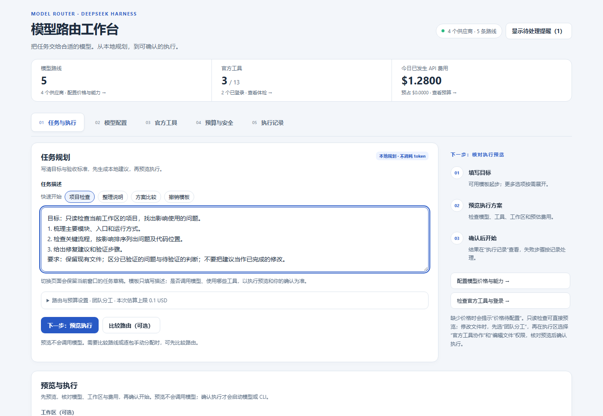

# DSH Model Router

English · [简体中文](README.zh.md)

[](https://www.npmjs.com/package/@ljwei-stak/dsh-model-router)

**Task-oriented model routing inside the standard DeepSeek Harness interface.**

Describe the result you want, choose suitable configured models or native CLI tools, review the plan, then follow execution and accounting from one workbench. This edition adds a **Model Router** sidebar entry and keeps the existing Harness workspace.

**Stable version: 0.74.3.** For Bot conversations, multi-Bot delegation, remote computers, private libraries, and routines, use the [full Bot edition](https://github.com/Alice-Marx/dsh-model-router/blob/main/README.md): **`@ljwei-stak/dsh-model-route-bot`**. Select one edition per profile.

## Install

1. In Harness **Plugins → Add plugin**, enter `@ljwei-stak/dsh-model-router@0.74.3`.
2. Enable it, quit Harness including its tray process, and restart.
3. Configure provider credentials/models in Harness **Models**, then open **Model Router** from the sidebar.

```powershell
dsh plugin --profile desktop add @ljwei-stak/dsh-model-router@0.74.3
```

## Run your first task

1. In **Model configuration**, refresh exact routes and enter known prices/capabilities. Unknown information can remain blank.
2. In **Task & execution**, start with **Project check**, **Organize documentation**, or **Compare approaches**, then edit the task and acceptance criteria. **Undo template** restores the previous text.
3. Choose **Next: preview execution → Preview execution plan**. Inspect models/tools, workspace, permissions, and API cost or subscription usage estimates.
4. Confirm the required items to start execution. Review output, receipts, cancellation, and supported retries in **Execution history**.

The current application uses Chinese interface labels; these English descriptions explain the corresponding controls.



*Models, prices, usage, and paths in the screenshot are examples; it does not show a live model run.*

## Workbench features

| Page | What it provides |
| --- | --- |
| Task & execution / 任务与执行 | Single-route, dependency-based team, and exact-model planning; optional route comparison and manual package assignment; preview and confirmed execution. |
| Model configuration / 模型配置 | Exact route profiles, prices, quality evidence, billing preferences, and CLI model mappings. |
| Native tools / 官方工具 | Detection, supported install methods, login/readiness inspection, and interactive CLI terminals. |
| Budget & safety / 预算与安全 | Per-task estimates, API daily/monthly limits and reservations, separate subscription calls/tokens, review policy, and explicit feedback. |
| Execution history / 执行记录 | Results, receipts, attempt status, cancellation, supported retries, and reconciliation of interrupted/unknown effects. |

Route comparison and execution preview run locally without model calls. Confirmation starts the selected provider or supported tool. **Model routing is read-only**; editing requires **Team → Native-tool collaboration → Edit files**. Tool installation/login and readiness for a specific managed execution mode are separate checks. Vendor-native processes run as the current system user; a worktree organizes changes rather than restricting system access.

Draft task, mode, exact model, and explicit estimate survive page remounts in the **current window's memory**. Closing the app or reloading the client clears the draft. Close **Needs your attention** with **×** and restore it from the header; the device remembers this visibility preference. Failed-run reminders open the relevant record.

API money and reservations are separate from subscription calls/reported tokens. Missing usage remains unknown; provider bills remain authoritative. Switching a subscription attempt to API requires fresh admission and the relevant confirmation. Review remote effects before retrying an interrupted task.

## Switch editions

Remove the current package entry in plugin management, then add the full Bot package in the same Harness profile. Retain your data directories and configured Bot home. Both editions share the routing configuration; enable one at a time.

## License and support

[MIT license](https://github.com/Alice-Marx/dsh-model-router/blob/main/LICENSE) · [Full guide](https://github.com/Alice-Marx/dsh-model-router/blob/main/README.md) · [Issues](https://github.com/Alice-Marx/dsh-model-router/issues) · [Installation files](https://github.com/Alice-Marx/dsh-model-router/releases/latest)
