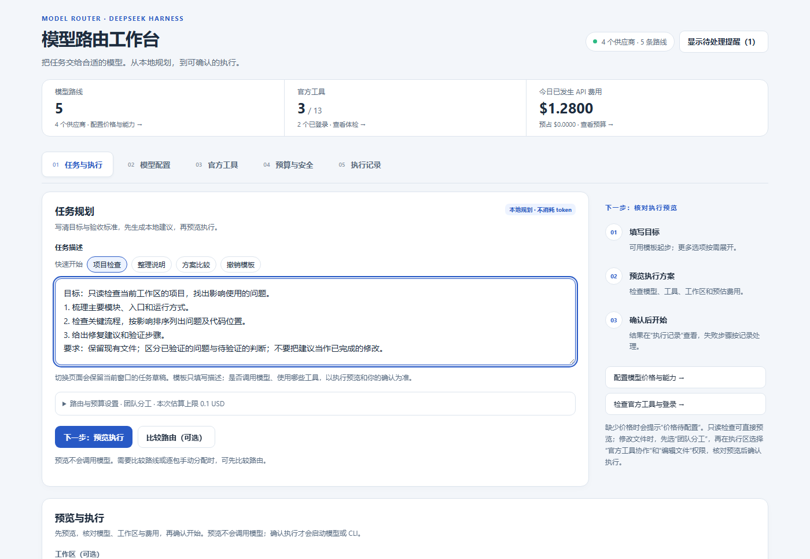

# DSH 模型路由

[English](README.md) · 简体中文

[](https://www.npmjs.com/package/@ljwei-stak/dsh-model-router)

**在 DeepSeek Harness 原有界面中，按任务选择模型并组织执行。**

写清期望结果，选择合适的已配置模型或原生 CLI 工具，审查计划后启动，并在同一工作台跟踪执行和费用。此版本保留现有 Harness 工作区，在侧栏增加 **模型路由** 入口。

**当前正式版：0.65.0。** 如需 Bot 对话、多 Bot 分工、远程电脑、私有资料库和例行任务，请使用 [完整 Bot 版本](https://github.com/Alice-Marx/dsh-model-router/blob/main/README.zh.md)：**`@ljwei-stak/dsh-model-route-bot`**。同一 profile 选择一种版本。

## 安装

1. 在 Harness **插件 → 添加插件** 输入 `@ljwei-stak/dsh-model-router@0.65.0`。
2. 启用后，连同托盘进程完全退出 Harness，再重新启动。
3. 在 Harness **模型** 中配置 Provider 凭据和模型，从侧栏打开 **模型路由**。

```powershell
dsh plugin --profile desktop add @ljwei-stak/dsh-model-router@0.65.0
```

## 完成第一个任务

1. 在 **模型配置** 刷新准确路线，填写已知价格和能力，未知信息留空。
2. 在 **任务与执行** 选择 **项目检查**、**整理说明** 或 **方案比较** 模板，修改任务与验收标准。**撤销模板** 可恢复原文。
3. 点击 **下一步：预览执行 → 预览执行计划**，检查模型/工具、工作区、权限和 API 费用或订阅用量估算。
4. 确认所需项目后启动执行，在 **执行记录** 检查结果、收据、取消状态及受支持的重试。

当前应用界面使用中文，英文文档提供对应操作解释。



*截图中的模型、价格、用量和路径均为示例，不是实时模型执行结果。*

## 工作台功能

| 页面 | 可用能力 |
| --- | --- |
| 任务与执行 | 单路线、带依赖团队、指定模型；可选路线比较、工作包手动分配、预览与确认执行。 |
| 模型配置 | 准确路线档案、价格、质量证据、计费偏好与 CLI 模型映射。 |
| 官方工具 | 工具检测、受支持的安装方式、登录/就绪检查与 CLI 交互终端。 |
| 预算与安全 | 单次估算、API 日/月限额及预占、独立订阅调用/token、复核策略和显式反馈。 |
| 执行记录 | 结果、收据、执行尝试、取消、受支持的重试及中断/未知影响核对。 |

路线比较和执行预览在本地进行，不调用模型；确认才会启动所选供应商或受支持的工具。**模型路由为只读执行**；修改文件需选择 **团队分工 → 官方工具协作 → 编辑文件**。工具安装/登录与具体托管执行模式就绪分别检查。厂商原生进程使用当前系统用户权限；工作树用于整理改动，不限制系统访问。

页面重新挂载时，任务、模式、准确模型及显式估算保留在**当前窗口内存**，关闭应用或重载客户端后清除。**需要你处理** 面板可用 **×** 关闭，由顶部入口恢复，当前设备会记住显示偏好；失败提醒会打开对应记录。

API 金额/预占与订阅调用/已报告 token 分别核算；缺失用量保持未知，账单以供应商为准。订阅转 API 需要重新准入及相应确认；中断后先核对远程实际影响，再决定重试。

## 切换版本

在插件管理中移除当前包入口，再在同一 Harness profile 添加完整 Bot 包，保留数据目录并沿用已配置的 Bot home。两种版本共用路由配置，同一时间启用一种。

## 许可与支持

[MIT 许可证](https://github.com/Alice-Marx/dsh-model-router/blob/main/LICENSE) · [完整指南](https://github.com/Alice-Marx/dsh-model-router/blob/main/README.zh.md) · [问题反馈](https://github.com/Alice-Marx/dsh-model-router/issues) · [安装文件](https://github.com/Alice-Marx/dsh-model-router/releases/latest)
